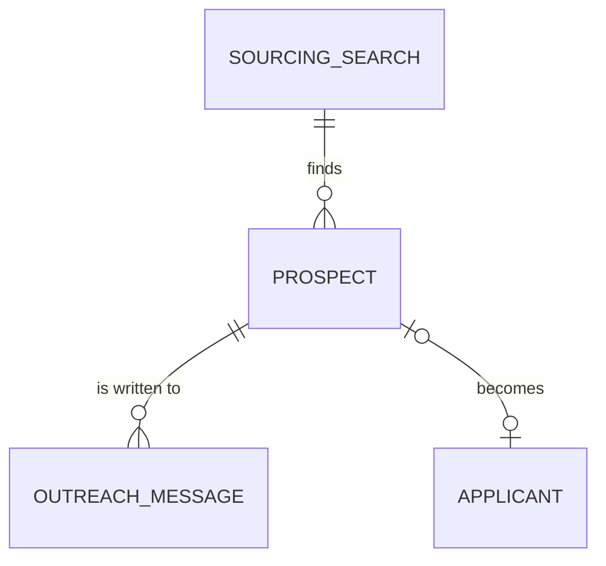
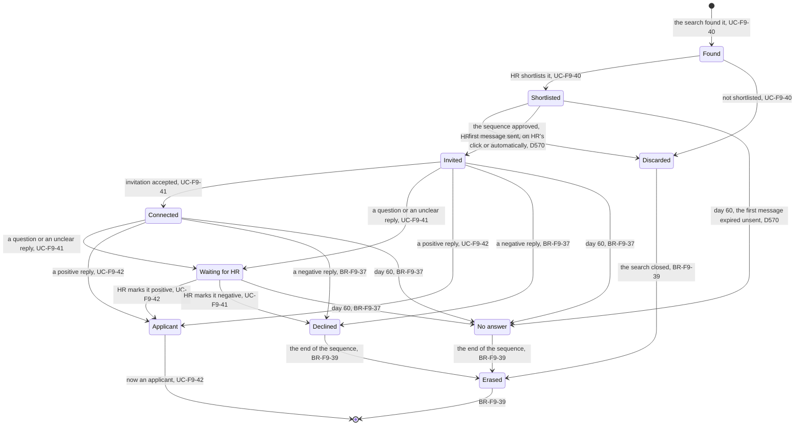

🏠 [Specs](../../../README.md) › 🧩 [Functional capabilities](../../README.md) › 👥 [F9 HR and projects](../README.md) ›
🗃️ [Data](README.md) › 🗃️ E-F9-45 Prospect

# 🗃️ E-F9-45 Prospect

**Status:** ✅ specified

## Purpose

A person found on LinkedIn for a job position, before they become an applicant: what of their public profile the
criteria use, their score and its reason, and where they are in the outreach
([D518](../../../06-decisions/f09-hr-and-projects/d518-linkedin-sourcing-through-unipile.md)).

## Fields

| Name | Type | Required | Validation | Default | Example | Personal data | Custom fields |
|---|---|---|---|---|---|---|---|
| sourcing search | sourcing search | yes | - | - | Site manager, Lyon | no | no |
| LinkedIn profile ID | text | yes | unique per search | - | as Unipile returns it | yes | no |
| name | text | yes | - | - | Julien R. | yes | no |
| headline, current position, location | text | no | - | - | Site manager at BTP Rhône, Lyon | yes | no |
| profile snapshot | the profile fields the criteria use | no | only those fields (BR-F9-39) | - | 6 years as site manager, French, English | yes | no |
| score | number | when scored | 0 to 100 | - | 92 | yes | no |
| reason | text | when scored | one short sentence | - | 8 of 9 criteria met, no Revit | yes | no |
| criteria met and missed | list | when scored | - | - | met: location, years; missed: Revit | yes | no |
| already connected | yes or no | yes | as Unipile reports it | no | no | yes | no |
| state | found, shortlisted, discarded, invited, connected, waiting for HR, applicant, declined, no answer, erased | yes | the lifecycle below | found | invited | no | no |
| shortlisted by, at | user, date and time | when shortlisted | HR | - | Claire P., 2026-11-03 | yes | no |
| applicant | applicant (E-F9-07) | when applicant | - | - | Sonia M., site manager | yes | no |
| kept until | date | yes | BR-F9-39 | the end of the sequence | 2027-01-02 | no | no |

## Relations

- [E-F9-44 Sourcing search](e-f09-44-sourcing-search.md)
- [E-F9-47 Outreach message](e-f09-47-outreach-message.md)
- [E-F9-07 Applicant](e-f09-07-applicant.md)

## Lifecycle

From any state, a person who asks to be erased is erased at once
([BR-F9-11](../business-rules/br-f09-11-candidate-data-has-a-term.md)).

In prepared mode a message that is not sent within 7 days expires, and the prospect goes on as if they had not
answered ([D570](../../../06-decisions/f09-hr-and-projects/d570-linkedin-sending-prepared-by-default.md),
[BR-F9-37](../business-rules/br-f09-37-outreach-stops-at-a-reply-a-refusal-or-day-60.md)). A prospect whose first
message expired was never contacted: they stay shortlisted, no follow-up falls due for them, and on day 60 they end as
"no answer", then are erased with the others at the end of the sequence. Every prospect of a sequence therefore reaches
an end state after day 60.

## Indexes and search

By search, state, score; unique LinkedIn profile ID per search; the do-not-contact list by LinkedIn profile ID
([BR-F9-39](../business-rules/br-f09-39-prospects-kept-only-as-long-as-needed.md)).

## Retention

As [BR-F9-39](../business-rules/br-f09-39-prospects-kept-only-as-long-as-needed.md) says: an applicant follows
[BR-F9-11](../business-rules/br-f09-11-candidate-data-has-a-term.md); a declined prospect or one without an
answer is erased at the end of the sequence, a discarded one when the search closes.

## Audit

Created by a search; shortlisted or removed, by whom; each change of state; erased, with the reason.

## Import and export

No import; HR may add one profile by its LinkedIn address. No export of prospects; the person's own copy on request
([CR-FR-195](../../../10-country-packs/france/data-protection/cr-fr-195-candidate-data.md)).

## Used by

- [UC-F9-40 Search and rank LinkedIn profiles](../use-cases/02-recruit/uc-f09-40-search-and-rank-linkedin-profiles.md)
- [UC-F9-41 Run a LinkedIn outreach sequence](../use-cases/02-recruit/uc-f09-41-run-a-linkedin-outreach-sequence.md)
- [UC-F9-42 Turn a positive reply into an applicant](../use-cases/02-recruit/uc-f09-42-turn-a-positive-reply-into-an-applicant.md)

## Open questions

None.

---

⬅️ [E-F9-44 Sourcing search](e-f09-44-sourcing-search.md) · ⬆️ [Up](README.md) ·
➡️ [E-F9-46 Outreach sequence](e-f09-46-outreach-sequence.md)
