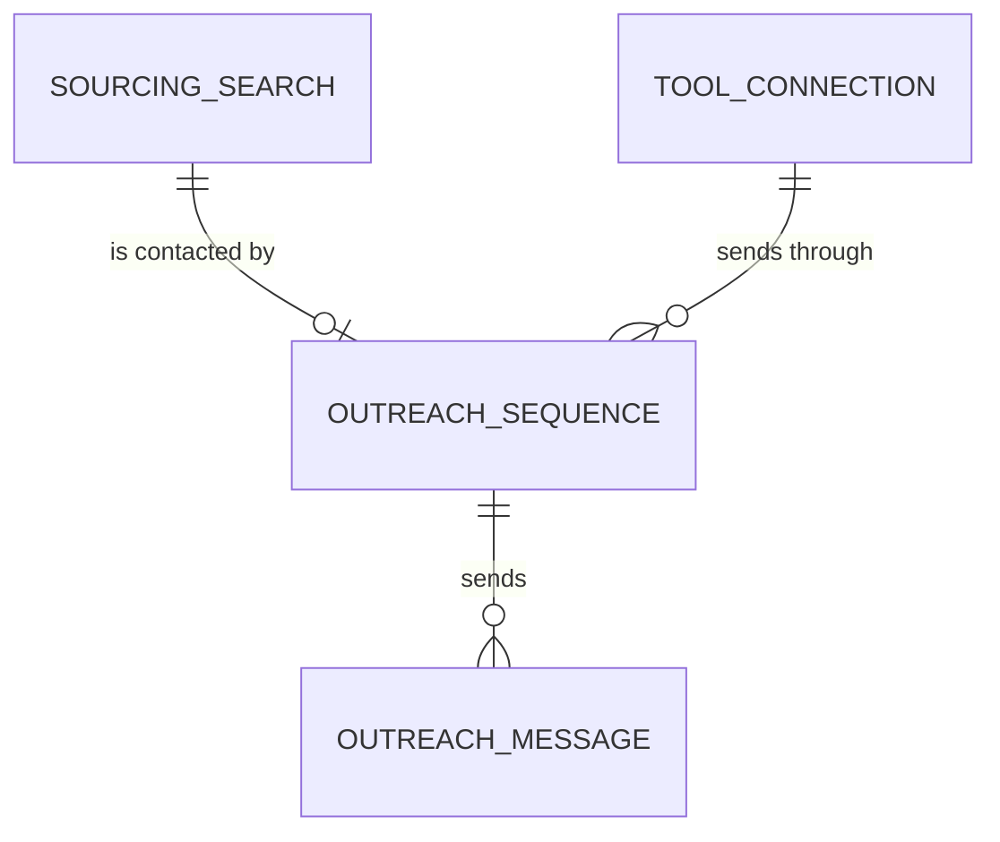
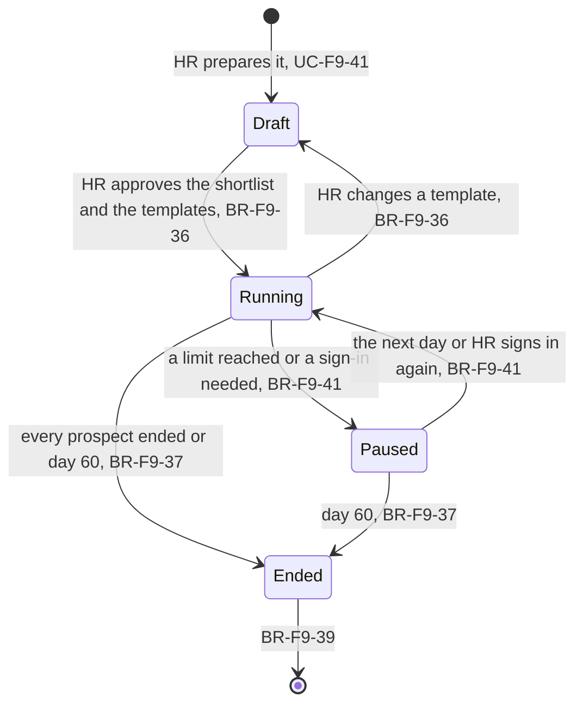

🏠 [Specs](../../../README.md) › 🧩 [Functional capabilities](../../README.md) › 👥 [F9 HR and projects](../README.md) ›
🗃️ [Data](README.md) › 🗃️ E-F9-46 Outreach sequence

# 🗃️ E-F9-46 Outreach sequence

**Status:** 🔄 waiting for the owner

## Purpose

The messages a sourcing search sends: its steps and their days, its templates, HR's approval, and its stop rules
([D518](../../../06-decisions/f09-hr-and-projects/d518-linkedin-sourcing-through-unipile.md)).

## Fields

| Name | Type | Required | Validation | Default | Example | Personal data | Custom fields |
|---|---|---|---|---|---|---|---|
| sourcing search | sourcing search | yes | one sequence per search | - | Site manager, Lyon | no | no |
| LinkedIn account | tool connection (E-F24-02) | yes | the search's account | - | Claire P. on LinkedIn | yes | no |
| steps | list of day and kind | yes | day 0 first; every step by day 60 (BR-F9-37) | invitation day 0, follow-ups days 7 and 21, end day 60 | 0, 7, 21, 60 | no | no |
| templates | invitation note, direct message, follow-up 1, follow-up 2, booking-link reply, thank-you | yes | the first message links the privacy notice (BR-F9-38) | the AI assistant's draft | Hello {first name}, I am Claire... | no | no |
| reply check | interval | yes | every few hours | (Proposed) 4 hours | 4 hours | no | no |
| privacy notice link | web address | yes | reachable | the company's notice for candidates | acme-batiment.fr/candidates-privacy | no | no |
| approved by, at | user, date and time | before the first message | HR (BR-F9-36) | - | Claire P., 2026-11-03 09:00 | yes | no |
| approved shortlist | list of prospects | before the first message | - | - | 12 prospects | yes | no |
| state | draft, running, paused, ended | yes | the lifecycle below | draft | running | no | no |
| pause reason | text | when paused | - | - | Daily limit reached | no | no |
| results | counts | no | - | - | 3 applicants, 2 declined, 7 no answer | no | no |

## Relations

- [E-F9-44 Sourcing search](e-f09-44-sourcing-search.md)
- [E-F9-47 Outreach message](e-f09-47-outreach-message.md)
- [E-F24-02 Tool connection](../../f24-integrations-hub/data/e-f24-02-tool-connection.md)

## Lifecycle

## Indexes and search

By search, owner, state; the running sequences of an account for its caps.

## Retention

The sequence and its templates are kept as long as its search ([E-F9-44 Sourcing search](e-f09-44-sourcing-search.md)).

## Audit

Approval with the shortlist and the templates' versions; each change of step, template or state, with who and when.

## Import and export

(Proposed) Templates copied from another sequence of the company; no export.

## Used by

- [UC-F9-41 Run a LinkedIn outreach sequence](../use-cases/02-recruit/uc-f09-41-run-a-linkedin-outreach-sequence.md)
- [UC-F9-42 Turn a positive reply into an applicant](../use-cases/02-recruit/uc-f09-42-turn-a-positive-reply-into-an-applicant.md)

## Open questions

- [Q18 LinkedIn automation and its user agreement](../../../07-questions/q18-linkedin-automation-and-its-user-agreement.md)

---

⬅️ [E-F9-45 Prospect](e-f09-45-prospect.md) · ⬆️ [Up](README.md) ·
➡️ [E-F9-47 Outreach message](e-f09-47-outreach-message.md)
