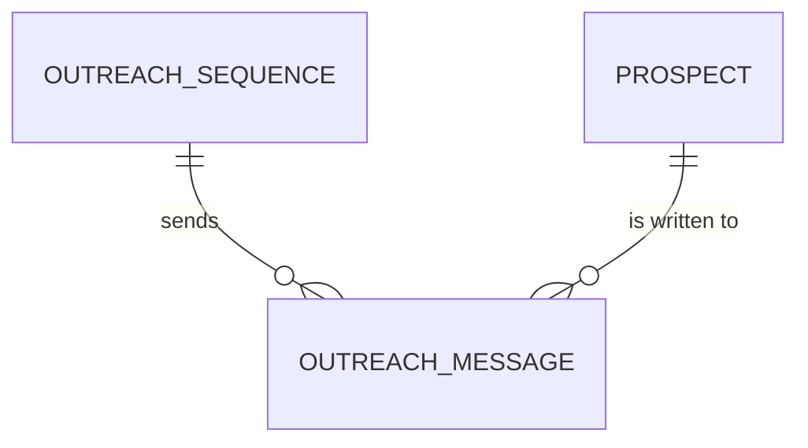
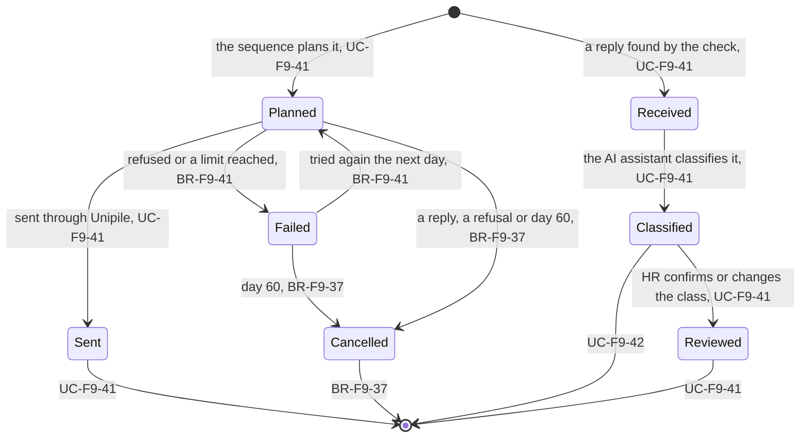

🏠 [Specs](../../../README.md) › 🧩 [Functional capabilities](../../README.md) › 👥 [F9 HR and projects](../README.md) ›
🗃️ [Data](README.md) › 🗃️ E-F9-47 Outreach message

# 🗃️ E-F9-47 Outreach message

**Status:** ✅ specified

## Purpose

One message of an outreach sequence, sent to a prospect or received from them, with the AI assistant's class for a reply
([D518](../../../06-decisions/f09-hr-and-projects/d518-linkedin-sourcing-through-unipile.md)).

## Fields

| Name | Type | Required | Validation | Default | Example | Personal data | Custom fields |
|---|---|---|---|---|---|---|---|
| sequence | outreach sequence | yes | - | - | Site manager, Lyon | no | no |
| prospect | prospect | yes | - | - | Julien R. | yes | no |
| direction | sent or received | yes | - | - | received | no | no |
| kind | invitation note, direct message, follow-up, booking-link reply, thank-you, HR's reply, reply | yes | - | - | follow-up 1 | no | no |
| text | text | yes | an approved template, filled in, for what SimpleERP sends | - | Is remote work possible two days a week? | yes | no |
| planned at | date and time | for what SimpleERP sends | by day 60 | - | 2026-11-10 09:30 | no | no |
| sent or received at | date and time | once sent or received | - | - | 2026-11-12 18:04 | no | no |
| provider message ID | text | once sent or received | unique, as Unipile returns it | - | as Unipile returns it | no | no |
| class | positive, negative, question, unclear | for a reply | - | - | question | yes | no |
| class reason and confidence | text and percent | for a reply | - | - | asks about remote work, 91 % | yes | no |
| classified by | AI assistant or HR | for a reply | - | AI assistant | AI assistant | no | no |
| status | planned, sent, failed, cancelled, received, classified, reviewed | yes | the lifecycle below | planned | sent | no | no |

## Relations

- [E-F9-46 Outreach sequence](e-f09-46-outreach-sequence.md)
- [E-F9-45 Prospect](e-f09-45-prospect.md)

## Lifecycle

## Indexes and search

By prospect and date; unique provider message ID; the replies waiting for HR.

## Retention

With its prospect: erased with them, or kept with the applicant's record
([BR-F9-39](../business-rules/br-f09-39-prospects-kept-only-as-long-as-needed.md),
[BR-F9-11](../business-rules/br-f09-11-candidate-data-has-a-term.md)).

## Audit

Planned, sent, failed, cancelled, received; each class with its source and confidence; each class changed by HR, with
the old and the new class.

## Import and export

No import; the person's own copy on request
([CR-FR-195](../../../10-country-packs/france/data-protection/cr-fr-195-candidate-data.md)).

## Used by

- [UC-F9-41 Run a LinkedIn outreach sequence](../use-cases/02-recruit/uc-f09-41-run-a-linkedin-outreach-sequence.md)
- [UC-F9-42 Turn a positive reply into an applicant](../use-cases/02-recruit/uc-f09-42-turn-a-positive-reply-into-an-applicant.md)

## Open questions

None.

---

⬅️ [E-F9-46 Outreach sequence](e-f09-46-outreach-sequence.md) · ⬆️ [Up](README.md) ·
➡️ [E-F9-48 Work location day](e-f09-48-work-location-day.md)
