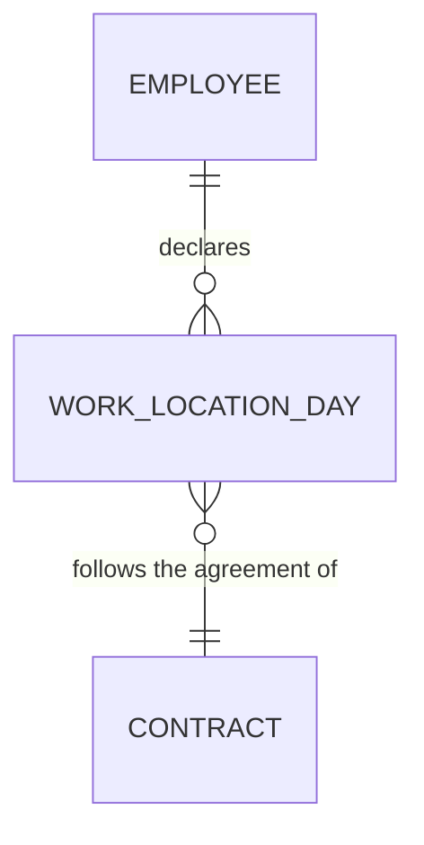
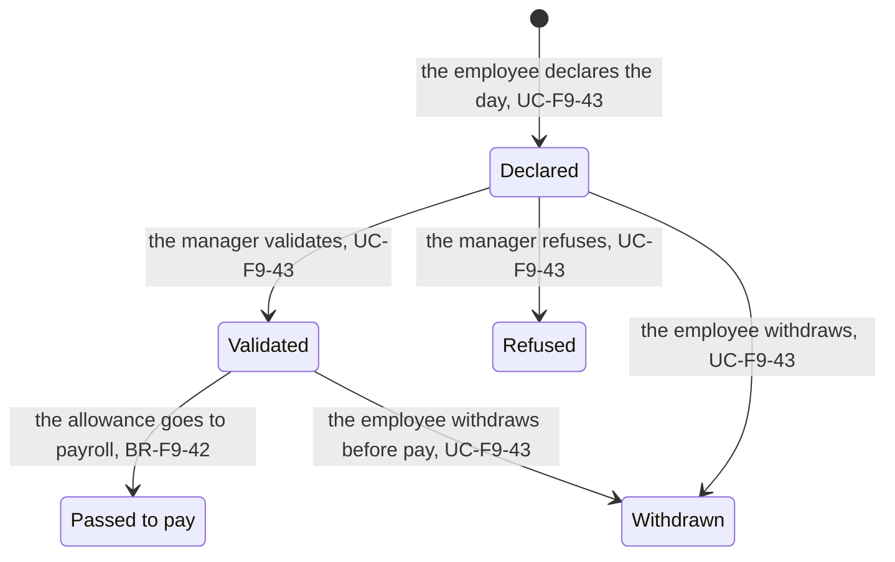

🏠 [Specs](../../../README.md) › 🧩 [Functional capabilities](../../README.md) › 👥 [F9 HR and projects](../README.md) ›
🗃️ [Data](README.md) › 🗃️ E-F9-48 Work location day

# 🗃️ E-F9-48 Work location day

**Status:** ✅ specified

## Purpose

One employee's declared work location for one day, with its validation and the allowance it earns
([D528](../../../06-decisions/f09-hr-and-projects/d528-benchmark-gaps-f09-hr-and-projects.md)).

## Fields

| Name | Type | Required | Validation | Default | Example | Personal data | Custom fields |
|---|---|---|---|---|---|---|---|
| employee | employee record | yes | - | - | Claire P. | yes | no |
| date | date | yes | one record per employee and day | - | 2026-11-18 | no | no |
| location | office, home, other site, travelling | yes | - | office | home | no | no |
| other site | text | when other site | - | - | Customer site, Lyon | no | no |
| allowance | money | no | from the agreement, never above its ceiling | 0 | 10.00 | no | no |
| declared by | employee or manager | yes | - | employee | employee | yes | no |
| validated by | manager | when validated | - | - | Marc D. | yes | no |
| exception reason | text | when over the quota | - | - | Customer project week | no | no |
| state | declared, validated, refused, withdrawn, passed to pay | yes | the lifecycle below | declared | declared | no | no |

## Relations

- [E-F9-01 Employee record](e-f09-01-employee-record.md)
- [E-F9-02 Contract](e-f09-02-contract.md)
- [E-F9-09 Time-off request](e-f09-09-time-off-request.md)

## Lifecycle

## Indexes and search

By employee and date, by location and by state; the unvalidated days of a manager's team.

## Retention

Kept with the payroll records of the year the allowance was paid
([CR-FR-002](../../../10-country-packs/france/accounting/cr-fr-002-accounting-records-kept-ten-years.md)); a day with no
allowance 3 years.

## Audit

Every declaration, validation, refusal, withdrawal and exception, with who and why.

## Import and export

CSV export of a month for payroll control; no import.

## Used by

- [UC-F9-43 Declare remote-work days](../use-cases/15-work-location-headcount-and-learning/uc-f09-43-declare-remote-work-days.md)

## Open questions

None.

---

⬅️ [E-F9-47 Outreach message](e-f09-47-outreach-message.md) · ⬆️ [Up](README.md) ·
➡️ [E-F9-49 Position](e-f09-49-position.md)
