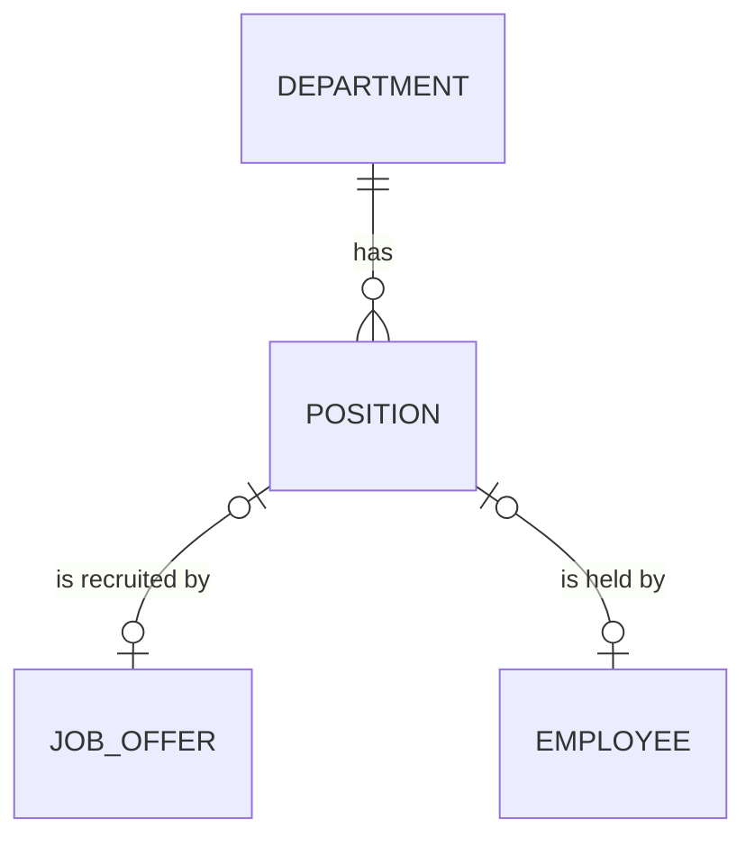
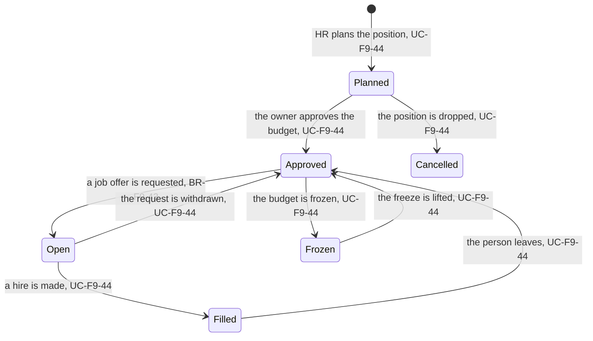

🏠 [Specs](../../../README.md) › 🧩 [Functional capabilities](../../README.md) › 👥 [F9 HR and projects](../README.md) ›
🗃️ [Data](README.md) › 🗃️ E-F9-49 Position

# 🗃️ E-F9-49 Position

**Status:** ✅ specified

## Purpose

One budgeted job in a department: its cost, start date and whether it is open or filled
([D528](../../../06-decisions/f09-hr-and-projects/d528-benchmark-gaps-f09-hr-and-projects.md)).

## Fields

| Name | Type | Required | Validation | Default | Example | Personal data | Custom fields |
|---|---|---|---|---|---|---|---|
| department | department | yes | - | - | Sales | no | no |
| title | text | yes | up to 80 characters | - | Site manager | no | no |
| full-time equivalent | number | yes | above 0, up to 1 | 1 | 1 | no | no |
| yearly cost | money | yes | above 0 | - | 62000.00 | no | no |
| start month | month | yes | - | - | 2027-03 | no | no |
| job offer | job offer | when open | - | - | Site manager, Lyon | no | no |
| holder | employee record | when filled | - | - | Julien R. | yes | no |
| state | planned, approved, cancelled, open, filled, frozen | yes | the lifecycle below | planned | planned | no | no |

## Relations

- [E-F9-03 Department](e-f09-03-department.md)
- [E-F9-06 Job position](e-f09-06-job-position.md)
- [E-F9-01 Employee record](e-f09-01-employee-record.md)
- [E-F8-16 Budget plan](../../f08-accounting/data/e-f08-16-budget-plan.md)

## Lifecycle

## Indexes and search

By department, state and start month; the open and the over-budget positions.

## Retention

Kept for 5 years after the position is cancelled or the last holder leaves.

## Audit

Every change of state, cost and holder, with who and why.

## Import and export

CSV import of positions at the budget round; CSV export of the plan.

## Used by

- [UC-F9-44 Plan headcount against budget](../use-cases/15-work-location-headcount-and-learning/uc-f09-44-plan-headcount-against-budget.md)

## Open questions

None.

---

⬅️ [E-F9-48 Work location day](e-f09-48-work-location-day.md) · ⬆️ [Up](README.md) ·
➡️ [E-F9-50 Succession plan](e-f09-50-succession-plan.md)
