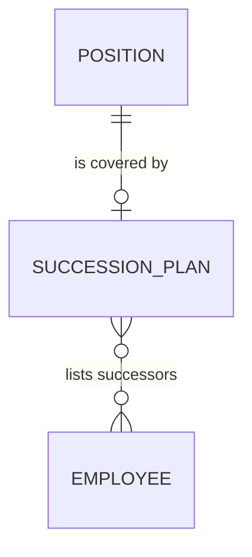
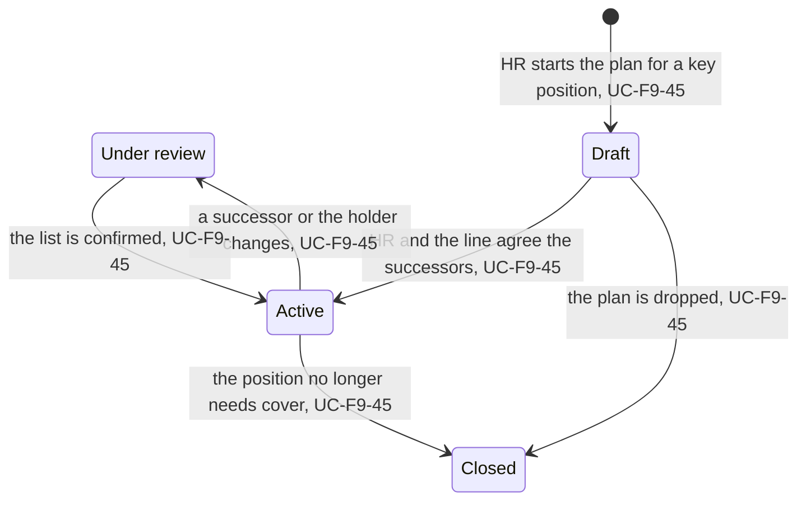

🏠 [Specs](../../../README.md) › 🧩 [Functional capabilities](../../README.md) › 👥 [F9 HR and projects](../README.md) ›
🗃️ [Data](README.md) › 🗃️ E-F9-50 Succession plan

# 🗃️ E-F9-50 Succession plan

**Status:** ✅ specified

## Purpose

The cover plan of one key position: its successors, their readiness and the actions to prepare them
([D528](../../../06-decisions/f09-hr-and-projects/d528-benchmark-gaps-f09-hr-and-projects.md)).

## Fields

| Name | Type | Required | Validation | Default | Example | Personal data | Custom fields |
|---|---|---|---|---|---|---|---|
| position | position | yes | a key position | - | Works director | no | no |
| holder | employee record | yes | - | - | Marc D. | yes | no |
| successors | list of employee, readiness | no | up to 5 | - | Sonia M., 1 to 2 years | yes | no |
| readiness | ready now, one to two years, three years or more | per successor | - | - | one to two years | yes | no |
| gaps and actions | list of text and training | no | - | - | Budget management course | no | no |
| vacancy risk | low, medium, high | yes | - | medium | high | no | no |
| next review | date | yes | within 12 months | in 12 months | 2027-11-30 | no | no |
| state | draft, active, under review, closed | yes | the lifecycle below | draft | draft | no | no |

## Relations

- [E-F9-49 Position](e-f09-49-position.md)
- [E-F9-01 Employee record](e-f09-01-employee-record.md)
- [E-F9-12 Qualification](e-f09-12-certification.md)
- [E-F9-11 Appraisal](e-f09-11-appraisal.md)

## Lifecycle

## Indexes and search

By position, holder, state, vacancy risk and next review; the plans without a ready successor.

## Retention

Kept while the plan is active, then 2 years after it is closed, then anonymised.

## Audit

Every change of successor, readiness and state, and every read by a user other than the owners.

## Import and export

CSV export of the plans for the owner, with the same field rules as the screen; no import.

## Used by

- [UC-F9-45 Plan careers and successors](../use-cases/15-work-location-headcount-and-learning/uc-f09-45-plan-careers-and-successors.md)

## Open questions

None.

---

⬅️ [E-F9-49 Position](e-f09-49-position.md) · ⬆️ [Up](README.md) ·
➡️ [E-F9-51 Change request](e-f09-51-change-request.md)
