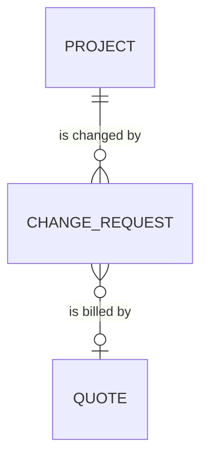
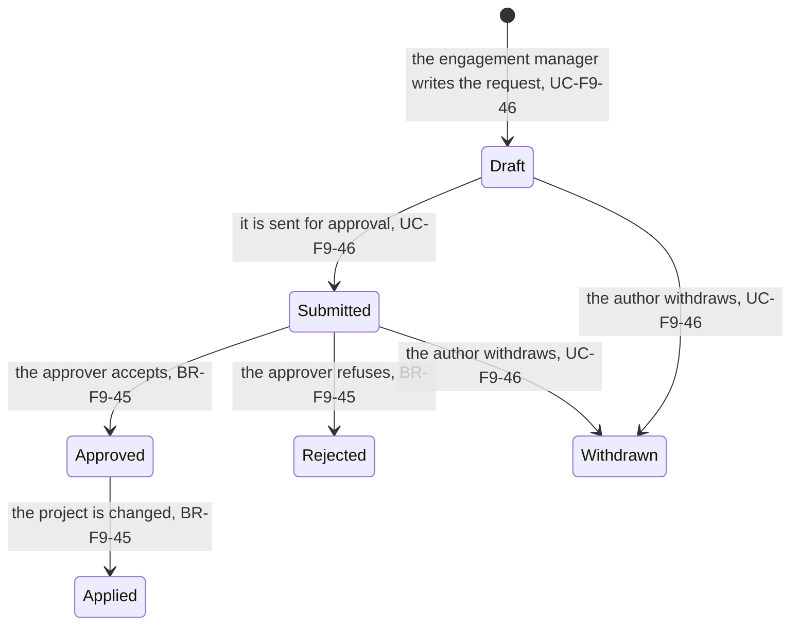

🏠 [Specs](../../../README.md) › 🧩 [Functional capabilities](../../README.md) › 👥 [F9 HR and projects](../README.md) ›
🗃️ [Data](README.md) › 🗃️ E-F9-51 Change request

# 🗃️ E-F9-51 Change request

**Status:** ✅ specified

## Purpose

A requested change to a project's scope, cost, days or date, with its decision and its application
([D528](../../../06-decisions/f09-hr-and-projects/d528-benchmark-gaps-f09-hr-and-projects.md)).

## Fields

| Name | Type | Required | Validation | Default | Example | Personal data | Custom fields |
|---|---|---|---|---|---|---|---|
| project | project | yes | - | - | Warehouse extension | no | no |
| title | text | yes | up to 120 characters | - | Add a second floor | no | no |
| reason | text | yes | - | - | Customer wants storage | no | no |
| impact on cost | money | yes | - | 0 | 9000.00 | no | no |
| impact on days | number | yes | - | 0 | 12 | no | no |
| new end date | date | no | after the project's start | - | 2027-04-15 | no | no |
| requested by | user | yes | - | - | Valérie P. | yes | no |
| approver | customer contact or owner | yes | - | the customer | Fabrice L. | yes | no |
| decided at, reason | date and text | when decided | - | - | 2026-11-20, agreed | no | no |
| state | draft, submitted, approved, rejected, applied, withdrawn | yes | the lifecycle below | draft | draft | no | no |

## Relations

- [E-F9-18 Project and task](e-f09-18-project-and-task.md)
- [E-F6-01 Customer record](../../f06-customers-and-sales/data/e-f06-01-customer-record.md)
- [E-F6-03 Quote](../../f06-customers-and-sales/data/e-f06-03-quote.md)

## Lifecycle

## Indexes and search

By project, state, approver and date; the requests waiting for a customer.

## Retention

Kept with the project's records for 10 years
([CR-FR-002](../../../10-country-packs/france/accounting/cr-fr-002-accounting-records-kept-ten-years.md)).

## Audit

Every state change with the decider, the figures at that time and the reason.

## Import and export

PDF export of a request for the customer's file; no import.

## Used by

- [UC-F9-46 Log project risks and change requests](../use-cases/15-work-location-headcount-and-learning/uc-f09-46-log-project-risks-and-change-requests.md)

## Open questions

None.

---

⬅️ [E-F9-50 Succession plan](e-f09-50-succession-plan.md) · ⬆️ [Up](README.md) ·
➡️ [E-F9-52 Online course](e-f09-52-online-course.md)
