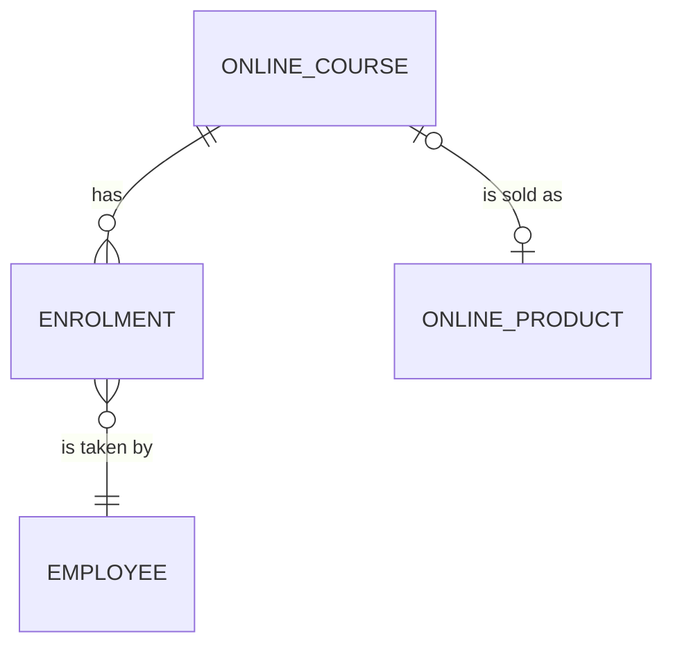
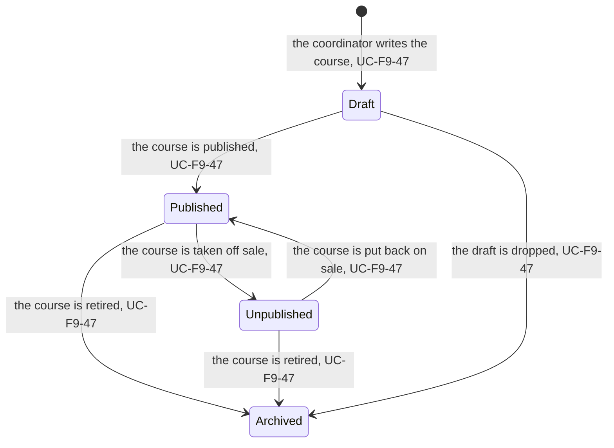

🏠 [Specs](../../../README.md) › 🧩 [Functional capabilities](../../README.md) › 👥 [F9 HR and projects](../README.md) ›
🗃️ [Data](README.md) › 🗃️ E-F9-52 Online course

# 🗃️ E-F9-52 Online course

**Status:** ✅ specified

## Purpose

A course taken online, with its modules, price, assessment and the results of its learners
([D528](../../../06-decisions/f09-hr-and-projects/d528-benchmark-gaps-f09-hr-and-projects.md)).

## Fields

| Name | Type | Required | Validation | Default | Example | Personal data | Custom fields |
|---|---|---|---|---|---|---|---|
| title | text | yes | up to 120 characters | - | Safe lifting | no | no |
| audience | staff, customers, public | yes | - | staff | customers | no | no |
| modules | list of text, video, quiz | yes | at least 1 | - | 4 modules | no | no |
| price | money | no | 0 or above | 0 | 49.00 | no | no |
| pass mark | percent | yes | 1 to 100 | 80 | 80 | no | no |
| attempts allowed | number | yes | at least 1 | 3 | 3 | no | no |
| certificate validity | months | no | - | - | 24 | no | no |
| learners and results | list of learner, progress, score, certificate | no | - | - | Claire P., 86, issued | yes | no |
| state | draft, published, unpublished, archived | yes | the lifecycle below | draft | draft | no | no |

## Relations

- [E-F9-12 Qualification](e-f09-12-certification.md)
- [E-F9-22 Training session](e-f09-22-training-session.md)
- [E-F11-03 Online product](../../f11-online-shop/data/e-f11-03-online-product.md)

## Lifecycle

## Indexes and search

By title, audience, state and learner; courses with learners who have not finished.

## Retention

Results and certificates are kept 5 years after the last activity; a certificate stays readable by its holder.

## Audit

Every publication, enrolment, attempt, certificate and archive, with who and when.

## Import and export

CSV export of results for the coordinator; import of an existing course as a package of modules.

## Used by

- [UC-F9-47 Publish and sell online courses](../use-cases/15-work-location-headcount-and-learning/uc-f09-47-publish-and-sell-online-courses.md)

## Open questions

None.

---

⬅️ [E-F9-51 Change request](e-f09-51-change-request.md) · ⬆️ [Up](README.md)
