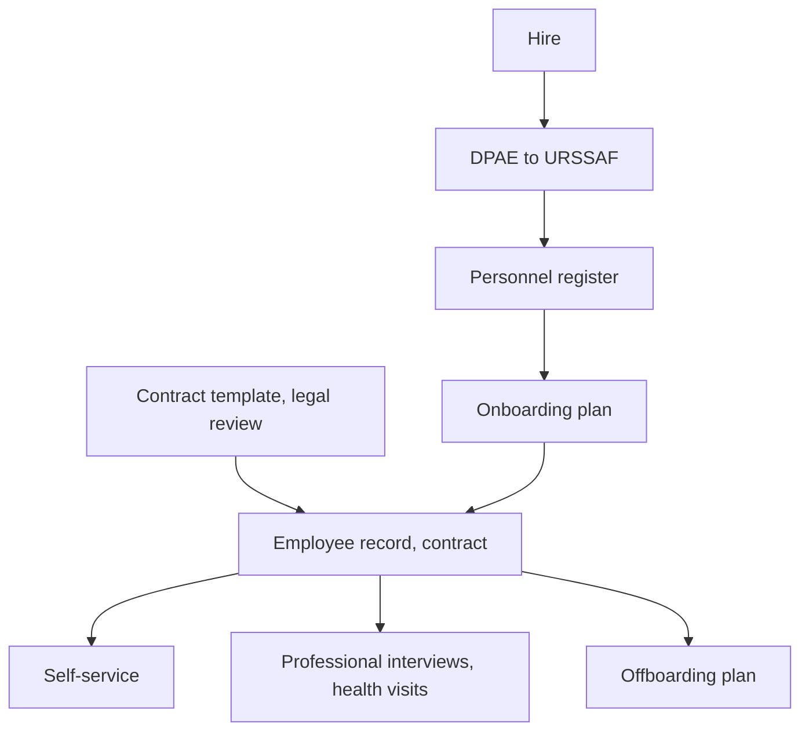

🏠 [Specs](../../../README.md) › 🧩 [Functional capabilities](../../README.md) › 👥 [F9 HR and projects](../README.md) ›
🔀 [Flows](README.md) › 🔀 FL-F9-01 People

# 🔀 FL-F9-01 People

**Status:** ✅ specified

## Summary

Covers UC-F9-01, UC-F9-02, UC-F9-03, UC-F9-04, UC-F9-19.

## Personas

- [U01 Employee](../../../01-users/personas/u01-employee.md)
- [U02 Manager](../../../01-users/personas/u02-manager.md)
- [U06 HR](../../../01-users/personas/u06-hr.md)
- [U14 Field worker](../../../01-users/personas/u14-field-worker.md)

## Flowchart

## Sequence diagram

See each use case.

## Steps

| Step | Persona | Screen | Use case | What happens |
|---|---|---|---|---|
| 1 | U06 | [S-F9-01](../screens/01-people/s-f09-01-employee.md) | [UC-F9-01](../use-cases/01-people/uc-f09-01-manage-employee-records-and-contracts.md) | Manage employee records and contracts |
| 2 | U06, U02 | [S-F9-02](../screens/01-people/s-f09-02-activity-plan.md) | [UC-F9-02](../use-cases/01-people/uc-f09-02-onboard-and-offboard.md) | Onboard and offboard |
| 3 | U06 | [S-F9-03](../screens/01-people/s-f09-03-hr-duties.md) | [UC-F9-03](../use-cases/01-people/uc-f09-03-comply-with-french-hr-duties.md) | Comply with French HR duties |
| 4 | U01, U14 | [S-F9-04](../screens/01-people/s-f09-04-my-hr.md) | [UC-F9-04](../use-cases/01-people/uc-f09-04-use-employee-self-service.md) | Use employee self-service |
| 5 | U06 | [S-F9-19](../screens/01-people/s-f09-19-contract-editor.md) | [UC-F9-19](../use-cases/01-people/uc-f09-19-edit-contract-templates.md) | Edit contract templates |

### Entities and screens

| Entity | States in this flow | Shown at step and screen | Aggregated view |
|---|---|---|---|
| [E-F9-19 Contract template](../data/e-f09-19-contract-template.md) | Draft, Published, Archived | 5 [S-F9-19](../screens/01-people/s-f09-19-contract-editor.md) | Contract templates |
| [E-F9-02 Contract](../data/e-f09-02-contract.md) | Draft, Running, Expired | 1 [S-F9-01](../screens/01-people/s-f09-01-employee.md) | Contracts |
| [E-F15-03 Document check](../../f15-legal-assistant/data/e-f15-03-document-check.md) | Recorded | Shown elsewhere: [S-F15-03 Document check](../../f15-legal-assistant/screens/03-check-a-document-against-the-law/s-f15-03-document-check.md) | Document checks |
| [E-F9-41 Pre-hiring declaration (DPAE)](../data/e-f09-41-pre-hiring-declaration-dpae.md) | Active | 3 [S-F9-03](../screens/01-people/s-f09-03-hr-duties.md) | Pre-hiring declaration (DPAE)s |
| [E-F9-40 Personnel register](../data/e-f09-40-personnel-register.md) | Active | 1 [S-F9-01](../screens/01-people/s-f09-01-employee.md) | Personnel registers |
| [E-F9-04 Activity plan](../data/e-f09-04-activity-plan.md) | Active | 2 [S-F9-02](../screens/01-people/s-f09-02-activity-plan.md) | Activity plans |
| [E-F9-01 Employee record](../data/e-f09-01-employee-record.md) | Active | 1 [S-F9-01](../screens/01-people/s-f09-01-employee.md); 2 [S-F9-02](../screens/01-people/s-f09-02-activity-plan.md); 3 [S-F9-03](../screens/01-people/s-f09-03-hr-duties.md); 4 [S-F9-04](../screens/01-people/s-f09-04-my-hr.md) | Employee records |
| [E-F9-05 HR duty](../data/e-f09-05-hr-duty.md) | Due, Done, Late | 3 [S-F9-03](../screens/01-people/s-f09-03-hr-duties.md) | HR duties |

## Errors

As each use case.

## Images

Every step and error, for each persona taking part, in light and dark mode (D120). Steps are numbered as in the Steps
table; E rows are the error cases.

| Step | Persona | Device | Light | Dark |
|---|---|---|---|---|
| 1 | U06 | desktop | [light](../images/01-people/u06-hr/1-employee-record-desktop-light.png) | [dark](../images/01-people/u06-hr/1-employee-record-desktop-dark.png) |
| 2 | U02 | desktop | [light](../images/01-people/u02-manager/2-onboarding-desktop-light.png) | [dark](../images/01-people/u02-manager/2-onboarding-desktop-dark.png) |
| 2 | U02 | phone | [light](../images/01-people/u02-manager/2-onboarding-phone-light.png) | [dark](../images/01-people/u02-manager/2-onboarding-phone-dark.png) |
| 2 | U06 | desktop | [light](../images/01-people/u06-hr/2-onboarding-desktop-light.png) | [dark](../images/01-people/u06-hr/2-onboarding-desktop-dark.png) |
| 3 | U06 | desktop | [light](../images/01-people/u06-hr/3-french-duties-desktop-light.png) | [dark](../images/01-people/u06-hr/3-french-duties-desktop-dark.png) |
| 4 | U01 | phone | [light](../images/01-people/u01-employee/4-self-service-phone-light.png) | [dark](../images/01-people/u01-employee/4-self-service-phone-dark.png) |
| 4 | U01 | desktop | [light](../images/01-people/u01-employee/4-self-service-desktop-light.png) | [dark](../images/01-people/u01-employee/4-self-service-desktop-dark.png) |
| 4 | U14 | phone | [light](../images/01-people/u14-field-worker/4-self-service-phone-light.png) | [dark](../images/01-people/u14-field-worker/4-self-service-phone-dark.png) |
| 5 | U06 | desktop | [light](../images/01-people/u06-hr/5-contract-editor-desktop-light.png) | [dark](../images/01-people/u06-hr/5-contract-editor-desktop-dark.png) |
| E1 | U06 | desktop | [light](../images/01-people/u06-hr/e1-blocking-issue-desktop-light.png) | [dark](../images/01-people/u06-hr/e1-blocking-issue-desktop-dark.png) |

## Open questions

None.

---

⬆️ [Up](README.md) · ➡️ [FL-F9-02 Recruit](fl-f09-02-recruit.md)
