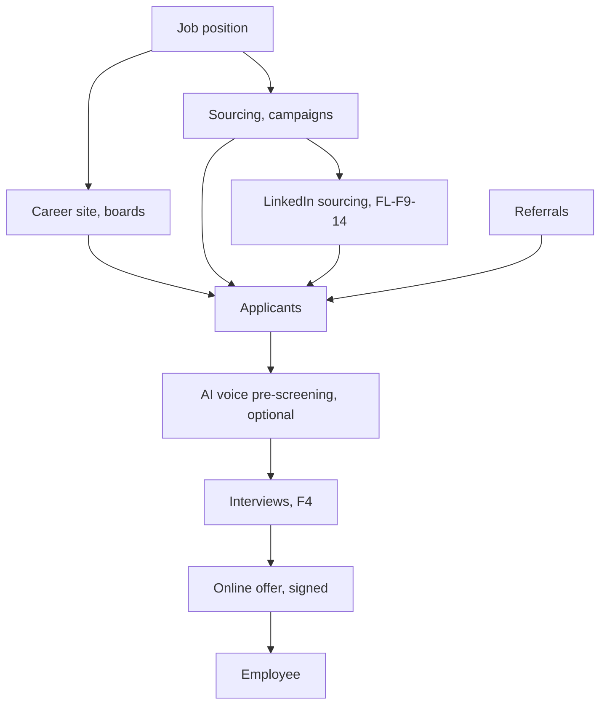

🏠 [Specs](../../../README.md) › 🧩 [Functional capabilities](../../README.md) › 👥 [F9 HR and projects](../README.md) ›
🔀 [Flows](README.md) › 🔀 FL-F9-02 Recruit

# 🔀 FL-F9-02 Recruit

**Status:** ✅ specified

## Summary

Covers UC-F9-05, UC-F9-06, UC-F9-07, UC-F9-08.

LinkedIn sourcing through Unipile ([UC-F9-40](../use-cases/02-recruit/uc-f09-40-search-and-rank-linkedin-profiles.md) to
[UC-F9-42](../use-cases/02-recruit/uc-f09-42-turn-a-positive-reply-into-an-applicant.md),
[D518](../../../06-decisions/f09-hr-and-projects/d518-linkedin-sourcing-through-unipile.md)) is the sourcing branch,
steps 1a to 1c, drawn in full in [FL-F9-14 Source candidates on LinkedIn](fl-f09-14-source-candidates-on-linkedin.md).

## Personas

- [U01 Employee](../../../01-users/personas/u01-employee.md)
- [U02 Manager](../../../01-users/personas/u02-manager.md)
- [U06 HR](../../../01-users/personas/u06-hr.md)

## Flowchart

## Sequence diagram

See each use case.

## Steps

| Step | Persona | Screen | Use case | What happens |
|---|---|---|---|---|
| 1 | U06 | [S-F9-05](../screens/02-recruit/s-f09-05-job-position.md) | [UC-F9-05](../use-cases/02-recruit/uc-f09-05-publish-jobs-and-source-candidates.md) | Publish jobs and source candidates |
| 1a | U06 | [S-F9-37](../screens/02-recruit/s-f09-37-linkedin-sourcing-search.md) | [UC-F9-40](../use-cases/02-recruit/uc-f09-40-search-and-rank-linkedin-profiles.md) | Search and rank LinkedIn profiles ([FL-F9-14](fl-f09-14-source-candidates-on-linkedin.md)) |
| 1b | U06 | [S-F9-38](../screens/02-recruit/s-f09-38-outreach-sequence.md) | [UC-F9-41](../use-cases/02-recruit/uc-f09-41-run-a-linkedin-outreach-sequence.md) | Run a LinkedIn outreach sequence |
| 1c | U06 | [S-F9-39](../screens/02-recruit/s-f09-39-prospect-conversations.md) | [UC-F9-42](../use-cases/02-recruit/uc-f09-42-turn-a-positive-reply-into-an-applicant.md) | Turn a positive reply into an applicant |
| 2 | U06, U02 | [S-F9-06](../screens/02-recruit/s-f09-06-applicant-pipeline.md) | [UC-F9-06](../use-cases/02-recruit/uc-f09-06-run-the-applicant-pipeline.md) | Run the applicant pipeline |
| 3 | U06 | [S-F9-07](../screens/02-recruit/s-f09-07-offer.md) | [UC-F9-07](../use-cases/02-recruit/uc-f09-07-make-an-offer-and-hire.md) | Make an offer and hire |
| 4 | U01, U06 | [S-F9-08](../screens/02-recruit/s-f09-08-referrals.md) | [UC-F9-08](../use-cases/02-recruit/uc-f09-08-run-referrals.md) | Run referrals |

### Entities and screens

| Entity | States in this flow | Shown at step and screen | Aggregated view |
|---|---|---|---|
| [E-F9-06 Job position](../data/e-f09-06-job-position.md) | Active | 1 [S-F9-05](../screens/02-recruit/s-f09-05-job-position.md); 1a [S-F9-37](../screens/02-recruit/s-f09-37-linkedin-sourcing-search.md); 1c [S-F9-39](../screens/02-recruit/s-f09-39-prospect-conversations.md); 2 [S-F9-06](../screens/02-recruit/s-f09-06-applicant-pipeline.md) | Job positions |
| [E-F18-01 Hosted website](../../f18-hosted-websites-and-domains/data/e-f18-01-hosted-website.md) | New, Live | Shown elsewhere: [S-F18-01 Site builder](../../f18-hosted-websites-and-domains/screens/01-build-the-site/s-f18-01-site-builder.md) | Hosted websites |
| [E-F5-05 Email or SMS campaign](../../f05-social-media/data/e-f05-05-email-or-sms-campaign.md) | Draft, Scheduled, Sent | Shown elsewhere: [S-F5-08 Email campaign](../../f05-social-media/screens/05-benchmark-additions/s-f05-08-email-campaign.md) | Email or SMS campaigns |
| [E-F9-07 Applicant](../data/e-f09-07-applicant.md) | Active | 1 [S-F9-05](../screens/02-recruit/s-f09-05-job-position.md); 1c [S-F9-39](../screens/02-recruit/s-f09-39-prospect-conversations.md); 2 [S-F9-06](../screens/02-recruit/s-f09-06-applicant-pipeline.md); 3 [S-F9-07](../screens/02-recruit/s-f09-07-offer.md); 4 [S-F9-08](../screens/02-recruit/s-f09-08-referrals.md) | Applicants |
| [E-F9-36 Employee referral](../data/e-f09-36-employee-referral.md) | Active | 4 [S-F9-08](../screens/02-recruit/s-f09-08-referrals.md) | Employee referrals |
| [E-F3-15 Agent](../../f03-assistant/data/e-f03-15-agent.md) | Paid, Paused | Shown elsewhere: [S-F3-14 Agents](../../f03-assistant/screens/10-benchmark-additions/s-f03-14-agents.md) | Agents |
| [E-F4-01 Meeting](../../f04-meetings/data/e-f04-01-meeting.md) | Planned, Live, Ended, Waiting for review, Checked | Shown elsewhere: [S-F4-01 Meeting](../../f04-meetings/screens/01-record-an-online-meeting/s-f04-01-meeting.md) | Meetings |
| [E-F9-38 Job offer](../data/e-f09-38-job-offer.md) | Active | 3 [S-F9-07](../screens/02-recruit/s-f09-07-offer.md) | Job offers |
| [E-F9-01 Employee record](../data/e-f09-01-employee-record.md) | Active | Shown elsewhere: [S-F9-01 Employee](../screens/01-people/s-f09-01-employee.md) | Employee records |
| [E-F9-46 Outreach sequence](../data/e-f09-46-outreach-sequence.md) | Draft, Running, Paused, Ended | 1b [S-F9-38](../screens/02-recruit/s-f09-38-outreach-sequence.md); 1c [S-F9-39](../screens/02-recruit/s-f09-39-prospect-conversations.md) | Outreach sequences |

## Errors

As each use case.

## Images

Every step and error, for each persona taking part, in light and dark mode (D120). Steps are numbered as in the Steps
table; E rows are the error cases.

| Step | Persona | Device | Light | Dark |
|---|---|---|---|---|
| 1 | U06 | desktop | [light](../images/02-recruit/u06-hr/1-job-and-sourcing-desktop-light.png) | [dark](../images/02-recruit/u06-hr/1-job-and-sourcing-desktop-dark.png) |
| 1a | U06 | desktop | [light](../images/14-source-candidates-on-linkedin/u06-hr/3-linkedin-sourcing-search-desktop-light.png) | [dark](../images/14-source-candidates-on-linkedin/u06-hr/3-linkedin-sourcing-search-desktop-dark.png) |
| 1b | U06 | desktop | [light](../images/14-source-candidates-on-linkedin/u06-hr/4-outreach-sequence-desktop-light.png) | [dark](../images/14-source-candidates-on-linkedin/u06-hr/4-outreach-sequence-desktop-dark.png) |
| 1c | U06 | desktop | [light](../images/14-source-candidates-on-linkedin/u06-hr/6-prospect-conversations-desktop-light.png) | [dark](../images/14-source-candidates-on-linkedin/u06-hr/6-prospect-conversations-desktop-dark.png) |
| 2 | U06 | desktop | [light](../images/02-recruit/u06-hr/2-pipeline-desktop-light.png) | [dark](../images/02-recruit/u06-hr/2-pipeline-desktop-dark.png) |
| 2 | U02 | desktop | [light](../images/02-recruit/u02-manager/2-pipeline-desktop-light.png) | [dark](../images/02-recruit/u02-manager/2-pipeline-desktop-dark.png) |
| 2 | U02 | phone | [light](../images/02-recruit/u02-manager/2-pipeline-phone-light.png) | [dark](../images/02-recruit/u02-manager/2-pipeline-phone-dark.png) |
| 3 | U06 | desktop | [light](../images/02-recruit/u06-hr/3-offer-desktop-light.png) | [dark](../images/02-recruit/u06-hr/3-offer-desktop-dark.png) |
| 4 | U01 | phone | [light](../images/02-recruit/u01-employee/4-referrals-phone-light.png) | [dark](../images/02-recruit/u01-employee/4-referrals-phone-dark.png) |
| 4 | U01 | desktop | [light](../images/02-recruit/u01-employee/4-referrals-desktop-light.png) | [dark](../images/02-recruit/u01-employee/4-referrals-desktop-dark.png) |
| 4 | U06 | desktop | [light](../images/02-recruit/u06-hr/4-referrals-desktop-light.png) | [dark](../images/02-recruit/u06-hr/4-referrals-desktop-dark.png) |
| E1 | U06 | desktop | [light](../images/02-recruit/u06-hr/e1-deletion-request-desktop-light.png) | [dark](../images/02-recruit/u06-hr/e1-deletion-request-desktop-dark.png) |

## Open questions

None.

---

⬅️ [FL-F9-01 People](fl-f09-01-people.md) · ⬆️ [Up](README.md) · ➡️ [FL-F9-03 Time](fl-f09-03-time.md)
