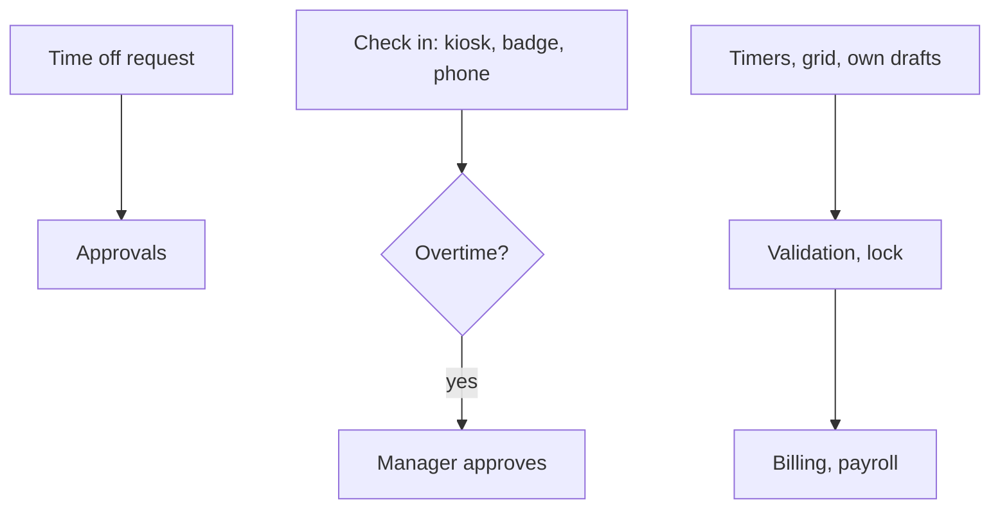

🏠 [Specs](../../../README.md) › 🧩 [Functional capabilities](../../README.md) › 👥 [F9 HR and projects](../README.md) ›
🔀 [Flows](README.md) › 🔀 FL-F9-03 Time

# 🔀 FL-F9-03 Time

**Status:** ✅ specified

## Summary

Covers UC-F9-09, UC-F9-10, UC-F9-16.

## Personas

- [U01 Employee](../../../01-users/personas/u01-employee.md)
- [U02 Manager](../../../01-users/personas/u02-manager.md)
- [U06 HR](../../../01-users/personas/u06-hr.md)
- [U14 Field worker](../../../01-users/personas/u14-field-worker.md)

## Flowchart

## Sequence diagram

See each use case.

## Steps

| Step | Persona | Screen | Use case | What happens |
|---|---|---|---|---|
| 1 | U01, U02, U06 | [S-F9-09](../screens/03-time/s-f09-09-time-off.md) | [UC-F9-09](../use-cases/03-time/uc-f09-09-request-and-approve-time-off.md) | Request and approve time off |
| 2 | U01, U14, U02 | [S-F9-10](../screens/03-time/s-f09-10-attendance.md) | [UC-F9-10](../use-cases/03-time/uc-f09-10-record-attendance-and-overtime.md) | Record attendance and overtime |
| 3 | U01, U14, U02 | [S-F9-16](../screens/03-time/s-f09-16-timesheets.md) | [UC-F9-16](../use-cases/03-time/uc-f09-16-record-and-validate-timesheets.md) | Record and validate timesheets |

### Entities and screens

| Entity | States in this flow | Shown at step and screen | Aggregated view |
|---|---|---|---|
| [E-F9-09 Time-off request](../data/e-f09-09-time-off-request.md) | To approve, Approved, Refused, Cancelled | 1 [S-F9-09](../screens/03-time/s-f09-09-time-off.md) | Time-off requests |
| [E-F9-10 Attendance](../data/e-f09-10-attendance.md) | Active | 2 [S-F9-10](../screens/03-time/s-f09-10-attendance.md) | Attendances |
| [E-F9-34 Attendance kiosk](../data/e-f09-34-attendance-kiosk.md) | Active | 2 [S-F9-10](../screens/03-time/s-f09-10-attendance.md) | Attendance kiosks |
| [E-F9-35 Employee badge](../data/e-f09-35-employee-badge.md) | Active | 2 [S-F9-10](../screens/03-time/s-f09-10-attendance.md) | Employee badges |
| [E-F9-17 Timesheet line](../data/e-f09-17-timesheet-line.md) | Draft | 3 [S-F9-16](../screens/03-time/s-f09-16-timesheets.md) | Timesheet lines |
| [E-F6-05 Invoice](../../f06-customers-and-sales/data/e-f06-05-invoice.md) | Draft | Shown elsewhere: [S-F6-06 Invoice](../../f06-customers-and-sales/screens/03-invoice-and-get-paid/s-f06-06-invoice.md) | Invoices |
| [E-F13-03 Pay input](../../f13-payroll/data/e-f13-03-pay-input.md) | Open, Complete, Late, Closed | Shown elsewhere: [S-F13-03 Pay inputs](../../f13-payroll/screens/02-monthly-pay-run/s-f13-03-pay-inputs.md) | Pay inputs |

## Errors

As each use case.

## Images

Every step and error, for each persona taking part, in light and dark mode (D120). Steps are numbered as in the Steps
table; E rows are the error cases.

| Step | Persona | Device | Light | Dark |
|---|---|---|---|---|
| 1 | U02 | desktop | [light](../images/03-time/u02-manager/1-time-off-desktop-light.png) | [dark](../images/03-time/u02-manager/1-time-off-desktop-dark.png) |
| 1 | U02 | phone | [light](../images/03-time/u02-manager/1-time-off-phone-light.png) | [dark](../images/03-time/u02-manager/1-time-off-phone-dark.png) |
| 1 | U01 | desktop | [light](../images/03-time/u01-employee/1-time-off-desktop-light.png) | [dark](../images/03-time/u01-employee/1-time-off-desktop-dark.png) |
| 1 | U01 | phone | [light](../images/03-time/u01-employee/1-time-off-phone-light.png) | [dark](../images/03-time/u01-employee/1-time-off-phone-dark.png) |
| 1 | U06 | desktop | [light](../images/03-time/u06-hr/1-time-off-desktop-light.png) | [dark](../images/03-time/u06-hr/1-time-off-desktop-dark.png) |
| 2 | U14 | phone | [light](../images/03-time/u14-field-worker/2-attendance-phone-light.png) | [dark](../images/03-time/u14-field-worker/2-attendance-phone-dark.png) |
| 2 | U01 | desktop | [light](../images/03-time/u01-employee/2-attendance-desktop-light.png) | [dark](../images/03-time/u01-employee/2-attendance-desktop-dark.png) |
| 2 | U01 | phone | [light](../images/03-time/u01-employee/2-attendance-phone-light.png) | [dark](../images/03-time/u01-employee/2-attendance-phone-dark.png) |
| 2 | U02 | desktop | [light](../images/03-time/u02-manager/2-attendance-desktop-light.png) | [dark](../images/03-time/u02-manager/2-attendance-desktop-dark.png) |
| 2 | U02 | phone | [light](../images/03-time/u02-manager/2-attendance-phone-light.png) | [dark](../images/03-time/u02-manager/2-attendance-phone-dark.png) |
| 3 | U01 | desktop | [light](../images/03-time/u01-employee/3-timesheets-desktop-light.png) | [dark](../images/03-time/u01-employee/3-timesheets-desktop-dark.png) |
| 3 | U01 | phone | [light](../images/03-time/u01-employee/3-timesheets-phone-light.png) | [dark](../images/03-time/u01-employee/3-timesheets-phone-dark.png) |
| 3 | U02 | desktop | [light](../images/03-time/u02-manager/3-timesheets-desktop-light.png) | [dark](../images/03-time/u02-manager/3-timesheets-desktop-dark.png) |
| 3 | U02 | phone | [light](../images/03-time/u02-manager/3-timesheets-phone-light.png) | [dark](../images/03-time/u02-manager/3-timesheets-phone-dark.png) |
| 3 | U14 | phone | [light](../images/03-time/u14-field-worker/3-timesheets-phone-light.png) | [dark](../images/03-time/u14-field-worker/3-timesheets-phone-dark.png) |
| E1 | U02 | desktop | [light](../images/03-time/u02-manager/e1-missing-check-out-desktop-light.png) | [dark](../images/03-time/u02-manager/e1-missing-check-out-desktop-dark.png) |
| E1 | U02 | phone | [light](../images/03-time/u02-manager/e1-missing-check-out-phone-light.png) | [dark](../images/03-time/u02-manager/e1-missing-check-out-phone-dark.png) |

## Open questions

None.

---

⬅️ [FL-F9-02 Recruit](fl-f09-02-recruit.md) · ⬆️ [Up](README.md) · ➡️ [FL-F9-04 Grow](fl-f09-04-grow.md)
