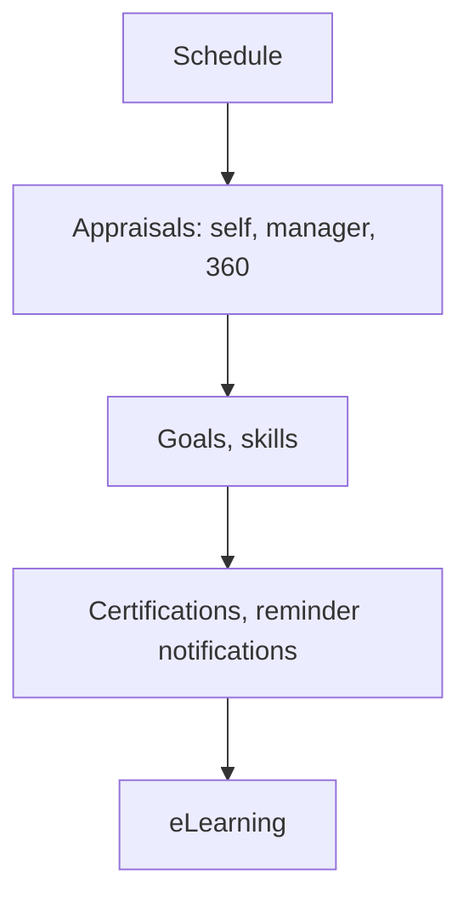

🏠 [Specs](../../../README.md) › 🧩 [Functional capabilities](../../README.md) › 👥 [F9 HR and projects](../README.md) ›
🔀 [Flows](README.md) › 🔀 FL-F9-04 Grow

# 🔀 FL-F9-04 Grow

**Status:** ✅ specified

## Summary

Covers UC-F9-11.

## Personas

- [U01 Employee](../../../01-users/personas/u01-employee.md)
- [U02 Manager](../../../01-users/personas/u02-manager.md)
- [U06 HR](../../../01-users/personas/u06-hr.md)

## Flowchart

## Sequence diagram

See each use case.

## Steps

| Step | Persona | Screen | Use case | What happens |
|---|---|---|---|---|
| 1 | U02, U01, U06 | [S-F9-11](../screens/04-grow/s-f09-11-appraisals-and-skills.md) | [UC-F9-11](../use-cases/04-grow/uc-f09-11-run-appraisals-and-track-skills.md) | Run appraisals and track skills |

### Entities and screens

| Entity | States in this flow | Shown at step and screen | Aggregated view |
|---|---|---|---|
| [E-F9-11 Appraisal](../data/e-f09-11-appraisal.md) | Active | 1 [S-F9-11](../screens/04-grow/s-f09-11-appraisals-and-skills.md) | Appraisals |
| [E-SC03-11 Skill](../../../08-sectors/sc03-services/data/e-sc03-11-skill.md) | New, Validated | Shown elsewhere: [S-SC03-13 Skills](../../../08-sectors/sc03-services/screens/05-client-and-people/s-sc03-13-skills.md) | Skills |
| [E-F9-12 Qualification](../data/e-f09-12-certification.md) | To verify, Verified, Rejected, Expired | 1 [S-F9-11](../screens/04-grow/s-f09-11-appraisals-and-skills.md) | Certifications |
| [E-T10-02 Notification](../../../03-technical/t10-translations-and-notifications/data/e-t10-02-notification.md) | Active | Shown elsewhere: [S-T10-02 Notification](../../../03-technical/t10-translations-and-notifications/screens/s-t10-02-notification.md), from the admin list [S-T10-L02](../../../03-technical/t10-translations-and-notifications/screens/00-lists/s-t10-l02-notifications.md) | Notifications |
| [E-SC12-07 E-learning record](../../../08-sectors/sc12-education-and-training/data/e-sc12-07-e-learning-record.md) | Recorded | Shown elsewhere: [S-SC12-07 E-learning](../../../08-sectors/sc12-education-and-training/screens/03-deliver-and-assess/s-sc12-07-e-learning.md) | E-learning records |

## Errors

As each use case.

## Images

Every step and error, for each persona taking part, in light and dark mode (D120). Steps are numbered as in the Steps
table; E rows are the error cases.

| Step | Persona | Device | Light | Dark |
|---|---|---|---|---|
| 1 | U02 | desktop | [light](../images/04-grow/u02-manager/1-appraisals-desktop-light.png) | [dark](../images/04-grow/u02-manager/1-appraisals-desktop-dark.png) |
| 1 | U02 | phone | [light](../images/04-grow/u02-manager/1-appraisals-phone-light.png) | [dark](../images/04-grow/u02-manager/1-appraisals-phone-dark.png) |
| 1 | U01 | desktop | [light](../images/04-grow/u01-employee/1-appraisals-desktop-light.png) | [dark](../images/04-grow/u01-employee/1-appraisals-desktop-dark.png) |
| 1 | U01 | phone | [light](../images/04-grow/u01-employee/1-appraisals-phone-light.png) | [dark](../images/04-grow/u01-employee/1-appraisals-phone-dark.png) |
| 1 | U06 | desktop | [light](../images/04-grow/u06-hr/1-appraisals-desktop-light.png) | [dark](../images/04-grow/u06-hr/1-appraisals-desktop-dark.png) |
| E1 | U06 | desktop | [light](../images/04-grow/u06-hr/e1-certification-expiring-desktop-light.png) | [dark](../images/04-grow/u06-hr/e1-certification-expiring-desktop-dark.png) |

## Open questions

None.

---

⬅️ [FL-F9-03 Time](fl-f09-03-time.md) · ⬆️ [Up](README.md) ·
➡️ [FL-F9-05 Workplace services](fl-f09-05-workplace-services.md)
