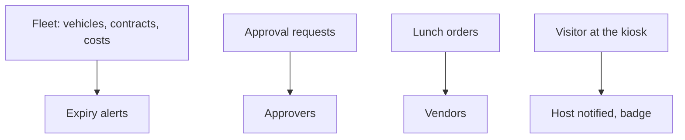

🏠 [Specs](../../../README.md) › 🧩 [Functional capabilities](../../README.md) › 👥 [F9 HR and projects](../README.md) ›
🔀 [Flows](README.md) › 🔀 FL-F9-05 Workplace services

# 🔀 FL-F9-05 Workplace services

**Status:** ✅ specified

## Summary

Covers UC-F9-12, UC-F9-13, UC-F9-14.

## Personas

- [U01 Employee](../../../01-users/personas/u01-employee.md)
- [U02 Manager](../../../01-users/personas/u02-manager.md)
- [U06 HR](../../../01-users/personas/u06-hr.md)
- [U07 Administrator](../../../01-users/personas/u07-administrator.md)
- [U16 Office worker](../../../01-users/personas/u16-office-worker.md)

## Flowchart

## Sequence diagram

See each use case.

## Steps

| Step | Persona | Screen | Use case | What happens |
|---|---|---|---|---|
| 1 | U06, U07 | [S-F9-12](../screens/05-workplace-services/s-f09-12-fleet.md) | [UC-F9-12](../use-cases/05-workplace-services/uc-f09-12-manage-the-fleet.md) | Manage the fleet |
| 2 | U01, U02 | [S-F9-13](../screens/05-workplace-services/s-f09-13-approvals-and-lunch.md) | [UC-F9-13](../use-cases/05-workplace-services/uc-f09-13-request-approvals-and-order-lunch.md) | Request approvals and order lunch |
| 3 | U16 | [S-F9-14](../screens/05-workplace-services/s-f09-14-visitors.md) | [UC-F9-14](../use-cases/05-workplace-services/uc-f09-14-welcome-visitors.md) | Welcome visitors |

### Entities and screens

| Entity | States in this flow | Shown at step and screen | Aggregated view |
|---|---|---|---|
| [E-F9-13 Company vehicle](../data/e-f09-13-company-vehicle.md) | Active | 1 [S-F9-12](../screens/05-workplace-services/s-f09-12-fleet.md) | Company vehicles |
| [E-T10-02 Notification](../../../03-technical/t10-translations-and-notifications/data/e-t10-02-notification.md) | Active | Shown elsewhere: [S-T10-02 Notification](../../../03-technical/t10-translations-and-notifications/screens/s-t10-02-notification.md), from the admin list [S-T10-L02](../../../03-technical/t10-translations-and-notifications/screens/00-lists/s-t10-l02-notifications.md) | Notifications |
| [E-F9-14 Approval request](../data/e-f09-14-approval-request.md) | To approve, Approved, Refused | 2 [S-F9-13](../screens/05-workplace-services/s-f09-13-approvals-and-lunch.md) | Approval requests |
| [E-F9-39 Lunch order](../data/e-f09-39-lunch-order.md) | Active | 2 [S-F9-13](../screens/05-workplace-services/s-f09-13-approvals-and-lunch.md) | Lunch orders |
| [E-F9-15 Visitor](../data/e-f09-15-visitor.md) | Checked, Planned | 3 [S-F9-14](../screens/05-workplace-services/s-f09-14-visitors.md) | Visitors |
| [E-F9-42 Reception kiosk](../data/e-f09-42-reception-kiosk.md) | Active | 3 [S-F9-14](../screens/05-workplace-services/s-f09-14-visitors.md) | Reception kiosks |
| [E-F9-43 Visitor badge](../data/e-f09-43-visitor-badge.md) | Active | 3 [S-F9-14](../screens/05-workplace-services/s-f09-14-visitors.md) | Visitor badges |

## Errors

As each use case.

## Images

Every step and error, for each persona taking part, in light and dark mode (D120). Steps are numbered as in the Steps
table; E rows are the error cases.

| Step | Persona | Device | Light | Dark |
|---|---|---|---|---|
| 1 | U06 | desktop | [light](../images/05-workplace-services/u06-hr/1-fleet-desktop-light.png) | [dark](../images/05-workplace-services/u06-hr/1-fleet-desktop-dark.png) |
| 1 | U07 | desktop | [light](../images/05-workplace-services/u07-administrator/1-fleet-desktop-light.png) | [dark](../images/05-workplace-services/u07-administrator/1-fleet-desktop-dark.png) |
| 2 | U01 | phone | [light](../images/05-workplace-services/u01-employee/2-approvals-and-lunch-phone-light.png) | [dark](../images/05-workplace-services/u01-employee/2-approvals-and-lunch-phone-dark.png) |
| 2 | U01 | desktop | [light](../images/05-workplace-services/u01-employee/2-approvals-and-lunch-desktop-light.png) | [dark](../images/05-workplace-services/u01-employee/2-approvals-and-lunch-desktop-dark.png) |
| 2 | U02 | desktop | [light](../images/05-workplace-services/u02-manager/2-approvals-and-lunch-desktop-light.png) | [dark](../images/05-workplace-services/u02-manager/2-approvals-and-lunch-desktop-dark.png) |
| 2 | U02 | phone | [light](../images/05-workplace-services/u02-manager/2-approvals-and-lunch-phone-light.png) | [dark](../images/05-workplace-services/u02-manager/2-approvals-and-lunch-phone-dark.png) |
| 3 | U16 | desktop | [light](../images/05-workplace-services/u16-office-worker/3-visitors-desktop-light.png) | [dark](../images/05-workplace-services/u16-office-worker/3-visitors-desktop-dark.png) |
| 3 | U16 | phone | [light](../images/05-workplace-services/u16-office-worker/3-visitors-phone-light.png) | [dark](../images/05-workplace-services/u16-office-worker/3-visitors-phone-dark.png) |
| E1 | U06 | desktop | [light](../images/05-workplace-services/u06-hr/e1-contract-expired-desktop-light.png) | [dark](../images/05-workplace-services/u06-hr/e1-contract-expired-desktop-dark.png) |

## Open questions

None.

---

⬅️ [FL-F9-04 Grow](fl-f09-04-grow.md) · ⬆️ [Up](README.md) ·
➡️ [FL-F9-06 Plan and deliver work](fl-f09-06-plan-and-deliver-work.md)
