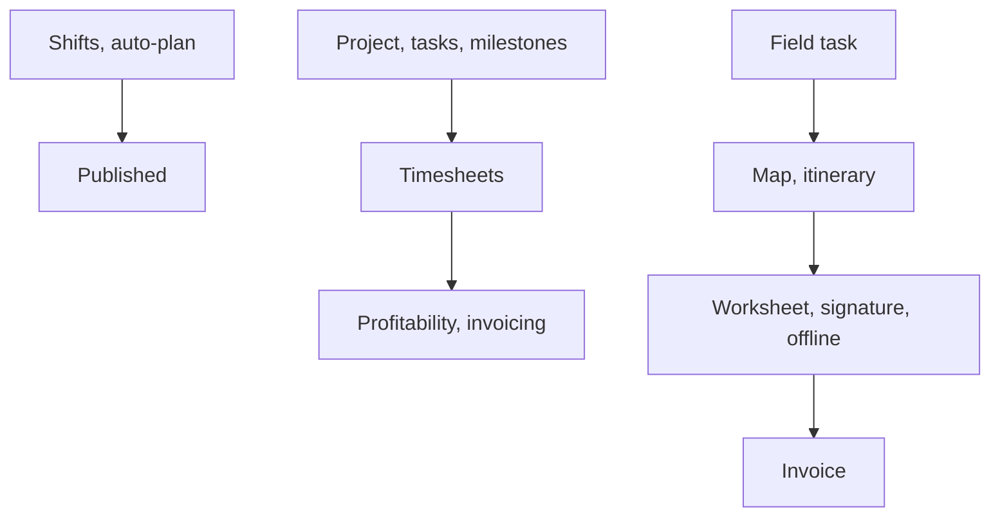

🏠 [Specs](../../../README.md) › 🧩 [Functional capabilities](../../README.md) › 👥 [F9 HR and projects](../README.md) ›
🔀 [Flows](README.md) › 🔀 FL-F9-06 Plan and deliver work

# 🔀 FL-F9-06 Plan and deliver work

**Status:** ✅ specified

## Summary

Covers UC-F9-15, UC-F9-17, UC-F9-18.

## Personas

- [U02 Manager](../../../01-users/personas/u02-manager.md)
- [U03 Sales](../../../01-users/personas/u03-sales.md)
- [U09 Customer](../../../01-users/personas/u09-customer.md)
- [U14 Field worker](../../../01-users/personas/u14-field-worker.md)

## Flowchart

## Sequence diagram

See each use case.

## Steps

| Step | Persona | Screen | Use case | What happens |
|---|---|---|---|---|
| 1 | U02, U14 | [S-F9-15](../screens/06-plan-and-deliver-work/s-f09-15-planning.md) | [UC-F9-15](../use-cases/06-plan-and-deliver-work/uc-f09-15-plan-shifts.md) | Plan shifts |
| 2 | U02, U03, U09 | [S-F9-17](../screens/06-plan-and-deliver-work/s-f09-17-projects.md) | [UC-F9-17](../use-cases/06-plan-and-deliver-work/uc-f09-17-manage-projects-and-tasks.md) | Manage projects and tasks |
| 3 | U14, U02 | [S-F9-18](../screens/06-plan-and-deliver-work/s-f09-18-field-service.md) | [UC-F9-18](../use-cases/06-plan-and-deliver-work/uc-f09-18-run-field-service.md) | Run field service |

### Entities and screens

| Entity | States in this flow | Shown at step and screen | Aggregated view |
|---|---|---|---|
| [E-F9-16 Shift](../data/e-f09-16-shift.md) | Draft, Published | 1 [S-F9-15](../screens/06-plan-and-deliver-work/s-f09-15-planning.md); 3 [S-F9-18](../screens/06-plan-and-deliver-work/s-f09-18-field-service.md) | Shifts |
| [E-F9-18 Project and task](../data/e-f09-18-project-and-task.md) | New, Planned, Active, Delivered, Done | 2 [S-F9-17](../screens/06-plan-and-deliver-work/s-f09-17-projects.md); 3 [S-F9-18](../screens/06-plan-and-deliver-work/s-f09-18-field-service.md) | Project and tasks |
| [E-SC03-08 Milestone](../../../08-sectors/sc03-services/data/e-sc03-08-milestone.md) | Planned, Accepted, Billed | Shown elsewhere: [S-SC03-07 Milestones](../../../08-sectors/sc03-services/screens/04-bill-and-recognise/s-sc03-07-milestones.md) | Milestones |
| [E-F9-17 Timesheet line](../data/e-f09-17-timesheet-line.md) | Draft, Submitted, Validated, Billed | Shown elsewhere: [S-F9-16 Timesheets](../screens/03-time/s-f09-16-timesheets.md) | Timesheet lines |
| [E-F6-05 Invoice](../../f06-customers-and-sales/data/e-f06-05-invoice.md) | Sent, Received, Refused, Paid, Draft, Issued, Partly paid, Overdue | Shown elsewhere: [S-F6-06 Invoice](../../f06-customers-and-sales/screens/03-invoice-and-get-paid/s-f06-06-invoice.md) | Invoices |
| [E-F9-37 Field worksheet](../data/e-f09-37-field-worksheet.md) | Active | 3 [S-F9-18](../screens/06-plan-and-deliver-work/s-f09-18-field-service.md) | Field worksheets |
| [E-F2-14 Signature request](../../f02-no-code-configuration/data/e-f02-14-signature-request.md) | Sent, Signed, Refused, Expired | Shown elsewhere: [S-F2-14 Signature requests](../../f02-no-code-configuration/screens/07-benchmark-additions/s-f02-14-signature-requests.md) | Signature requests |

## Errors

As each use case.

## Images

Every step and error, for each persona taking part, in light and dark mode (D120). Steps are numbered as in the Steps
table; E rows are the error cases.

| Step | Persona | Device | Light | Dark |
|---|---|---|---|---|
| 1 | U02 | desktop | [light](../images/06-plan-and-deliver-work/u02-manager/1-shifts-desktop-light.png) | [dark](../images/06-plan-and-deliver-work/u02-manager/1-shifts-desktop-dark.png) |
| 1 | U02 | phone | [light](../images/06-plan-and-deliver-work/u02-manager/1-shifts-phone-light.png) | [dark](../images/06-plan-and-deliver-work/u02-manager/1-shifts-phone-dark.png) |
| 1 | U14 | phone | [light](../images/06-plan-and-deliver-work/u14-field-worker/1-shifts-phone-light.png) | [dark](../images/06-plan-and-deliver-work/u14-field-worker/1-shifts-phone-dark.png) |
| 2 | U02 | desktop | [light](../images/06-plan-and-deliver-work/u02-manager/2-projects-desktop-light.png) | [dark](../images/06-plan-and-deliver-work/u02-manager/2-projects-desktop-dark.png) |
| 2 | U02 | phone | [light](../images/06-plan-and-deliver-work/u02-manager/2-projects-phone-light.png) | [dark](../images/06-plan-and-deliver-work/u02-manager/2-projects-phone-dark.png) |
| 2 | U03 | desktop | [light](../images/06-plan-and-deliver-work/u03-sales/2-projects-desktop-light.png) | [dark](../images/06-plan-and-deliver-work/u03-sales/2-projects-desktop-dark.png) |
| 2 | U03 | phone | [light](../images/06-plan-and-deliver-work/u03-sales/2-projects-phone-light.png) | [dark](../images/06-plan-and-deliver-work/u03-sales/2-projects-phone-dark.png) |
| 2 | U03 | tablet | [light](../images/06-plan-and-deliver-work/u03-sales/2-projects-tablet-light.png) | [dark](../images/06-plan-and-deliver-work/u03-sales/2-projects-tablet-dark.png) |
| 2 | U09 | phone | [light](../images/06-plan-and-deliver-work/u09-customer/2-projects-phone-light.png) | [dark](../images/06-plan-and-deliver-work/u09-customer/2-projects-phone-dark.png) |
| 3 | U14 | phone | [light](../images/06-plan-and-deliver-work/u14-field-worker/3-field-service-phone-light.png) | [dark](../images/06-plan-and-deliver-work/u14-field-worker/3-field-service-phone-dark.png) |
| 3 | U02 | desktop | [light](../images/06-plan-and-deliver-work/u02-manager/3-field-service-desktop-light.png) | [dark](../images/06-plan-and-deliver-work/u02-manager/3-field-service-desktop-dark.png) |
| 3 | U02 | phone | [light](../images/06-plan-and-deliver-work/u02-manager/3-field-service-phone-light.png) | [dark](../images/06-plan-and-deliver-work/u02-manager/3-field-service-phone-dark.png) |
| E1 | U02 | desktop | [light](../images/06-plan-and-deliver-work/u02-manager/e1-shift-conflict-desktop-light.png) | [dark](../images/06-plan-and-deliver-work/u02-manager/e1-shift-conflict-desktop-dark.png) |
| E1 | U02 | phone | [light](../images/06-plan-and-deliver-work/u02-manager/e1-shift-conflict-phone-light.png) | [dark](../images/06-plan-and-deliver-work/u02-manager/e1-shift-conflict-phone-dark.png) |

## Open questions

None.

---

⬅️ [FL-F9-05 Workplace services](fl-f09-05-workplace-services.md) · ⬆️ [Up](README.md) ·
➡️ [FL-F9-07 Fair pay and speaking up](fl-f09-07-fair-pay-and-speaking-up.md)
