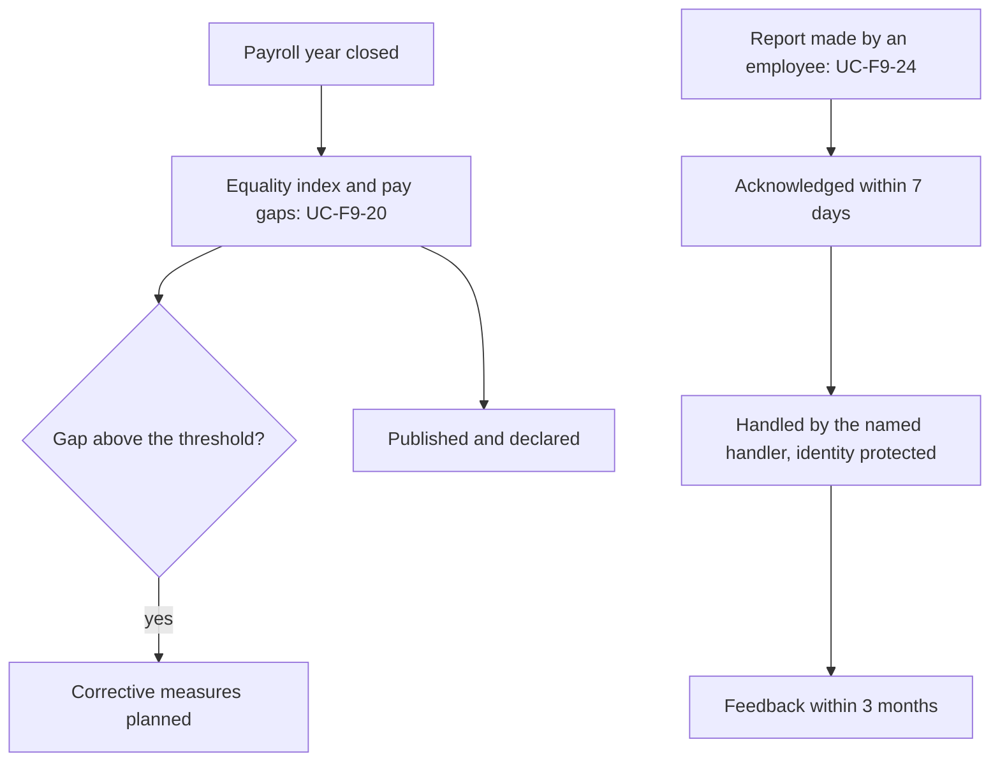

🏠 [Specs](../../../README.md) › 🧩 [Functional capabilities](../../README.md) › 👥 [F9 HR and projects](../README.md) ›
🔀 [Flows](README.md) › 🔀 FL-F9-07 Fair pay and speaking up

# 🔀 FL-F9-07 Fair pay and speaking up

**Status:** ✅ specified

## Summary

The equality index and pay-transparency information computed from payroll and published, and a whistleblowing channel
where reports are received, protected and followed.

## Personas

- [U01 Employee](../../../01-users/personas/u01-employee.md)
- [U06 Human resources](../../../01-users/personas/u06-hr.md)
- [U13 Owner](../../../01-users/personas/u13-owner.md)

## Flowchart

## Sequence diagram

- [UC-F9-24 Receive and handle a whistleblowing report](../use-cases/07-fair-pay-and-speaking-up/uc-f09-24-receive-and-handle-a-whistleblowing-report.md#sequence-diagram)

## Steps

| Step | Persona | Screen | Use case | What happens |
|---|---|---|---|---|
| 1 | [U06](../../../01-users/personas/u06-hr.md) | [S-F9-20](../screens/07-fair-pay-and-speaking-up/s-f09-20-equality-and-pay-transparency.md) | [UC-F9-20](../use-cases/07-fair-pay-and-speaking-up/uc-f09-20-publish-the-equality-index-and-pay-transparency-information.md) | Compute the equality index and pay gaps |
| 2 | [U13](../../../01-users/personas/u13-owner.md) | [S-F9-20](../screens/07-fair-pay-and-speaking-up/s-f09-20-equality-and-pay-transparency.md) | [UC-F9-20](../use-cases/07-fair-pay-and-speaking-up/uc-f09-20-publish-the-equality-index-and-pay-transparency-information.md) | Publish the index and plan measures |
| 3 | [U01](../../../01-users/personas/u01-employee.md) | [S-F9-21](../screens/07-fair-pay-and-speaking-up/s-f09-21-whistleblowing.md) | [UC-F9-24](../use-cases/07-fair-pay-and-speaking-up/uc-f09-24-receive-and-handle-a-whistleblowing-report.md) | Make a whistleblowing report |
| 4 | [U06](../../../01-users/personas/u06-hr.md) | [S-F9-21](../screens/07-fair-pay-and-speaking-up/s-f09-21-whistleblowing.md) | [UC-F9-24](../use-cases/07-fair-pay-and-speaking-up/uc-f09-24-receive-and-handle-a-whistleblowing-report.md) | Acknowledge, handle and give feedback |

### Entities and screens

| Entity | States in this flow | Shown at step and screen | Aggregated view |
|---|---|---|---|
| [E-F13-06 Pay run](../../f13-payroll/data/e-f13-06-pay-run.md) | Recorded | Shown elsewhere: [S-F13-07 Pay run](../../f13-payroll/screens/02-monthly-pay-run/s-f13-07-pay-run.md) | Pay runs |
| [E-F9-20 Equality index](../data/e-f09-20-equality-index.md) | Draft, Published | 1, 2 [S-F9-20](../screens/07-fair-pay-and-speaking-up/s-f09-20-equality-and-pay-transparency.md) | Equality indexes |
| [E-F9-21 Whistleblowing report](../data/e-f09-21-whistleblowing-report.md) | Received, Acknowledged, Closed | 3, 4 [S-F9-21](../screens/07-fair-pay-and-speaking-up/s-f09-21-whistleblowing.md) | Whistleblowing reports |

## Errors

Too few employees in a category, a report's identity requested by someone else, a feedback date missed (BR-F9-14,
BR-F9-15).

## Images

Every step and error, for each persona taking part, in light and dark mode (D120). Steps are numbered as in the Steps
table; E rows are the error cases.

| Step | Persona | Device | Light | Dark |
|---|---|---|---|---|
| 1 | U06 | desktop | [light](../images/07-fair-pay-and-speaking-up/u06-hr/1-equality-and-pay-transparency-desktop-light.png) | [dark](../images/07-fair-pay-and-speaking-up/u06-hr/1-equality-and-pay-transparency-desktop-dark.png) |
| 2 | U13 | desktop | [light](../images/07-fair-pay-and-speaking-up/u13-owner/2-equality-and-pay-transparency-desktop-light.png) | [dark](../images/07-fair-pay-and-speaking-up/u13-owner/2-equality-and-pay-transparency-desktop-dark.png) |
| 2 | U13 | phone | [light](../images/07-fair-pay-and-speaking-up/u13-owner/2-equality-and-pay-transparency-phone-light.png) | [dark](../images/07-fair-pay-and-speaking-up/u13-owner/2-equality-and-pay-transparency-phone-dark.png) |
| 3 | U01 | desktop | [light](../images/07-fair-pay-and-speaking-up/u01-employee/3-whistleblowing-desktop-light.png) | [dark](../images/07-fair-pay-and-speaking-up/u01-employee/3-whistleblowing-desktop-dark.png) |
| 3 | U01 | phone | [light](../images/07-fair-pay-and-speaking-up/u01-employee/3-whistleblowing-phone-light.png) | [dark](../images/07-fair-pay-and-speaking-up/u01-employee/3-whistleblowing-phone-dark.png) |
| 4 | U06 | desktop | [light](../images/07-fair-pay-and-speaking-up/u06-hr/4-whistleblowing-desktop-light.png) | [dark](../images/07-fair-pay-and-speaking-up/u06-hr/4-whistleblowing-desktop-dark.png) |
| E1 | U06 | desktop | [light](../images/07-fair-pay-and-speaking-up/u06-hr/e1-equality-and-pay-transparency-refused-desktop-light.png) | [dark](../images/07-fair-pay-and-speaking-up/u06-hr/e1-equality-and-pay-transparency-refused-desktop-dark.png) |

## Open questions

None.

---

⬅️ [FL-F9-06 Plan and deliver work](fl-f09-06-plan-and-deliver-work.md) · ⬆️ [Up](README.md) ·
➡️ [FL-F9-08 HR duties](fl-f09-08-hr-duties.md)
