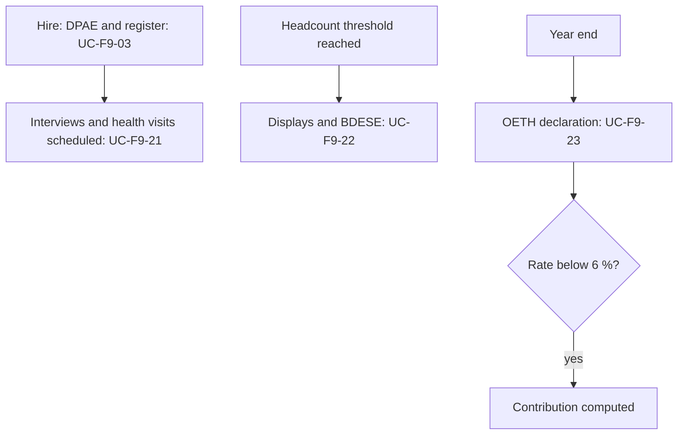

🏠 [Specs](../../../README.md) › 🧩 [Functional capabilities](../../README.md) › 👥 [F9 HR and projects](../README.md) ›
🔀 [Flows](README.md) › 🔀 FL-F9-08 HR duties

# 🔀 FL-F9-08 HR duties

**Status:** ✅ specified

## Summary

UC-F9-03 split per duty: hires declared and the register kept, professional interviews and health visits scheduled,
displays and the BDESE kept current, and disability employment declared.

## Personas

- [U06 Human resources](../../../01-users/personas/u06-hr.md)
- [U45 Payroll officer](../../../01-users/personas/u45-payroll-officer.md)

## Flowchart

## Sequence diagram

- [UC-F9-21 Schedule professional interviews and health visits](../use-cases/08-hr-duties/uc-f09-21-schedule-professional-interviews-and-health-visits.md#sequence-diagram)

## Steps

| Step | Persona | Screen | Use case | What happens |
|---|---|---|---|---|
| 1 | [U06](../../../01-users/personas/u06-hr.md) | [S-F9-03](../screens/01-people/s-f09-03-hr-duties.md) | [UC-F9-03](../use-cases/01-people/uc-f09-03-comply-with-french-hr-duties.md) | Declare a hire and update the register |
| 2 | [U06](../../../01-users/personas/u06-hr.md) | [S-F9-03](../screens/01-people/s-f09-03-hr-duties.md) | [UC-F9-21](../use-cases/08-hr-duties/uc-f09-21-schedule-professional-interviews-and-health-visits.md) | Schedule professional interviews and health visits |
| 3 | [U06](../../../01-users/personas/u06-hr.md) | [S-F9-03](../screens/01-people/s-f09-03-hr-duties.md) | [UC-F9-22](../use-cases/08-hr-duties/uc-f09-22-keep-the-displays-and-the-bdese-current.md) | Keep the displays and the BDESE current |
| 4 | [U45](../../../01-users/personas/u45-payroll-officer.md) | [S-F9-03](../screens/01-people/s-f09-03-hr-duties.md) | [UC-F9-23](../use-cases/08-hr-duties/uc-f09-23-declare-disability-employment.md) | Declare disability employment |

### Entities and screens

| Entity | States in this flow | Shown at step and screen | Aggregated view |
|---|---|---|---|
| [E-F9-41 Pre-hiring declaration (DPAE)](../data/e-f09-41-pre-hiring-declaration-dpae.md) | Active | 1, 2, 3, 4 [S-F9-03](../screens/01-people/s-f09-03-hr-duties.md) | Pre-hiring declaration (DPAE)s |
| [E-F15-04 Standard register entry](../../f15-legal-assistant/data/e-f15-04-standard-register-entry.md) | Open | Shown elsewhere: [S-F15-06 Standards register](../../f15-legal-assistant/screens/04-set-up-the-legal-assistant/s-f15-06-standards-register.md) | Standard register entries |
| [E-F9-05 HR duty](../data/e-f09-05-hr-duty.md) | Due, Done, Late | 1, 2, 3, 4 [S-F9-03](../screens/01-people/s-f09-03-hr-duties.md) | HR duties |
| [E-F8-10 Fiscal period](../../f08-accounting/data/e-f08-10-fiscal-period.md) | Active | Shown elsewhere: [S-F8-01 Books setup](../../f08-accounting/screens/01-set-up-and-post/s-f08-01-books-setup.md) | Fiscal periods |
| [E-F13-09 Social declaration](../../f13-payroll/data/e-f13-09-social-declaration.md) | Accepted, Filed, Late, Rejected, Returned | Shown elsewhere: [S-F13-10 Social declaration](../../f13-payroll/screens/03-declarations-and-payments/s-f13-10-social-declaration.md) | Social declarations |
| [E-F13-11 Contribution payment](../../f13-payroll/data/e-f13-11-contribution-payment.md) | Active | Shown elsewhere: [S-F13-12 Contributions](../../f13-payroll/screens/03-declarations-and-payments/s-f13-12-contributions.md) | Contribution payments |

## Errors

A DPAE refused, an interview overdue, a display missing, a recognition expired (BR-F9-03, BR-F9-04, BR-F9-16).

## Images

Every step and error, for each persona taking part, in light and dark mode (D120). Steps are numbered as in the Steps
table; E rows are the error cases.

| Step | Persona | Device | Light | Dark |
|---|---|---|---|---|
| 1 | U06 | desktop | [light](../images/08-hr-duties/u06-hr/1-hr-duties-desktop-light.png) | [dark](../images/08-hr-duties/u06-hr/1-hr-duties-desktop-dark.png) |
| 2 | U06 | desktop | [light](../images/08-hr-duties/u06-hr/2-hr-duties-desktop-light.png) | [dark](../images/08-hr-duties/u06-hr/2-hr-duties-desktop-dark.png) |
| 3 | U06 | desktop | [light](../images/08-hr-duties/u06-hr/3-hr-duties-desktop-light.png) | [dark](../images/08-hr-duties/u06-hr/3-hr-duties-desktop-dark.png) |
| 4 | U45 | desktop | [light](../images/08-hr-duties/u45-payroll-officer/4-hr-duties-desktop-light.png) | [dark](../images/08-hr-duties/u45-payroll-officer/4-hr-duties-desktop-dark.png) |
| E1 | U06 | desktop | [light](../images/08-hr-duties/u06-hr/e1-hr-duties-refused-desktop-light.png) | [dark](../images/08-hr-duties/u06-hr/e1-hr-duties-refused-desktop-dark.png) |

## Open questions

None.

---

⬅️ [FL-F9-07 Fair pay and speaking up](fl-f09-07-fair-pay-and-speaking-up.md) · ⬆️ [Up](README.md) ·
➡️ [FL-F9-09 Train and protect](fl-f09-09-train-and-protect.md)
