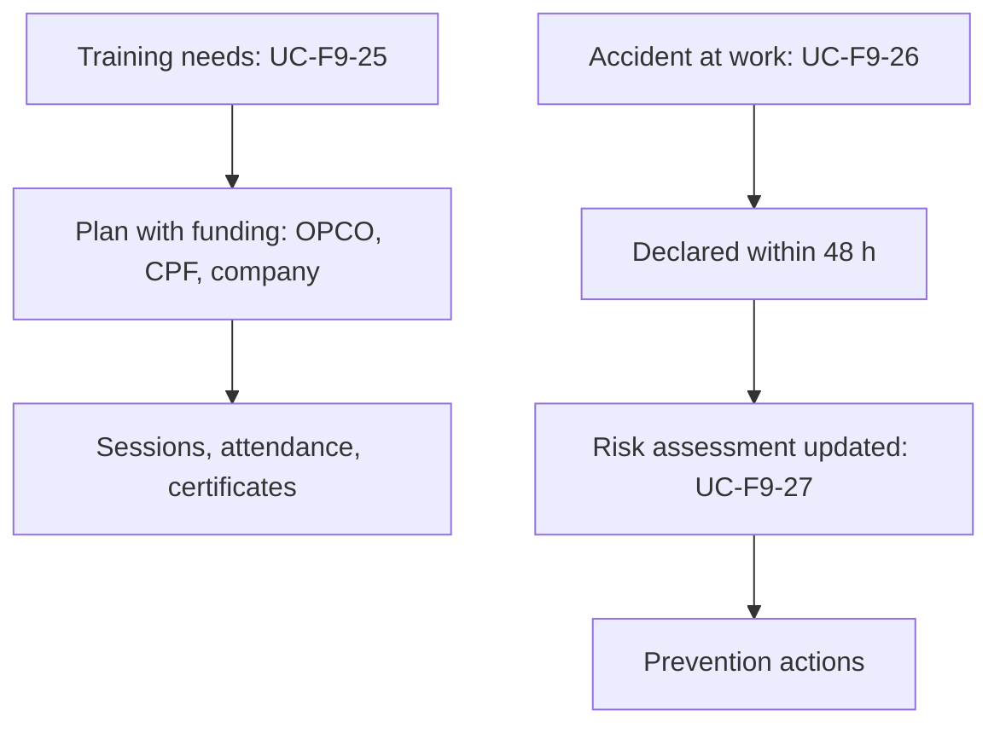

🏠 [Specs](../../../README.md) › 🧩 [Functional capabilities](../../README.md) › 👥 [F9 HR and projects](../README.md) ›
🔀 [Flows](README.md) › 🔀 FL-F9-09 Train and protect

# 🔀 FL-F9-09 Train and protect

**Status:** ✅ specified

## Summary

The training plan with mandatory trainings and OPCO funding, work accidents declared within 48 hours, and the
occupational risk assessment kept for every employer.

## Personas

- [U02 Manager](../../../01-users/personas/u02-manager.md)
- [U06 Human resources](../../../01-users/personas/u06-hr.md)
- [U13 Owner](../../../01-users/personas/u13-owner.md)

## Flowchart

## Sequence diagram

- [UC-F9-26 Declare a work accident](../use-cases/09-train-and-protect/uc-f09-26-declare-a-work-accident.md#sequence-diagram)

## Steps

| Step | Persona | Screen | Use case | What happens |
|---|---|---|---|---|
| 1 | [U06](../../../01-users/personas/u06-hr.md) | [S-F9-22](../screens/09-train-and-protect/s-f09-22-training-plan.md) | [UC-F9-25](../use-cases/09-train-and-protect/uc-f09-25-run-the-training-plan-with-opco-funding.md) | Build the training plan and request OPCO funding |
| 2 | [U02](../../../01-users/personas/u02-manager.md) | [S-F9-23](../screens/09-train-and-protect/s-f09-23-work-accident.md) | [UC-F9-26](../use-cases/09-train-and-protect/uc-f09-26-declare-a-work-accident.md) | Report a work accident |
| 3 | [U06](../../../01-users/personas/u06-hr.md) | [S-F9-23](../screens/09-train-and-protect/s-f09-23-work-accident.md) | [UC-F9-26](../use-cases/09-train-and-protect/uc-f09-26-declare-a-work-accident.md) | Declare it within 48 hours |
| 4 | [U13](../../../01-users/personas/u13-owner.md) | [S-F9-24](../screens/09-train-and-protect/s-f09-24-risk-assessment.md) | [UC-F9-27](../use-cases/09-train-and-protect/uc-f09-27-keep-the-occupational-risk-assessment.md) | Update the risk assessment |

### Entities and screens

| Entity | States in this flow | Shown at step and screen | Aggregated view |
|---|---|---|---|
| [E-SC12-05 Training funding](../../../08-sectors/sc12-education-and-training/data/e-sc12-05-training-funding.md) | Requested, Granted, Refused | Shown elsewhere: [S-SC12-04 Funding](../../../08-sectors/sc12-education-and-training/screens/02-enrol-and-fund/s-sc12-04-funding.md) | Training fundings |
| [E-F1-01 Company](../../f01-administration/data/e-f01-01-company.md) | In setup, Active | Shown elsewhere: [S-F1-10 Client companies](../../f01-administration/screens/08-provider-and-client-companies/s-f01-10-client-companies.md) | Companies |
| [E-F9-22 Training session](../data/e-f09-22-training-session.md) | Planned, Closed, Held | 1 [S-F9-22](../screens/09-train-and-protect/s-f09-22-training-plan.md) | Training sessions |
| [E-F9-10 Attendance](../data/e-f09-10-attendance.md) | Active | Shown elsewhere: [S-F9-10 Attendance](../screens/03-time/s-f09-10-attendance.md) | Attendances |
| [E-F9-12 Qualification](../data/e-f09-12-certification.md) | To verify, Verified, Expired | 1 [S-F9-22](../screens/09-train-and-protect/s-f09-22-training-plan.md) | Certifications |
| [E-F9-23 Work accident](../data/e-f09-23-work-accident.md) | Active, Closed | 2, 3 [S-F9-23](../screens/09-train-and-protect/s-f09-23-work-accident.md) | Work accidents |
| [E-F12-26 Risk assessment](../../f12-manufacturing/data/e-f12-26-risk-assessment.md) | Active | Shown elsewhere: [S-F12-17 Safety registers](../../f12-manufacturing/screens/07-compliance-and-safety/s-f12-17-safety-registers.md) | Risk assessments |
| [E-SC05-09 Quality action](../../../08-sectors/sc05-manufacturing/data/e-sc05-09-quality-action.md) | Open, Done, Effective | Shown elsewhere: [S-SC05-09 Actions](../../../08-sectors/sc05-manufacturing/screens/04-quality-system/s-sc05-09-actions.md) | Quality actions |

## Errors

A mandatory training expired, a declaration late, a risk assessment more than a year old (BR-F9-17 to BR-F9-19).

## Images

Every step and error, for each persona taking part, in light and dark mode (D120). Steps are numbered as in the Steps
table; E rows are the error cases.

| Step | Persona | Device | Light | Dark |
|---|---|---|---|---|
| 1 | U06 | desktop | [light](../images/09-train-and-protect/u06-hr/1-training-plan-desktop-light.png) | [dark](../images/09-train-and-protect/u06-hr/1-training-plan-desktop-dark.png) |
| 2 | U02 | desktop | [light](../images/09-train-and-protect/u02-manager/2-work-accident-desktop-light.png) | [dark](../images/09-train-and-protect/u02-manager/2-work-accident-desktop-dark.png) |
| 2 | U02 | phone | [light](../images/09-train-and-protect/u02-manager/2-work-accident-phone-light.png) | [dark](../images/09-train-and-protect/u02-manager/2-work-accident-phone-dark.png) |
| 3 | U06 | desktop | [light](../images/09-train-and-protect/u06-hr/3-work-accident-desktop-light.png) | [dark](../images/09-train-and-protect/u06-hr/3-work-accident-desktop-dark.png) |
| 4 | U13 | desktop | [light](../images/09-train-and-protect/u13-owner/4-risk-assessment-desktop-light.png) | [dark](../images/09-train-and-protect/u13-owner/4-risk-assessment-desktop-dark.png) |
| 4 | U13 | phone | [light](../images/09-train-and-protect/u13-owner/4-risk-assessment-phone-light.png) | [dark](../images/09-train-and-protect/u13-owner/4-risk-assessment-phone-dark.png) |
| E1 | U06 | desktop | [light](../images/09-train-and-protect/u06-hr/e1-training-plan-refused-desktop-light.png) | [dark](../images/09-train-and-protect/u06-hr/e1-training-plan-refused-desktop-dark.png) |

## Open questions

None.

---

⬅️ [FL-F9-08 HR duties](fl-f09-08-hr-duties.md) · ⬆️ [Up](README.md) ·
➡️ [FL-F9-10 Listen to employees](fl-f09-10-listen-to-employees.md)
