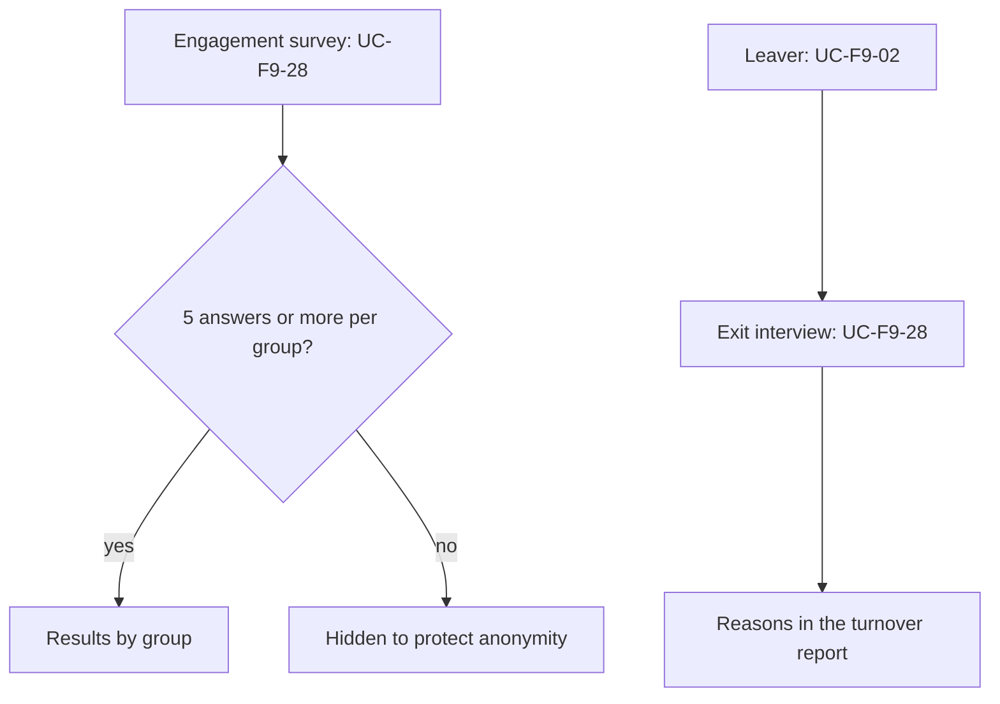

🏠 [Specs](../../../README.md) › 🧩 [Functional capabilities](../../README.md) › 👥 [F9 HR and projects](../README.md) ›
🔀 [Flows](README.md) › 🔀 FL-F9-10 Listen to employees

# 🔀 FL-F9-10 Listen to employees

**Status:** ✅ specified

## Summary

Engagement surveys and exit interviews explain the turnover figure.

## Personas

- [U01 Employee](../../../01-users/personas/u01-employee.md)
- [U06 Human resources](../../../01-users/personas/u06-hr.md)

## Flowchart

## Sequence diagram

- [UC-F9-28 Run engagement surveys and exit interviews](../use-cases/10-listen-to-employees/uc-f09-28-run-engagement-surveys-and-exit-interviews.md#sequence-diagram)

## Steps

| Step | Persona | Screen | Use case | What happens |
|---|---|---|---|---|
| 1 | [U06](../../../01-users/personas/u06-hr.md) | [S-F9-25](../screens/10-listen-to-employees/s-f09-25-surveys-and-exit-interviews.md) | [UC-F9-28](../use-cases/10-listen-to-employees/uc-f09-28-run-engagement-surveys-and-exit-interviews.md) | Send an engagement survey |
| 2 | [U01](../../../01-users/personas/u01-employee.md) | [S-F9-25](../screens/10-listen-to-employees/s-f09-25-surveys-and-exit-interviews.md) | [UC-F9-28](../use-cases/10-listen-to-employees/uc-f09-28-run-engagement-surveys-and-exit-interviews.md) | Answer anonymously |
| 3 | [U06](../../../01-users/personas/u06-hr.md) | [S-F9-25](../screens/10-listen-to-employees/s-f09-25-surveys-and-exit-interviews.md) | [UC-F9-28](../use-cases/10-listen-to-employees/uc-f09-28-run-engagement-surveys-and-exit-interviews.md) | Hold an exit interview and read the reasons |

### Entities and screens

| Entity | States in this flow | Shown at step and screen | Aggregated view |
|---|---|---|---|
| [E-F5-08 Survey](../../f05-social-media/data/e-f05-08-survey.md) | Draft, Sent, Closed | 1, 2, 3 [S-F9-25](../screens/10-listen-to-employees/s-f09-25-surveys-and-exit-interviews.md) | Surveys |
| [E-F4-01 Meeting](../../f04-meetings/data/e-f04-01-meeting.md) | Planned, Live, Ended, Waiting for review, Checked | Shown elsewhere: [S-F4-01 Meeting](../../f04-meetings/screens/01-record-an-online-meeting/s-f04-01-meeting.md) | Meetings |

## Errors

A group too small to show results, a leaver declining the interview (BR-F9-20).

## Images

Every step and error, for each persona taking part, in light and dark mode (D120). Steps are numbered as in the Steps
table; E rows are the error cases.

| Step | Persona | Device | Light | Dark |
|---|---|---|---|---|
| 1 | U06 | desktop | [light](../images/10-listen-to-employees/u06-hr/1-surveys-and-exit-interviews-desktop-light.png) | [dark](../images/10-listen-to-employees/u06-hr/1-surveys-and-exit-interviews-desktop-dark.png) |
| 2 | U01 | desktop | [light](../images/10-listen-to-employees/u01-employee/2-surveys-and-exit-interviews-desktop-light.png) | [dark](../images/10-listen-to-employees/u01-employee/2-surveys-and-exit-interviews-desktop-dark.png) |
| 2 | U01 | phone | [light](../images/10-listen-to-employees/u01-employee/2-surveys-and-exit-interviews-phone-light.png) | [dark](../images/10-listen-to-employees/u01-employee/2-surveys-and-exit-interviews-phone-dark.png) |
| 3 | U06 | desktop | [light](../images/10-listen-to-employees/u06-hr/3-surveys-and-exit-interviews-desktop-light.png) | [dark](../images/10-listen-to-employees/u06-hr/3-surveys-and-exit-interviews-desktop-dark.png) |
| E1 | U06 | desktop | [light](../images/10-listen-to-employees/u06-hr/e1-surveys-and-exit-interviews-refused-desktop-light.png) | [dark](../images/10-listen-to-employees/u06-hr/e1-surveys-and-exit-interviews-refused-desktop-dark.png) |

## Open questions

None.

---

⬅️ [FL-F9-09 Train and protect](fl-f09-09-train-and-protect.md) · ⬆️ [Up](README.md) ·
➡️ [FL-F9-11 Capacity, rounds and partners](fl-f09-11-capacity-rounds-and-partners.md)
