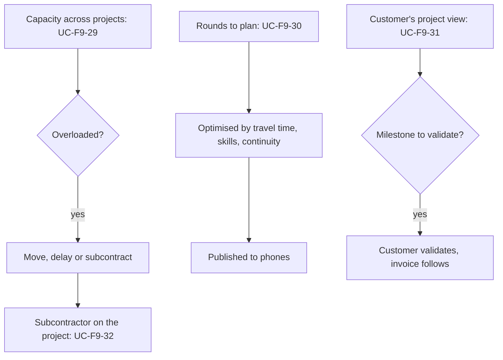

🏠 [Specs](../../../README.md) › 🧩 [Functional capabilities](../../README.md) › 👥 [F9 HR and projects](../README.md) ›
🔀 [Flows](README.md) › 🔀 FL-F9-11 Capacity, rounds and partners

# 🔀 FL-F9-11 Capacity, rounds and partners

**Status:** ✅ specified

## Summary

Who works on what: capacity across projects, rounds and routes optimised for field staff, the customer's view of their
project, and subcontractors and freelancers on projects.

The rounds and the route optimiser of this flow also place the work requests scheduled by
[FL-F9-12 Schedule customer requests](fl-f09-12-schedule-customer-requests.md).

## Personas

- [U02 Manager](../../../01-users/personas/u02-manager.md)
- [U09 Customer](../../../01-users/personas/u09-customer.md)
- [U24 Engagement manager](../../../01-users/personas/u24-engagement-manager.md)
- [U25 Care coordinator](../../../01-users/personas/u25-care-coordinator.md)

## Flowchart

## Sequence diagram

- [UC-F9-30 Plan rounds and optimise routes](../use-cases/11-capacity-rounds-and-partners/uc-f09-30-plan-rounds-and-optimise-routes.md#sequence-diagram)

## Steps

| Step | Persona | Screen | Use case | What happens |
|---|---|---|---|---|
| 1 | [U24](../../../01-users/personas/u24-engagement-manager.md) | [S-F9-26](../screens/11-capacity-rounds-and-partners/s-f09-26-capacity-planning.md) | [UC-F9-29](../use-cases/11-capacity-rounds-and-partners/uc-f09-29-plan-capacity-across-projects.md) | Read capacity across projects and rebalance |
| 2 | [U25](../../../01-users/personas/u25-care-coordinator.md) | [S-F9-27](../screens/11-capacity-rounds-and-partners/s-f09-27-rounds.md) | [UC-F9-30](../use-cases/11-capacity-rounds-and-partners/uc-f09-30-plan-rounds-and-optimise-routes.md) | Plan the week's rounds and optimise routes |
| 3 | [U09](../../../01-users/personas/u09-customer.md) | [S-F9-28](../screens/11-capacity-rounds-and-partners/s-f09-28-customer-project-view.md) | [UC-F9-31](../use-cases/11-capacity-rounds-and-partners/uc-f09-31-follow-a-project-as-a-customer.md) | The customer follows the project and validates a milestone |
| 4 | [U02](../../../01-users/personas/u02-manager.md) | [S-F9-29](../screens/11-capacity-rounds-and-partners/s-f09-29-subcontractors.md) | [UC-F9-32](../use-cases/11-capacity-rounds-and-partners/uc-f09-32-work-with-subcontractors-and-freelancers-on-projects.md) | Add a subcontractor to a project |

### Entities and screens

| Entity | States in this flow | Shown at step and screen | Aggregated view |
|---|---|---|---|
| [E-F9-18 Project and task](../data/e-f09-18-project-and-task.md) | New, Planned | 1 [S-F9-26](../screens/11-capacity-rounds-and-partners/s-f09-26-capacity-planning.md); 3 [S-F9-28](../screens/11-capacity-rounds-and-partners/s-f09-28-customer-project-view.md); 4 [S-F9-29](../screens/11-capacity-rounds-and-partners/s-f09-29-subcontractors.md) | Project and tasks |
| [E-F9-26 Round](../data/e-f09-26-round.md) | Draft, Published | 2 [S-F9-27](../screens/11-capacity-rounds-and-partners/s-f09-27-rounds.md) | Rounds |
| [E-F13-03 Pay input](../../f13-payroll/data/e-f13-03-pay-input.md) | Open, Complete, Late, Closed | Shown elsewhere: [S-F13-03 Pay inputs](../../f13-payroll/screens/02-monthly-pay-run/s-f13-03-pay-inputs.md) | Pay inputs |
| [E-F9-12 Qualification](../data/e-f09-12-certification.md) | To verify, Verified, Rejected, Expired | 2 [S-F9-27](../screens/11-capacity-rounds-and-partners/s-f09-27-rounds.md) | Certifications |
| [E-F1-17 Portal account](../../f01-administration/data/e-f01-17-portal-account.md) | Invited, Active, Blocked, Deactivated | Shown elsewhere: [S-F1-19 Portal accounts](../../f01-administration/screens/12-portal-accounts-and-integrations/s-f01-19-portal-accounts.md) | Portal accounts |
| [E-SC03-08 Milestone](../../../08-sectors/sc03-services/data/e-sc03-08-milestone.md) | Planned | Shown elsewhere: [S-SC03-07 Milestones](../../../08-sectors/sc03-services/screens/04-bill-and-recognise/s-sc03-07-milestones.md) | Milestones |
| [E-F6-05 Invoice](../../f06-customers-and-sales/data/e-f06-05-invoice.md) | Sent, Received, Refused, Paid, Draft, Issued, Partly paid, Overdue | Shown elsewhere: [S-F6-06 Invoice](../../f06-customers-and-sales/screens/03-invoice-and-get-paid/s-f06-06-invoice.md) | Invoices |

## Errors

A person planned beyond their hours, a visit no carer can reach in time, a subcontractor without its vigilance documents
(BR-F9-21 to BR-F9-24).

## Images

Every step and error, for each persona taking part, in light and dark mode (D120). Steps are numbered as in the Steps
table; E rows are the error cases.

| Step | Persona | Device | Light | Dark |
|---|---|---|---|---|
| 1 | U24 | desktop | [light](../images/11-capacity-rounds-and-partners/u24-engagement-manager/1-capacity-planning-desktop-light.png) | [dark](../images/11-capacity-rounds-and-partners/u24-engagement-manager/1-capacity-planning-desktop-dark.png) |
| 1 | U24 | phone | [light](../images/11-capacity-rounds-and-partners/u24-engagement-manager/1-capacity-planning-phone-light.png) | [dark](../images/11-capacity-rounds-and-partners/u24-engagement-manager/1-capacity-planning-phone-dark.png) |
| 2 | U25 | desktop | [light](../images/11-capacity-rounds-and-partners/u25-care-coordinator/2-rounds-desktop-light.png) | [dark](../images/11-capacity-rounds-and-partners/u25-care-coordinator/2-rounds-desktop-dark.png) |
| 2 | U25 | phone | [light](../images/11-capacity-rounds-and-partners/u25-care-coordinator/2-rounds-phone-light.png) | [dark](../images/11-capacity-rounds-and-partners/u25-care-coordinator/2-rounds-phone-dark.png) |
| 3 | U09 | phone | [light](../images/11-capacity-rounds-and-partners/u09-customer/3-customer-project-view-phone-light.png) | [dark](../images/11-capacity-rounds-and-partners/u09-customer/3-customer-project-view-phone-dark.png) |
| 4 | U02 | desktop | [light](../images/11-capacity-rounds-and-partners/u02-manager/4-subcontractors-desktop-light.png) | [dark](../images/11-capacity-rounds-and-partners/u02-manager/4-subcontractors-desktop-dark.png) |
| 4 | U02 | phone | [light](../images/11-capacity-rounds-and-partners/u02-manager/4-subcontractors-phone-light.png) | [dark](../images/11-capacity-rounds-and-partners/u02-manager/4-subcontractors-phone-dark.png) |
| E1 | U24 | desktop | [light](../images/11-capacity-rounds-and-partners/u24-engagement-manager/e1-capacity-planning-refused-desktop-light.png) | [dark](../images/11-capacity-rounds-and-partners/u24-engagement-manager/e1-capacity-planning-refused-desktop-dark.png) |
| E1 | U24 | phone | [light](../images/11-capacity-rounds-and-partners/u24-engagement-manager/e1-capacity-planning-refused-phone-light.png) | [dark](../images/11-capacity-rounds-and-partners/u24-engagement-manager/e1-capacity-planning-refused-phone-dark.png) |

## Open questions

None.

---

⬅️ [FL-F9-10 Listen to employees](fl-f09-10-listen-to-employees.md) · ⬆️ [Up](README.md) ·
➡️ [FL-F9-12 Schedule customer requests](fl-f09-12-schedule-customer-requests.md)
