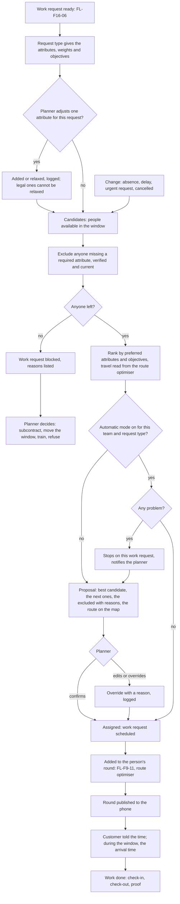
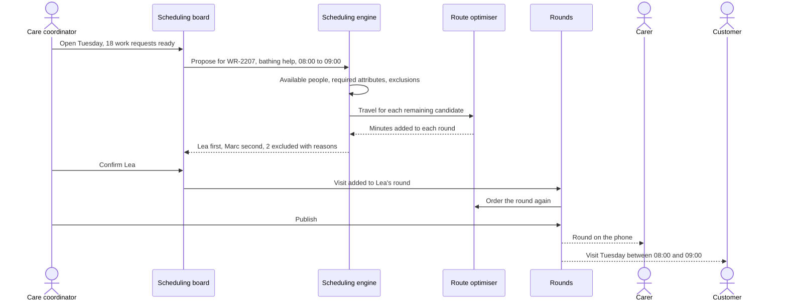

🏠 [Specs](../../../README.md) › 🧩 [Functional capabilities](../../README.md) › 👥 [F9 HR and projects](../README.md) ›
🔀 [Flows](README.md) › 🔀 FL-F9-12 Schedule customer requests

# 🔀 FL-F9-12 Schedule customer requests

**Status:** ✅ specified, ⚖️ lawyer review before launch (D574)

## Summary

Every customer request, once it is a work request
([FL-F16-06](../../f16-customer-support-agents/flows/fl-f16-06-take-in-every-request.md)), is given to an eligible
person. The scheduling engine keeps the people available in the window, excludes anyone missing a required attribute,
ranks the others by the preferred attributes and the objectives, and proposes. The planner confirms, edits or
overrides; a fully automatic mode, enabled by hand, assigns on its own and stops at the first problem.

The flow builds on the rounds of [FL-F9-11](fl-f09-11-capacity-rounds-and-partners.md): a confirmed assignment with a
place joins the person's round ([E-F9-26 Round](../data/e-f09-26-round.md)), which the route optimiser of
[BR-F9-22](../business-rules/br-f09-22-rounds-respect-travel-skills-continuity-and-working-time.md) orders, and the
planner publishes it on [S-F9-27 Rounds](../screens/11-capacity-rounds-and-partners/s-f09-27-rounds.md) as before. The
engine reads its travel times from that optimiser; it does not compute a second set of routes.

## Personas

- [U25 Care coordinator](../../../01-users/personas/u25-care-coordinator.md), as a planner (D517)
- [U29 Dispatcher](../../../01-users/personas/u29-dispatcher.md), as a planner (D517)
- [U02 Manager](../../../01-users/personas/u02-manager.md), the planners' manager
- [U07 Administrator](../../../01-users/personas/u07-administrator.md), who may enable the automatic mode (D517)
- [U26 Carer](../../../01-users/personas/u26-carer.md), [U30 Driver](../../../01-users/personas/u30-driver.md) and
  [U14 Field worker](../../../01-users/personas/u14-field-worker.md), who do the work
- [U09 Customer](../../../01-users/personas/u09-customer.md), who is told the time and the arrival time

## Flowchart

The problems that stop the automatic mode are listed in
[BR-F9-33](../business-rules/br-f09-33-automatic-mode-stops-on-a-problem.md): no candidate, a legal conflict, a window
missed, a cost over the limit, an overlap.

## Sequence diagram

## Steps

| Step | Persona | Screen | Use case | What happens |
|---|---|---|---|---|
| 1 | [U29](../../../01-users/personas/u29-dispatcher.md) | [S-F16-14](../../f16-customer-support-agents/screens/06-take-in-every-request/s-f16-14-work-requests.md) | [UC-F9-33](../use-cases/12-schedule-customer-requests/uc-f09-33-schedule-a-work-request.md) | The planner opens the ready work requests, as a list or on the map |
| 2 | [U25](../../../01-users/personas/u25-care-coordinator.md) | [S-F9-30](../screens/12-schedule-customer-requests/s-f09-30-scheduling-board.md) | [UC-F9-33](../use-cases/12-schedule-customer-requests/uc-f09-33-schedule-a-work-request.md) | People by day, the work assigned and the proposals waiting; the engine proposes |
| 3 | [U25](../../../01-users/personas/u25-care-coordinator.md) | [S-F9-31](../screens/12-schedule-customer-requests/s-f09-31-proposal-review.md) | [UC-F9-33](../use-cases/12-schedule-customer-requests/uc-f09-33-schedule-a-work-request.md) | The planner confirms, edits or overrides with a reason |
| 4 | [U25](../../../01-users/personas/u25-care-coordinator.md) | [S-F9-27](../screens/11-capacity-rounds-and-partners/s-f09-27-rounds.md) | [UC-F9-30](../use-cases/11-capacity-rounds-and-partners/uc-f09-30-plan-rounds-and-optimise-routes.md) | The assignment joins the person's round; the round is ordered and published (FL-F9-11 step 2) |
| 5 | [U02](../../../01-users/personas/u02-manager.md) | [S-F9-32](../screens/12-schedule-customer-requests/s-f09-32-automatic-scheduling-settings.md) | [UC-F9-34](../use-cases/12-schedule-customer-requests/uc-f09-34-run-the-automatic-scheduling.md) | The planners' manager enables the automatic mode for a team and request types |
| 6 | [U29](../../../01-users/personas/u29-dispatcher.md) | [S-F9-30](../screens/12-schedule-customer-requests/s-f09-30-scheduling-board.md) | [UC-F9-34](../use-cases/12-schedule-customer-requests/uc-f09-34-run-the-automatic-scheduling.md) | The engine assigns on its own; at a problem it stops and the planner is notified |
| 7 | [U25](../../../01-users/personas/u25-care-coordinator.md) | [S-F9-30](../screens/12-schedule-customer-requests/s-f09-30-scheduling-board.md) | [UC-F9-35](../use-cases/12-schedule-customer-requests/uc-f09-35-re-plan-after-a-change.md) | An absence, a delay or an urgent request: the work concerned is proposed again |
| 8 | [U02](../../../01-users/personas/u02-manager.md) | [S-F9-33](../screens/12-schedule-customer-requests/s-f09-33-planning-map.md) | [UC-F9-36](../use-cases/12-schedule-customer-requests/uc-f09-36-see-work-and-places-on-a-map.md) | Work, places, routes and the shared positions on the map |
| 9 | [U26](../../../01-users/personas/u26-carer.md) | [S-F9-34](../screens/12-schedule-customer-requests/s-f09-34-my-position.md) | [UC-F9-37](../use-cases/12-schedule-customer-requests/uc-f09-37-share-my-position-during-work.md) | Where the team option is on, the carer sees what is shared, with whom, and pauses it |
| 10 | [U09](../../../01-users/personas/u09-customer.md) | [S-F16-15](../../f16-customer-support-agents/screens/06-take-in-every-request/s-f16-15-arrival-of-your-visit.md) | [UC-F16-17](../../f16-customer-support-agents/use-cases/06-take-in-every-request/uc-f16-17-follow-the-arrival-of-a-visit.md) | The customer sees the time window, then the arrival time during the window |
| 11 | [U14](../../../01-users/personas/u14-field-worker.md) | [S-F9-18](../screens/06-plan-and-deliver-work/s-f09-18-field-service.md) | [UC-F9-18](../use-cases/06-plan-and-deliver-work/uc-f09-18-run-field-service.md) | Check-in, the work, check-out and proof; the work request is done |

### Entities and screens

| Entity | States in this flow | Shown at step and screen | Aggregated view |
|---|---|---|---|
| [E-F16-12 Work request](../../f16-customer-support-agents/data/e-f16-12-work-request.md) | Ready, Proposed, Blocked, Scheduled, In progress, Done, Cancelled | 1 [S-F16-14](../../f16-customer-support-agents/screens/06-take-in-every-request/s-f16-14-work-requests.md); 2, 6, 7 [S-F9-30](../screens/12-schedule-customer-requests/s-f09-30-scheduling-board.md); 3 [S-F9-31](../screens/12-schedule-customer-requests/s-f09-31-proposal-review.md); 11 [S-F9-18](../screens/06-plan-and-deliver-work/s-f09-18-field-service.md) | Work requests |
| [E-F9-28 Assignment proposal](../data/e-f09-28-assignment-proposal.md) | Waiting, No candidate, Applied, Stopped, Confirmed, Overridden, Superseded | 2, 6, 7 [S-F9-30](../screens/12-schedule-customer-requests/s-f09-30-scheduling-board.md); 3 [S-F9-31](../screens/12-schedule-customer-requests/s-f09-31-proposal-review.md) | Assignment proposals |
| [E-F9-33 Automatic scheduling setting](../data/e-f09-33-automatic-scheduling-setting.md) | Off, On | 5 [S-F9-32](../screens/12-schedule-customer-requests/s-f09-32-automatic-scheduling-settings.md); 6 [S-F9-30](../screens/12-schedule-customer-requests/s-f09-30-scheduling-board.md) | Automatic scheduling settings |
| [E-F9-26 Round](../data/e-f09-26-round.md) | Draft, published, changed | 4 [S-F9-27](../screens/11-capacity-rounds-and-partners/s-f09-27-rounds.md); 8 [S-F9-33](../screens/12-schedule-customer-requests/s-f09-33-planning-map.md) | Rounds |
| [E-F9-32 Live position](../data/e-f09-32-live-position.md) | Off, Sharing, Paused | 8 [S-F9-33](../screens/12-schedule-customer-requests/s-f09-33-planning-map.md); 9 [S-F9-34](../screens/12-schedule-customer-requests/s-f09-34-my-position.md); 10 [S-F16-15](../../f16-customer-support-agents/screens/06-take-in-every-request/s-f16-15-arrival-of-your-visit.md) | Live positions |
| [E-F2-25 Request type](../../f02-no-code-configuration/data/e-f02-25-request-type.md) | Published (read only here) | 3 [S-F9-31](../screens/12-schedule-customer-requests/s-f09-31-proposal-review.md) | Request types |

The states are those of the entity drafts; E-F9-26 Round keeps its existing states.

## Errors

- **E1 No eligible person.** Everyone available misses a required attribute: the work request is blocked with the
  reasons ([BR-F9-25](../business-rules/br-f09-25-required-attributes-exclude.md)); the planner subcontracts, moves the
  window, trains someone or refuses (step 3). It is ready again once the window, an attribute or the people change.
- **E2 The automatic mode stops.** A problem of
  [BR-F9-33](../business-rules/br-f09-33-automatic-mode-stops-on-a-problem.md): the engine stops on that work request,
  leaves it as a proposal and notifies the planner, who decides on S-F9-31 (step 3). The setting stays on for the
  other work requests (D517).
- **E3 A legal requirement cannot be relaxed.** The planner tries to relax an attribute the law ties to the task
  ([BR-F9-26](../business-rules/br-f09-26-legal-requirements-never-relaxed.md)): refused with the reason; the request
  keeps it (step 3).
- **E4 No map right.** A user without the map right opens the planning map: the same records show as a list with
  addresses ([BR-F1-32](../../f01-administration/business-rules/br-f01-32-map-right-for-planners-and-managers.md)),
  step 8.
- **E5 The round is beyond working time.** The route optimiser refuses the round
  ([BR-F9-22](../business-rules/br-f09-22-rounds-respect-travel-skills-continuity-and-working-time.md)); the assignment
  goes back to the proposal with the next candidate (step 4, then 3).

## Images

Every step and error, for each persona taking part, in light and dark mode (D120). Steps are numbered as in the Steps
table; E rows are the error cases.

| Step | Persona | Device | Light | Dark |
|---|---|---|---|---|
| 1 | U29 | desktop | [light](../images/12-schedule-customer-requests/u29-dispatcher/1-work-requests-desktop-light.png) | [dark](../images/12-schedule-customer-requests/u29-dispatcher/1-work-requests-desktop-dark.png) |
| 1 | U29 | phone | [light](../images/12-schedule-customer-requests/u29-dispatcher/1-work-requests-phone-light.png) | [dark](../images/12-schedule-customer-requests/u29-dispatcher/1-work-requests-phone-dark.png) |
| 2 | U25 | desktop | [light](../images/12-schedule-customer-requests/u25-care-coordinator/2-scheduling-board-desktop-light.png) | [dark](../images/12-schedule-customer-requests/u25-care-coordinator/2-scheduling-board-desktop-dark.png) |
| 2 | U25 | phone | [light](../images/12-schedule-customer-requests/u25-care-coordinator/2-scheduling-board-phone-light.png) | [dark](../images/12-schedule-customer-requests/u25-care-coordinator/2-scheduling-board-phone-dark.png) |
| 3 | U25 | desktop | [light](../images/12-schedule-customer-requests/u25-care-coordinator/3-proposal-review-desktop-light.png) | [dark](../images/12-schedule-customer-requests/u25-care-coordinator/3-proposal-review-desktop-dark.png) |
| 3 | U25 | phone | [light](../images/12-schedule-customer-requests/u25-care-coordinator/3-proposal-review-phone-light.png) | [dark](../images/12-schedule-customer-requests/u25-care-coordinator/3-proposal-review-phone-dark.png) |
| 4 | U25 | desktop | [light](../images/12-schedule-customer-requests/u25-care-coordinator/4-rounds-desktop-light.png) | [dark](../images/12-schedule-customer-requests/u25-care-coordinator/4-rounds-desktop-dark.png) |
| 4 | U25 | phone | [light](../images/12-schedule-customer-requests/u25-care-coordinator/4-rounds-phone-light.png) | [dark](../images/12-schedule-customer-requests/u25-care-coordinator/4-rounds-phone-dark.png) |
| 5 | U02 | desktop | [light](../images/12-schedule-customer-requests/u02-manager/5-automatic-scheduling-settings-desktop-light.png) | [dark](../images/12-schedule-customer-requests/u02-manager/5-automatic-scheduling-settings-desktop-dark.png) |
| 5 | U07 | desktop | [light](../images/12-schedule-customer-requests/u07-administrator/5-automatic-scheduling-settings-desktop-light.png) | [dark](../images/12-schedule-customer-requests/u07-administrator/5-automatic-scheduling-settings-desktop-dark.png) |
| 5 | U02 | phone | [light](../images/12-schedule-customer-requests/u02-manager/5-automatic-scheduling-settings-phone-light.png) | [dark](../images/12-schedule-customer-requests/u02-manager/5-automatic-scheduling-settings-phone-dark.png) |
| 6 | U29 | desktop | [light](../images/12-schedule-customer-requests/u29-dispatcher/6-scheduling-board-desktop-light.png) | [dark](../images/12-schedule-customer-requests/u29-dispatcher/6-scheduling-board-desktop-dark.png) |
| 6 | U29 | phone | [light](../images/12-schedule-customer-requests/u29-dispatcher/6-scheduling-board-phone-light.png) | [dark](../images/12-schedule-customer-requests/u29-dispatcher/6-scheduling-board-phone-dark.png) |
| 7 | U25 | desktop | [light](../images/12-schedule-customer-requests/u25-care-coordinator/7-scheduling-board-desktop-light.png) | [dark](../images/12-schedule-customer-requests/u25-care-coordinator/7-scheduling-board-desktop-dark.png) |
| 7 | U25 | phone | [light](../images/12-schedule-customer-requests/u25-care-coordinator/7-scheduling-board-phone-light.png) | [dark](../images/12-schedule-customer-requests/u25-care-coordinator/7-scheduling-board-phone-dark.png) |
| 8 | U02 | desktop | [light](../images/12-schedule-customer-requests/u02-manager/8-planning-map-desktop-light.png) | [dark](../images/12-schedule-customer-requests/u02-manager/8-planning-map-desktop-dark.png) |
| 8 | U02 | phone | [light](../images/12-schedule-customer-requests/u02-manager/8-planning-map-phone-light.png) | [dark](../images/12-schedule-customer-requests/u02-manager/8-planning-map-phone-dark.png) |
| 9 | U26 | phone | [light](../images/12-schedule-customer-requests/u26-carer/9-my-position-phone-light.png) | [dark](../images/12-schedule-customer-requests/u26-carer/9-my-position-phone-dark.png) |
| 9 | U30 | phone | [light](../images/12-schedule-customer-requests/u30-driver/9-my-position-phone-light.png) | [dark](../images/12-schedule-customer-requests/u30-driver/9-my-position-phone-dark.png) |
| 10 | U09 | phone | [light](../images/12-schedule-customer-requests/u09-customer/10-arrival-of-your-visit-phone-light.png) | [dark](../images/12-schedule-customer-requests/u09-customer/10-arrival-of-your-visit-phone-dark.png) |
| 11 | U14 | phone | [light](../images/12-schedule-customer-requests/u14-field-worker/11-field-service-phone-light.png) | [dark](../images/12-schedule-customer-requests/u14-field-worker/11-field-service-phone-dark.png) |
| E1 | U25 | desktop | [light](../images/12-schedule-customer-requests/u25-care-coordinator/e1-no-eligible-person-desktop-light.png) | [dark](../images/12-schedule-customer-requests/u25-care-coordinator/e1-no-eligible-person-desktop-dark.png) |
| E1 | U25 | phone | [light](../images/12-schedule-customer-requests/u25-care-coordinator/e1-no-eligible-person-phone-light.png) | [dark](../images/12-schedule-customer-requests/u25-care-coordinator/e1-no-eligible-person-phone-dark.png) |
| E2 | U29 | desktop | [light](../images/12-schedule-customer-requests/u29-dispatcher/e2-the-automatic-mode-stops-desktop-light.png) | [dark](../images/12-schedule-customer-requests/u29-dispatcher/e2-the-automatic-mode-stops-desktop-dark.png) |
| E2 | U29 | phone | [light](../images/12-schedule-customer-requests/u29-dispatcher/e2-the-automatic-mode-stops-phone-light.png) | [dark](../images/12-schedule-customer-requests/u29-dispatcher/e2-the-automatic-mode-stops-phone-dark.png) |
| E3 | U25 | desktop | [light](../images/12-schedule-customer-requests/u25-care-coordinator/e3-a-legal-requirement-cannot-be-relaxed-desktop-light.png) | [dark](../images/12-schedule-customer-requests/u25-care-coordinator/e3-a-legal-requirement-cannot-be-relaxed-desktop-dark.png) |
| E3 | U25 | phone | [light](../images/12-schedule-customer-requests/u25-care-coordinator/e3-a-legal-requirement-cannot-be-relaxed-phone-light.png) | [dark](../images/12-schedule-customer-requests/u25-care-coordinator/e3-a-legal-requirement-cannot-be-relaxed-phone-dark.png) |
| E4 | U02 | desktop | [light](../images/12-schedule-customer-requests/u02-manager/e4-no-map-right-desktop-light.png) | [dark](../images/12-schedule-customer-requests/u02-manager/e4-no-map-right-desktop-dark.png) |
| E4 | U02 | phone | [light](../images/12-schedule-customer-requests/u02-manager/e4-no-map-right-phone-light.png) | [dark](../images/12-schedule-customer-requests/u02-manager/e4-no-map-right-phone-dark.png) |
| E5 | U25 | desktop | [light](../images/12-schedule-customer-requests/u25-care-coordinator/e5-the-round-is-beyond-working-time-desktop-light.png) | [dark](../images/12-schedule-customer-requests/u25-care-coordinator/e5-the-round-is-beyond-working-time-desktop-dark.png) |
| E5 | U25 | phone | [light](../images/12-schedule-customer-requests/u25-care-coordinator/e5-the-round-is-beyond-working-time-phone-light.png) | [dark](../images/12-schedule-customer-requests/u25-care-coordinator/e5-the-round-is-beyond-working-time-phone-dark.png) |

## Open questions

- (⚖️ lawyer review before launch, D574) Whether the scheduling engine allocates tasks in the sense of
  [CR-FR-058](../../../10-country-packs/france/ai-and-recording/cr-fr-058-high-risk-ai-in-employment.md), which would
  make its deployer duties apply from 2027-12-02; to read: the AI Act, Annex III, point 4(b).

---

⬅️ [FL-F9-11 Capacity, rounds and partners](fl-f09-11-capacity-rounds-and-partners.md) · ⬆️ [Up](README.md) ·
➡️ [FL-F9-13 Keep employees' qualifications](fl-f09-13-keep-qualifications.md)
