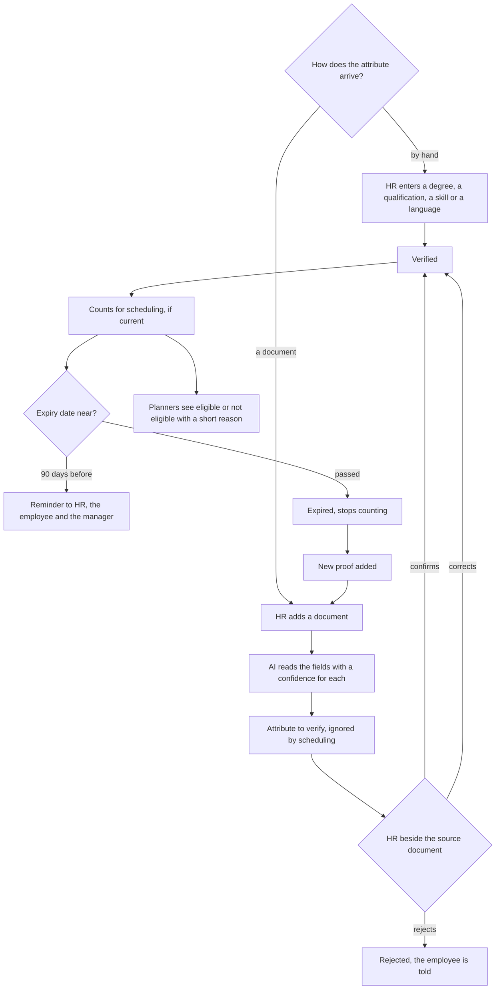
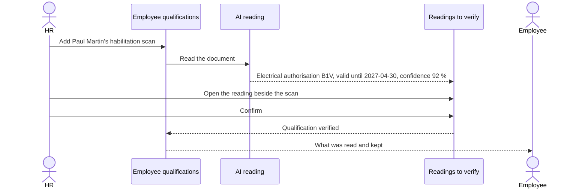

🏠 [Specs](../../../README.md) › 🧩 [Functional capabilities](../../README.md) › 👥 [F9 HR and projects](../README.md) ›
🔀 [Flows](README.md) › 🔀 FL-F9-13 Keep employees' qualifications

# 🔀 FL-F9-13 Keep employees' qualifications

**Status:** ✅ specified

## Summary

HR keeps the attributes scheduling may use: degrees, qualifications, skills and languages, place and travel, person and
contract. Each one is entered by hand or read by the AI from a document (a CV, a diploma scan, a licence, a
certificate, a training record). An AI reading counts only once HR has confirmed it beside its source document; until
then it is "to verify" and scheduling ignores it. An expired qualification stops counting on its expiry date. Planners
see only whether a person is eligible, never the sensitive details.

The attributes kept here are what [FL-F9-12 Schedule customer requests](fl-f09-12-schedule-customer-requests.md) checks.

## Personas

- [U06 HR](../../../01-users/personas/u06-hr.md)
- [U01 Employee](../../../01-users/personas/u01-employee.md), who reads their own attributes and what was read
- [U02 Manager](../../../01-users/personas/u02-manager.md), who sees the team's eligibility and expiry dates

## Flowchart

## Sequence diagram

## Steps

| Step | Persona | Screen | Use case | What happens |
|---|---|---|---|---|
| 1 | [U06](../../../01-users/personas/u06-hr.md) | [S-F9-35](../screens/13-keep-qualifications/s-f09-35-employee-qualifications.md) | [UC-F9-38](../use-cases/13-keep-qualifications/uc-f09-38-record-degrees-and-qualifications.md) | HR enters degrees, qualifications, skills, languages, place and travel by hand |
| 2 | [U06](../../../01-users/personas/u06-hr.md) | [S-F9-35](../screens/13-keep-qualifications/s-f09-35-employee-qualifications.md) | [UC-F9-39](../use-cases/13-keep-qualifications/uc-f09-39-read-documents-and-verify.md) | HR adds a document; the AI reads it |
| 3 | [U06](../../../01-users/personas/u06-hr.md) | [S-F9-36](../screens/13-keep-qualifications/s-f09-36-readings-to-verify.md) | [UC-F9-39](../use-cases/13-keep-qualifications/uc-f09-39-read-documents-and-verify.md) | HR confirms, corrects or rejects each reading beside its source |
| 4 | [U01](../../../01-users/personas/u01-employee.md) | [S-F9-35](../screens/13-keep-qualifications/s-f09-35-employee-qualifications.md) | [UC-F9-38](../use-cases/13-keep-qualifications/uc-f09-38-record-degrees-and-qualifications.md) | The employee reads their own attributes and what the AI read |
| 5 | [U02](../../../01-users/personas/u02-manager.md) | [S-F9-35](../screens/13-keep-qualifications/s-f09-35-employee-qualifications.md) | [UC-F9-38](../use-cases/13-keep-qualifications/uc-f09-38-record-degrees-and-qualifications.md) | The manager sees the team's eligibility and the expiry dates, not the sensitive details |

### Entities and screens

| Entity | States in this flow | Shown at step and screen | Aggregated view |
|---|---|---|---|
| [E-F9-29 Degree](../data/e-f09-29-degree.md) | To verify, verified, rejected | 1, 4 [S-F9-35](../screens/13-keep-qualifications/s-f09-35-employee-qualifications.md); 3 [S-F9-36](../screens/13-keep-qualifications/s-f09-36-readings-to-verify.md) | Degrees |
| [E-F9-12 Qualification](../data/e-f09-12-certification.md), generalised into Qualification | To verify, verified, rejected, expired | 1, 4, 5 [S-F9-35](../screens/13-keep-qualifications/s-f09-35-employee-qualifications.md); 3 [S-F9-36](../screens/13-keep-qualifications/s-f09-36-readings-to-verify.md) | Certifications |
| [E-F9-31 Attribute reading](../data/e-f09-31-attribute-reading.md) | Reading, Failed, To verify, Confirmed, Corrected, Rejected | 2 [S-F9-35](../screens/13-keep-qualifications/s-f09-35-employee-qualifications.md); 3 [S-F9-36](../screens/13-keep-qualifications/s-f09-36-readings-to-verify.md) | Attribute readings |
| [E-F9-30 Qualification type](../data/e-f09-30-qualification-type.md) | Active (read only here) | 1 [S-F9-35](../screens/13-keep-qualifications/s-f09-35-employee-qualifications.md) | Qualification types |
| [E-F9-01 Employee record](../data/e-f09-01-employee-record.md) | Active (unchanged) | 1, 4, 5 [S-F9-35](../screens/13-keep-qualifications/s-f09-35-employee-qualifications.md) | Employee records |

The states are those of the entity drafts and of the change note on E-F9-12.

## Errors

- **E1 The AI cannot read the document.** A blurred photo or an unknown layout: nothing is drafted, HR is told and
  enters the attribute by hand (step 2, then 1).
- **E2 The reading disagrees with the record**. The AI reads a different name or birth date from the
  employee record: the reading is flagged, never merged, and HR decides (step 3).
- **E3 A qualification has expired.** It stops counting on its expiry date
  ([BR-F9-27](../business-rules/br-f09-27-unverified-attributes-do-not-count.md)); work already scheduled that needs
  it is shown to the planner for re-planning
  ([UC-F9-35](../use-cases/12-schedule-customer-requests/uc-f09-35-re-plan-after-a-change.md)), step 1.

## Images

Every step and error, for each persona taking part, in light and dark mode (D120). Steps are numbered as in the Steps
table; E rows are the error cases.

| Step | Persona | Device | Light | Dark |
|---|---|---|---|---|
| 1 | U06 | desktop | [light](../images/13-keep-qualifications/u06-hr/1-employee-qualifications-desktop-light.png) | [dark](../images/13-keep-qualifications/u06-hr/1-employee-qualifications-desktop-dark.png) |
| 2 | U06 | desktop | [light](../images/13-keep-qualifications/u06-hr/2-employee-qualifications-desktop-light.png) | [dark](../images/13-keep-qualifications/u06-hr/2-employee-qualifications-desktop-dark.png) |
| 3 | U06 | desktop | [light](../images/13-keep-qualifications/u06-hr/3-readings-to-verify-desktop-light.png) | [dark](../images/13-keep-qualifications/u06-hr/3-readings-to-verify-desktop-dark.png) |
| 4 | U01 | desktop | [light](../images/13-keep-qualifications/u01-employee/4-employee-qualifications-desktop-light.png) | [dark](../images/13-keep-qualifications/u01-employee/4-employee-qualifications-desktop-dark.png) |
| 4 | U01 | phone | [light](../images/13-keep-qualifications/u01-employee/4-employee-qualifications-phone-light.png) | [dark](../images/13-keep-qualifications/u01-employee/4-employee-qualifications-phone-dark.png) |
| 5 | U02 | desktop | [light](../images/13-keep-qualifications/u02-manager/5-employee-qualifications-desktop-light.png) | [dark](../images/13-keep-qualifications/u02-manager/5-employee-qualifications-desktop-dark.png) |
| 5 | U02 | phone | [light](../images/13-keep-qualifications/u02-manager/5-employee-qualifications-phone-light.png) | [dark](../images/13-keep-qualifications/u02-manager/5-employee-qualifications-phone-dark.png) |
| E1 | U06 | desktop | [light](../images/13-keep-qualifications/u06-hr/e1-the-ai-cannot-read-the-document-desktop-light.png) | [dark](../images/13-keep-qualifications/u06-hr/e1-the-ai-cannot-read-the-document-desktop-dark.png) |
| E2 | U06 | desktop | [light](../images/13-keep-qualifications/u06-hr/e2-the-reading-disagrees-with-the-record-desktop-light.png) | [dark](../images/13-keep-qualifications/u06-hr/e2-the-reading-disagrees-with-the-record-desktop-dark.png) |
| E3 | U06 | desktop | [light](../images/13-keep-qualifications/u06-hr/e3-a-qualification-has-expired-desktop-light.png) | [dark](../images/13-keep-qualifications/u06-hr/e3-a-qualification-has-expired-desktop-dark.png) |

## Open questions

None.

---

⬅️ [FL-F9-12 Schedule customer requests](fl-f09-12-schedule-customer-requests.md) · ⬆️ [Up](README.md) ·
➡️ [FL-F9-14 Source candidates on LinkedIn](fl-f09-14-source-candidates-on-linkedin.md)
