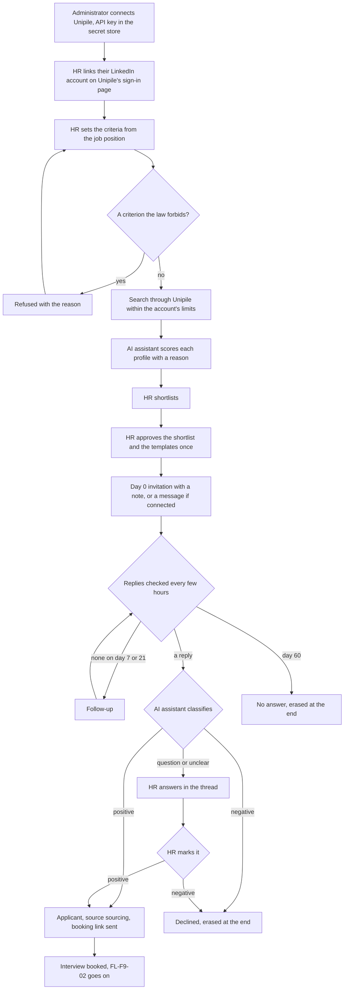
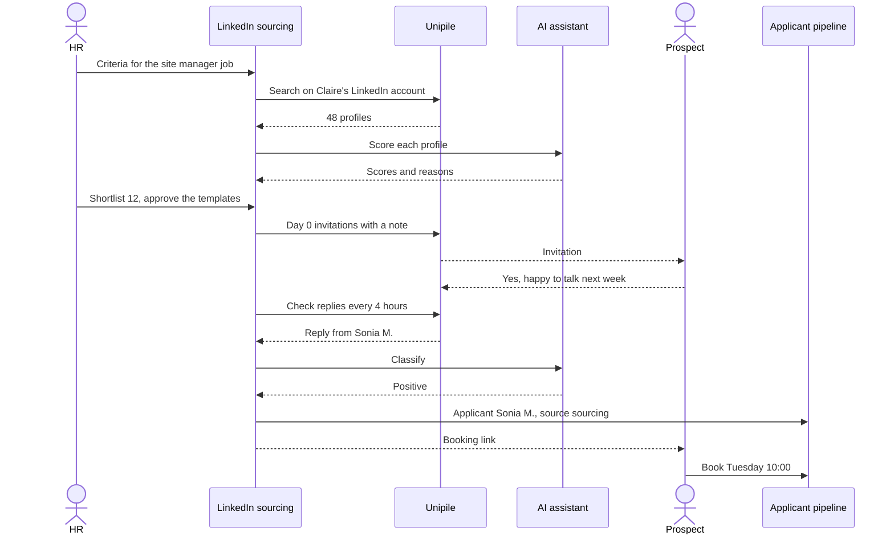

🏠 [Specs](../../../README.md) › 🧩 [Functional capabilities](../../README.md) › 👥 [F9 HR and projects](../README.md) ›
🔀 [Flows](README.md) › 🔀 FL-F9-14 Source candidates on LinkedIn

# 🔀 FL-F9-14 Source candidates on LinkedIn

**Status:** 🔄 waiting for the owner

## Summary

HR finds people on LinkedIn for a job position through Unipile, an F24 connector whose API key stays in the secret
store; each HR user links their own LinkedIn account on Unipile's hosted sign-in page, so simple-ERP never sees the
password. The AI assistant ranks the profiles against the job position's criteria with a short reason per score; HR
shortlists and approves the shortlist and the templates once. An invitation with a note goes on day 0 and follow-ups on
days 7 and 21; replies are checked every few hours and classified by the AI assistant; everything stops at a reply, a
refusal or day 60. A positive reply becomes an applicant who gets the booking link, and
[FL-F9-02 Recruit](fl-f09-02-recruit.md) goes on
([D518](../../../06-decisions/f09-hr-and-projects/d518-linkedin-sourcing-through-unipile.md)).

## Personas

- [U06 Human resources](../../../01-users/personas/u06-hr.md)
- [U07 Administrator](../../../01-users/personas/u07-administrator.md), who connects Unipile once

## Flowchart

## Sequence diagram

## Steps

| Step | Persona | Screen | Use case | What happens |
|---|---|---|---|---|
| 1 | [U07](../../../01-users/personas/u07-administrator.md) | [S-F24-02](../../f24-integrations-hub/screens/01-find-and-connect/s-f24-02-connect.md) | [UC-F24-02](../../f24-integrations-hub/use-cases/01-find-and-connect/uc-f24-02-connect-a-tool-in-the-fewest-steps.md) | The administrator connects Unipile once: its API key goes to the secret store; the daily and weekly caps are set |
| 2 | [U06](../../../01-users/personas/u06-hr.md) | [S-F9-37](../screens/02-recruit/s-f09-37-linkedin-sourcing-search.md) | [UC-F9-40](../use-cases/02-recruit/uc-f09-40-search-and-rank-linkedin-profiles.md) | HR links their LinkedIn account on Unipile's sign-in page once, sets the criteria and runs the search; the AI assistant scores each profile with a reason |
| 3 | [U06](../../../01-users/personas/u06-hr.md) | [S-F9-37](../screens/02-recruit/s-f09-37-linkedin-sourcing-search.md) | [UC-F9-40](../use-cases/02-recruit/uc-f09-40-search-and-rank-linkedin-profiles.md) | HR reads the scores and shortlists |
| 4 | [U06](../../../01-users/personas/u06-hr.md) | [S-F9-38](../screens/02-recruit/s-f09-38-outreach-sequence.md) | [UC-F9-41](../use-cases/02-recruit/uc-f09-41-run-a-linkedin-outreach-sequence.md) | HR approves the shortlist and the templates once |
| 5 | [U06](../../../01-users/personas/u06-hr.md) | [S-F9-39](../screens/02-recruit/s-f09-39-prospect-conversations.md) | [UC-F9-41](../use-cases/02-recruit/uc-f09-41-run-a-linkedin-outreach-sequence.md) | Invitations and follow-ups go out; replies are checked and classified; a question or an unclear reply waits for HR |
| 6 | [U06](../../../01-users/personas/u06-hr.md) | [S-F9-39](../screens/02-recruit/s-f09-39-prospect-conversations.md) | [UC-F9-42](../use-cases/02-recruit/uc-f09-42-turn-a-positive-reply-into-an-applicant.md) | A positive reply: the applicant is created, source sourcing, and gets the booking link |
| 7 | [U06](../../../01-users/personas/u06-hr.md) | [S-F9-06](../screens/02-recruit/s-f09-06-applicant-pipeline.md) | [UC-F9-06](../use-cases/02-recruit/uc-f09-06-run-the-applicant-pipeline.md) | The applicant books an interview; the pipeline goes on ([FL-F9-02](fl-f09-02-recruit.md)) |

### Entities and screens

| Entity | States in this flow | Shown at step and screen | Aggregated view |
|---|---|---|---|
| [E-F24-02 Tool connection](../../f24-integrations-hub/data/e-f24-02-tool-connection.md) | Proposed, Active | 1 [S-F24-02](../../f24-integrations-hub/screens/01-find-and-connect/s-f24-02-connect.md); 2 [S-F9-37](../screens/02-recruit/s-f09-37-linkedin-sourcing-search.md) | Tool connections |
| [E-F9-44 Sourcing search](../data/e-f09-44-sourcing-search.md) | Draft, Running, Ranked, Failed, Closed | 2, 3 [S-F9-37](../screens/02-recruit/s-f09-37-linkedin-sourcing-search.md) | Sourcing searches |
| [E-F9-45 Prospect](../data/e-f09-45-prospect.md) | Found, Shortlisted, Discarded, Invited, Connected, Waiting for HR, Applicant, Declined, No answer, Erased | 2, 3 [S-F9-37](../screens/02-recruit/s-f09-37-linkedin-sourcing-search.md); 5, 6 [S-F9-39](../screens/02-recruit/s-f09-39-prospect-conversations.md) | Prospects |
| [E-F9-46 Outreach sequence](../data/e-f09-46-outreach-sequence.md) | Draft, Running, Paused, Ended | 4 [S-F9-38](../screens/02-recruit/s-f09-38-outreach-sequence.md) | Outreach sequences |
| [E-F9-47 Outreach message](../data/e-f09-47-outreach-message.md) | Planned, Sent, Failed, Cancelled, Received, Classified, Reviewed | 5, 6 [S-F9-39](../screens/02-recruit/s-f09-39-prospect-conversations.md) | Outreach messages |
| [E-F9-07 Applicant](../data/e-f09-07-applicant.md) | Active (created at the first stage) | 6 [S-F9-39](../screens/02-recruit/s-f09-39-prospect-conversations.md); 7 [S-F9-06](../screens/02-recruit/s-f09-06-applicant-pipeline.md) | Applicants |
| [E-F9-06 Job position](../data/e-f09-06-job-position.md) | Active | 2, 3 [S-F9-37](../screens/02-recruit/s-f09-37-linkedin-sourcing-search.md); 5, 6 [S-F9-39](../screens/02-recruit/s-f09-39-prospect-conversations.md); 7 [S-F9-06](../screens/02-recruit/s-f09-06-applicant-pipeline.md) | Job positions |

## Errors

- **E1 The LinkedIn account's limit is reached.** As Unipile reports it, or the administrator's cap: sending pauses
  until the next day ([BR-F9-41](../business-rules/br-f09-41-linkedin-account-limits-respected.md)), step 5.
- **E2 The LinkedIn account needs a new sign-in.** The sequence pauses; HR signs in again on Unipile's page and it goes
  on, still ending on day 60, step 5.
- **E3 A criterion the law forbids.** Refused with the reason; the search does not run
  ([BR-F9-40](../business-rules/br-f09-40-no-criterion-the-law-forbids-in-hiring.md)), step 2.
- **E4 A prospect asks to be erased.** Erased everywhere at once
  ([BR-F9-11](../business-rules/br-f09-11-candidate-data-has-a-term.md)), step 5.

## Images

Every step and error, for each persona taking part, in light and dark mode (D120). Steps are numbered as in the Steps
table; E rows are the error cases.

| Step | Persona | Device | Light | Dark |
|---|---|---|---|---|
| 1 | U07 | desktop | [light](../images/14-source-candidates-on-linkedin/u07-administrator/1-connect-desktop-light.png) | [dark](../images/14-source-candidates-on-linkedin/u07-administrator/1-connect-desktop-dark.png) |
| 2 | U06 | desktop | [light](../images/14-source-candidates-on-linkedin/u06-hr/2-linkedin-sourcing-search-desktop-light.png) | [dark](../images/14-source-candidates-on-linkedin/u06-hr/2-linkedin-sourcing-search-desktop-dark.png) |
| 3 | U06 | desktop | [light](../images/14-source-candidates-on-linkedin/u06-hr/3-linkedin-sourcing-search-desktop-light.png) | [dark](../images/14-source-candidates-on-linkedin/u06-hr/3-linkedin-sourcing-search-desktop-dark.png) |
| 4 | U06 | desktop | [light](../images/14-source-candidates-on-linkedin/u06-hr/4-outreach-sequence-desktop-light.png) | [dark](../images/14-source-candidates-on-linkedin/u06-hr/4-outreach-sequence-desktop-dark.png) |
| 5 | U06 | desktop | [light](../images/14-source-candidates-on-linkedin/u06-hr/5-prospect-conversations-desktop-light.png) | [dark](../images/14-source-candidates-on-linkedin/u06-hr/5-prospect-conversations-desktop-dark.png) |
| 6 | U06 | desktop | [light](../images/14-source-candidates-on-linkedin/u06-hr/6-prospect-conversations-desktop-light.png) | [dark](../images/14-source-candidates-on-linkedin/u06-hr/6-prospect-conversations-desktop-dark.png) |
| 7 | U06 | desktop | [light](../images/14-source-candidates-on-linkedin/u06-hr/7-applicant-pipeline-desktop-light.png) | [dark](../images/14-source-candidates-on-linkedin/u06-hr/7-applicant-pipeline-desktop-dark.png) |
| E1 | U06 | desktop | [light](../images/14-source-candidates-on-linkedin/u06-hr/e1-limit-reached-desktop-light.png) | [dark](../images/14-source-candidates-on-linkedin/u06-hr/e1-limit-reached-desktop-dark.png) |
| E2 | U06 | desktop | [light](../images/14-source-candidates-on-linkedin/u06-hr/e2-sign-in-needed-desktop-light.png) | [dark](../images/14-source-candidates-on-linkedin/u06-hr/e2-sign-in-needed-desktop-dark.png) |
| E3 | U06 | desktop | [light](../images/14-source-candidates-on-linkedin/u06-hr/e3-forbidden-criterion-desktop-light.png) | [dark](../images/14-source-candidates-on-linkedin/u06-hr/e3-forbidden-criterion-desktop-dark.png) |
| E4 | U06 | desktop | [light](../images/14-source-candidates-on-linkedin/u06-hr/e4-erasure-request-desktop-light.png) | [dark](../images/14-source-candidates-on-linkedin/u06-hr/e4-erasure-request-desktop-dark.png) |

## Open questions

- [Q18 LinkedIn automation and its user agreement](../../../07-questions/q18-linkedin-automation-and-its-user-agreement.md)
- [Q19 Which LinkedIn search sourcing uses](../../../07-questions/q19-which-linkedin-search-sourcing-uses.md)

---

⬅️ [FL-F9-13 Keep employees' qualifications](fl-f09-13-keep-qualifications.md) · ⬆️ [Up](README.md) ·
➡️ [FL-F9-15 Work location, headcount, careers and learning](fl-f09-15-work-location-headcount-and-learning.md)
