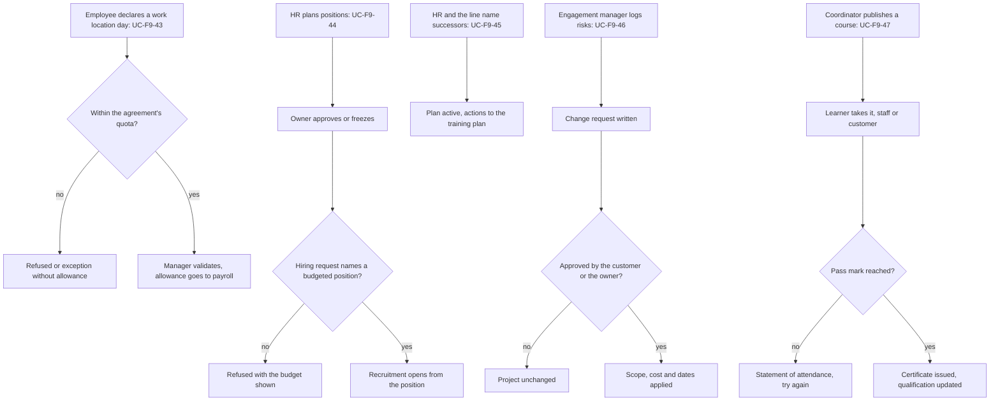
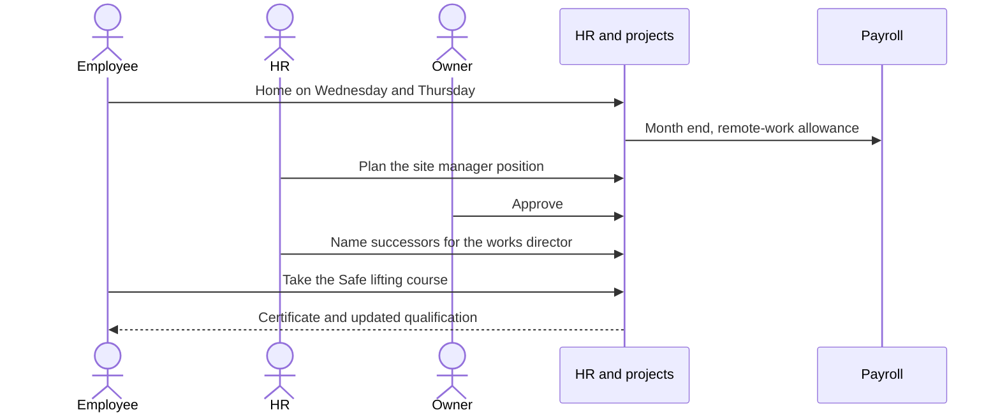

🏠 [Specs](../../../README.md) › 🧩 [Functional capabilities](../../README.md) › 👥 [F9 HR and projects](../README.md) ›
🔀 [Flows](README.md) › 🔀 FL-F9-15 Work location, headcount, careers and learning

# 🔀 FL-F9-15 Work location, headcount, careers and learning

**Status:** ✅ specified

## Summary

Five gaps of HR and projects that benchmarked suites cover and SimpleERP lacked: employees declare remote-work days and
the allowance follows the agreement
([UC-F9-43](../use-cases/15-work-location-headcount-and-learning/uc-f09-43-declare-remote-work-days.md)), HR and the
owner plan headcount against the budget and hiring needs a budgeted position
([UC-F9-44](../use-cases/15-work-location-headcount-and-learning/uc-f09-44-plan-headcount-against-budget.md)), HR and
the line plan careers and successors
([UC-F9-45](../use-cases/15-work-location-headcount-and-learning/uc-f09-45-plan-careers-and-successors.md)), project
teams log risks and change requests that apply only once approved
([UC-F9-46](../use-cases/15-work-location-headcount-and-learning/uc-f09-46-log-project-risks-and-change-requests.md)),
and the coordinator publishes and sells online courses with certificates that follow a passed assessment
([UC-F9-47](../use-cases/15-work-location-headcount-and-learning/uc-f09-47-publish-and-sell-online-courses.md)). The
owner chose each in the 2026-11-14 interview
([D528](../../../06-decisions/f09-hr-and-projects/d528-benchmark-gaps-f09-hr-and-projects.md)).

## Personas

- [U01 Employee](../../../01-users/personas/u01-employee.md)
- [U02 Manager](../../../01-users/personas/u02-manager.md)
- [U06 Human resources](../../../01-users/personas/u06-hr.md)
- [U13 Owner](../../../01-users/personas/u13-owner.md)
- [U24 Engagement manager](../../../01-users/personas/u24-engagement-manager.md)
- [U09 Customer](../../../01-users/personas/u09-customer.md)
- [U38 Training coordinator](../../../01-users/personas/u38-training-coordinator.md)

## Flowchart

## Sequence diagram

## Steps

| Step | Persona | Screen | Use case | What happens |
|---|---|---|---|---|
| 1 | [U01](../../../01-users/personas/u01-employee.md), [U02](../../../01-users/personas/u02-manager.md) | [S-F9-40](../screens/15-work-location-headcount-and-learning/s-f09-40-work-location.md) | [UC-F9-43](../use-cases/15-work-location-headcount-and-learning/uc-f09-43-declare-remote-work-days.md) | The employee declares the week's locations on a phone and the manager validates the team's days |
| 2 | [U06](../../../01-users/personas/u06-hr.md), [U13](../../../01-users/personas/u13-owner.md) | [S-F9-41](../screens/15-work-location-headcount-and-learning/s-f09-41-headcount-plan.md) | [UC-F9-44](../use-cases/15-work-location-headcount-and-learning/uc-f09-44-plan-headcount-against-budget.md) | HR plans the positions against the budget and the owner approves or freezes them |
| 3 | [U06](../../../01-users/personas/u06-hr.md), [U02](../../../01-users/personas/u02-manager.md) | [S-F9-42](../screens/15-work-location-headcount-and-learning/s-f09-42-careers-and-succession.md) | [UC-F9-45](../use-cases/15-work-location-headcount-and-learning/uc-f09-45-plan-careers-and-successors.md) | HR and the line name successors for a key position and the gaps to close |
| 4 | [U24](../../../01-users/personas/u24-engagement-manager.md), [U09](../../../01-users/personas/u09-customer.md) | [S-F9-43](../screens/15-work-location-headcount-and-learning/s-f09-43-project-risks.md) | [UC-F9-46](../use-cases/15-work-location-headcount-and-learning/uc-f09-46-log-project-risks-and-change-requests.md) | The engagement manager logs risks and a change request, and the customer decides it on a phone |
| 5 | [U38](../../../01-users/personas/u38-training-coordinator.md), [U01](../../../01-users/personas/u01-employee.md), [U09](../../../01-users/personas/u09-customer.md) | [S-F9-44](../screens/15-work-location-headcount-and-learning/s-f09-44-online-courses.md) | [UC-F9-47](../use-cases/15-work-location-headcount-and-learning/uc-f09-47-publish-and-sell-online-courses.md) | The coordinator publishes a course, and an employee and a customer take it on a phone |

### Entities and screens

| Entity | States in this flow | Shown at step and screen | Aggregated view |
|---|---|---|---|
| [E-F9-48 Work location day](../data/e-f09-48-work-location-day.md) | Declared, Validated, Refused, Withdrawn, Passed to pay | 1 [S-F9-40](../screens/15-work-location-headcount-and-learning/s-f09-40-work-location.md) | Work location days |
| [E-F9-49 Position](../data/e-f09-49-position.md) | Planned, Approved, Cancelled, Open, Filled, Frozen | 2 [S-F9-41](../screens/15-work-location-headcount-and-learning/s-f09-41-headcount-plan.md) | Positions |
| [E-F9-50 Succession plan](../data/e-f09-50-succession-plan.md) | Draft, Active, Under review, Closed | 3 [S-F9-42](../screens/15-work-location-headcount-and-learning/s-f09-42-careers-and-succession.md) | Succession plans |
| [E-F9-51 Change request](../data/e-f09-51-change-request.md) | Draft, Submitted, Approved, Rejected, Applied, Withdrawn | 4 [S-F9-43](../screens/15-work-location-headcount-and-learning/s-f09-43-project-risks.md) | Change requests |
| [E-F9-52 Online course](../data/e-f09-52-online-course.md) | Draft, Published, Unpublished, Archived | 5 [S-F9-44](../screens/15-work-location-headcount-and-learning/s-f09-44-online-courses.md) | Online courses |

## Errors

- **E1 No budgeted position.** A hiring request names no budgeted position or one without a free headcount: refused with
  the budget shown ([BR-F9-43](../business-rules/br-f09-43-a-requisition-needs-a-budgeted-position.md)), step 2.
- **E2 A day over the quota.** The employee is told and may ask the manager for an exception
  ([BR-F9-42](../business-rules/br-f09-42-remote-work-allowances-follow-the-agreement.md)), step 1.
- **E3 A successor list opened by the wrong person.** Refused and audited
  ([BR-F9-44](../business-rules/br-f09-44-successor-lists-are-seen-by-hr-and-the-line.md)), step 3.
- **E4 A change applied before approval.** Refused
  ([BR-F9-45](../business-rules/br-f09-45-a-change-request-applies-only-once-approved.md)), step 4.
- **E5 A certificate without a passed assessment.** Not issued
  ([BR-F9-46](../business-rules/br-f09-46-certificates-follow-a-passed-assessment.md)), step 5.

## Images

Every step and error, for each persona taking part, in light and dark mode (D120). Steps are numbered as in the Steps
table; E rows are the error cases.

| Step | Persona | Device | Light | Dark |
|---|---|---|---|---|
| 1 | U01 | phone | [light](../images/15-work-location-headcount-and-learning/u01-employee/1-work-location-phone-light.png) | [dark](../images/15-work-location-headcount-and-learning/u01-employee/1-work-location-phone-dark.png) |
| 1 | U02 | desktop | [light](../images/15-work-location-headcount-and-learning/u02-manager/1-work-location-desktop-light.png) | [dark](../images/15-work-location-headcount-and-learning/u02-manager/1-work-location-desktop-dark.png) |
| 1 | U01 | desktop | [light](../images/15-work-location-headcount-and-learning/u01-employee/1-work-location-desktop-light.png) | [dark](../images/15-work-location-headcount-and-learning/u01-employee/1-work-location-desktop-dark.png) |
| 1 | U01 | phone | [light](../images/15-work-location-headcount-and-learning/u01-employee/1-work-location-phone-light.png) | [dark](../images/15-work-location-headcount-and-learning/u01-employee/1-work-location-phone-dark.png) |
| 1 | U02 | desktop | [light](../images/15-work-location-headcount-and-learning/u02-manager/1-work-location-desktop-light.png) | [dark](../images/15-work-location-headcount-and-learning/u02-manager/1-work-location-desktop-dark.png) |
| 1 | U02 | phone | [light](../images/15-work-location-headcount-and-learning/u02-manager/1-work-location-phone-light.png) | [dark](../images/15-work-location-headcount-and-learning/u02-manager/1-work-location-phone-dark.png) |
| 2 | U06 | desktop | [light](../images/15-work-location-headcount-and-learning/u06-hr/2-headcount-plan-desktop-light.png) | [dark](../images/15-work-location-headcount-and-learning/u06-hr/2-headcount-plan-desktop-dark.png) |
| 2 | U13 | desktop | [light](../images/15-work-location-headcount-and-learning/u13-owner/2-headcount-plan-desktop-light.png) | [dark](../images/15-work-location-headcount-and-learning/u13-owner/2-headcount-plan-desktop-dark.png) |
| 2 | U06 | desktop | [light](../images/15-work-location-headcount-and-learning/u06-hr/2-headcount-plan-desktop-light.png) | [dark](../images/15-work-location-headcount-and-learning/u06-hr/2-headcount-plan-desktop-dark.png) |
| 2 | U13 | desktop | [light](../images/15-work-location-headcount-and-learning/u13-owner/2-headcount-plan-desktop-light.png) | [dark](../images/15-work-location-headcount-and-learning/u13-owner/2-headcount-plan-desktop-dark.png) |
| 2 | U13 | phone | [light](../images/15-work-location-headcount-and-learning/u13-owner/2-headcount-plan-phone-light.png) | [dark](../images/15-work-location-headcount-and-learning/u13-owner/2-headcount-plan-phone-dark.png) |
| 3 | U02 | desktop | [light](../images/15-work-location-headcount-and-learning/u02-manager/3-careers-and-succession-desktop-light.png) | [dark](../images/15-work-location-headcount-and-learning/u02-manager/3-careers-and-succession-desktop-dark.png) |
| 3 | U06 | desktop | [light](../images/15-work-location-headcount-and-learning/u06-hr/3-careers-and-succession-desktop-light.png) | [dark](../images/15-work-location-headcount-and-learning/u06-hr/3-careers-and-succession-desktop-dark.png) |
| 3 | U02 | desktop | [light](../images/15-work-location-headcount-and-learning/u02-manager/3-careers-and-succession-desktop-light.png) | [dark](../images/15-work-location-headcount-and-learning/u02-manager/3-careers-and-succession-desktop-dark.png) |
| 3 | U02 | phone | [light](../images/15-work-location-headcount-and-learning/u02-manager/3-careers-and-succession-phone-light.png) | [dark](../images/15-work-location-headcount-and-learning/u02-manager/3-careers-and-succession-phone-dark.png) |
| 3 | U06 | desktop | [light](../images/15-work-location-headcount-and-learning/u06-hr/3-careers-and-succession-desktop-light.png) | [dark](../images/15-work-location-headcount-and-learning/u06-hr/3-careers-and-succession-desktop-dark.png) |
| 4 | U09 | phone | [light](../images/15-work-location-headcount-and-learning/u09-customer/4-project-risks-phone-light.png) | [dark](../images/15-work-location-headcount-and-learning/u09-customer/4-project-risks-phone-dark.png) |
| 4 | U24 | desktop | [light](../images/15-work-location-headcount-and-learning/u24-engagement-manager/4-project-risks-desktop-light.png) | [dark](../images/15-work-location-headcount-and-learning/u24-engagement-manager/4-project-risks-desktop-dark.png) |
| 4 | U09 | phone | [light](../images/15-work-location-headcount-and-learning/u09-customer/4-project-risks-phone-light.png) | [dark](../images/15-work-location-headcount-and-learning/u09-customer/4-project-risks-phone-dark.png) |
| 4 | U24 | desktop | [light](../images/15-work-location-headcount-and-learning/u24-engagement-manager/4-project-risks-desktop-light.png) | [dark](../images/15-work-location-headcount-and-learning/u24-engagement-manager/4-project-risks-desktop-dark.png) |
| 4 | U24 | phone | [light](../images/15-work-location-headcount-and-learning/u24-engagement-manager/4-project-risks-phone-light.png) | [dark](../images/15-work-location-headcount-and-learning/u24-engagement-manager/4-project-risks-phone-dark.png) |
| 5 | U01 | phone | [light](../images/15-work-location-headcount-and-learning/u01-employee/5-online-courses-phone-light.png) | [dark](../images/15-work-location-headcount-and-learning/u01-employee/5-online-courses-phone-dark.png) |
| 5 | U09 | phone | [light](../images/15-work-location-headcount-and-learning/u09-customer/5-online-courses-phone-light.png) | [dark](../images/15-work-location-headcount-and-learning/u09-customer/5-online-courses-phone-dark.png) |
| 5 | U38 | desktop | [light](../images/15-work-location-headcount-and-learning/u38-training-coordinator/5-online-courses-desktop-light.png) | [dark](../images/15-work-location-headcount-and-learning/u38-training-coordinator/5-online-courses-desktop-dark.png) |
| 5 | U01 | desktop | [light](../images/15-work-location-headcount-and-learning/u01-employee/5-online-courses-desktop-light.png) | [dark](../images/15-work-location-headcount-and-learning/u01-employee/5-online-courses-desktop-dark.png) |
| 5 | U01 | phone | [light](../images/15-work-location-headcount-and-learning/u01-employee/5-online-courses-phone-light.png) | [dark](../images/15-work-location-headcount-and-learning/u01-employee/5-online-courses-phone-dark.png) |
| 5 | U09 | phone | [light](../images/15-work-location-headcount-and-learning/u09-customer/5-online-courses-phone-light.png) | [dark](../images/15-work-location-headcount-and-learning/u09-customer/5-online-courses-phone-dark.png) |
| 5 | U38 | desktop | [light](../images/15-work-location-headcount-and-learning/u38-training-coordinator/5-online-courses-desktop-light.png) | [dark](../images/15-work-location-headcount-and-learning/u38-training-coordinator/5-online-courses-desktop-dark.png) |
| E1 | U01 | phone | [light](../images/15-work-location-headcount-and-learning/u01-employee/e1-no-budgeted-position-phone-light.png) | [dark](../images/15-work-location-headcount-and-learning/u01-employee/e1-no-budgeted-position-phone-dark.png) |
| E1 | U01 | desktop | [light](../images/15-work-location-headcount-and-learning/u01-employee/e1-no-budgeted-position-desktop-light.png) | [dark](../images/15-work-location-headcount-and-learning/u01-employee/e1-no-budgeted-position-desktop-dark.png) |
| E1 | U01 | phone | [light](../images/15-work-location-headcount-and-learning/u01-employee/e1-no-budgeted-position-phone-light.png) | [dark](../images/15-work-location-headcount-and-learning/u01-employee/e1-no-budgeted-position-phone-dark.png) |

## Open questions

None.

---

⬅️ [FL-F9-14 Source candidates on LinkedIn](fl-f09-14-source-candidates-on-linkedin.md) · ⬆️ [Up](README.md)
