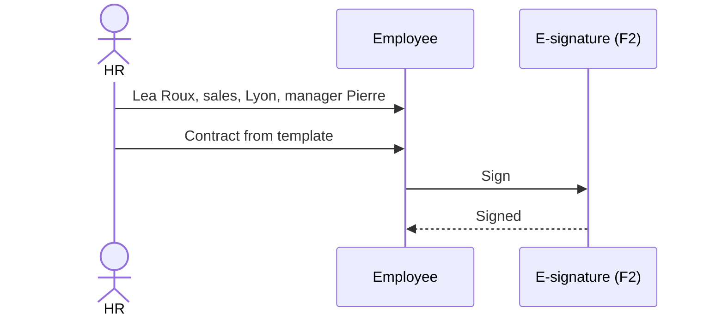

🏠 [Specs](../../../../README.md) › 🧩 [Functional capabilities](../../../README.md) ›
👥 [F9 HR and projects](../../README.md) › 📝 [Use cases](../README.md) › 📝 [Use cases: FL-F9-01 People](README.md) ›
📝 UC-F9-01 Manage employee records and contracts

# 📝 UC-F9-01 Manage employee records and contracts

**Status:** ✅ specified

## Summary

HR keeps employee records, departments and the org chart, contracts and their documents, equipment and badges.

## Personas

- [U06 HR](../../../../01-users/personas/u06-hr.md)

## Goal

One reliable record per employee.

## Trigger

A hire, a change, a contract end.

## Frequency

Weekly.

## Preconditions

F9 set up for the company.

## Postconditions

- **Succeeded:** the employee's record and contract are current.
- **Failed:** a key change waits for validation.

## Main flow

1. HR creates the employee on the employee screen ([S-F9-01](../../screens/01-people/s-f09-01-employee.md)): work,
   private, resume and skills.
2. Departments nest; the org chart follows managers.
3. Contracts come from templates ([UC-F9-19](uc-f09-19-edit-contract-templates.md)) with status and expiry, and are
   signed,
   [UC-F2-14](../../../f02-no-code-configuration/use-cases/07-benchmark-additions/uc-f02-14-send-documents-for-e-signature.md).
4. Equipment and badges are assigned.

## Alternative flows

- 1a. Import employees from a spreadsheet.

## Error flows

- 3e. A contract about to end: HR reminded 30 days before, 15 days before a trial period ends,
  [D290](../../../../06-decisions/f09-hr-and-projects/d290-f9-use-cases.md),
  [CR-FR-040](../../../../10-country-packs/france/labour/cr-fr-040-trial-period-limits.md).

## Business rules

- [BR-F9-02 HR data stays with HR and the person](../../business-rules/br-f09-02-hr-data-stays-with-hr-and-the-person.md)

## Entities

- [E-F9-01 Employee record](../../data/e-f09-01-employee-record.md)
- [E-F9-02 Contract](../../data/e-f09-02-contract.md)
- [E-F9-03 Department](../../data/e-f09-03-department.md)
- [E-F9-40 Personnel register](../../data/e-f09-40-personnel-register.md)

## Permissions

HR; the owner reads; HR data stays with HR and the person
([BR-F9-02](../../business-rules/br-f09-02-hr-data-stays-with-hr-and-the-person.md)).

## Notifications

HR: contract ends.

## Audit events

Records and contracts changed.

## AI involvement

The AI assistant prepares it for confirmation
([BR-F3-07](../../../f03-assistant/business-rules/br-f03-07-no-deletes-no-irreversible-acts.md)); figures come from
queries ([BR-F3-03](../../../f03-assistant/business-rules/br-f03-03-figures-come-from-queries.md)).

## API, MCP and A2A exposure

T5 operations of F9 with the caller's rights; the MCP tool of F9; no A2A skill.

## Screens

- [S-F9-01](../../screens/01-people/s-f09-01-employee.md)

## Flowchart

See [FL-F9-01 People](../../flows/fl-f09-01-people.md#flowchart).

## Sequence diagram

## Acceptance criteria

1. **Given** a fixed-term contract ending 2026-12-31 **when** 2026-12-01 comes **then** HR is reminded.
2. **Given** a trial period ending 2026-11-30 **when** 2026-11-15 comes **then** HR is reminded.
3. **Given** Lea's manager set to Pierre **when** the org chart opens **then** she shows under Pierre.

## Non-functional notes

None.

## Regulatory references

[CR-FR-038](../../../../10-country-packs/france/labour/cr-fr-038-personnel-register.md);
[CR-FR-041](../../../../10-country-packs/france/labour/cr-fr-041-fixed-term-contracts.md).

## Related use cases

See the flows.

## Open questions

None.

---

⬆️ [Up](README.md) · ➡️ [UC-F9-02 Onboard and offboard](uc-f09-02-onboard-and-offboard.md)
