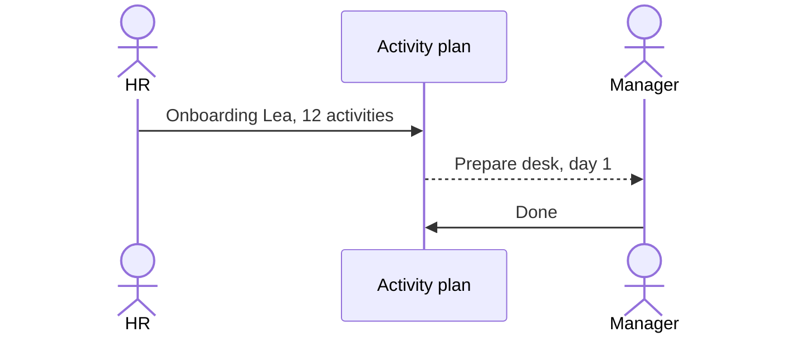

🏠 [Specs](../../../../README.md) › 🧩 [Functional capabilities](../../../README.md) ›
👥 [F9 HR and projects](../../README.md) › 📝 [Use cases](../README.md) › 📝 [Use cases: FL-F9-01 People](README.md) ›
📝 UC-F9-02 Onboard and offboard

# 📝 UC-F9-02 Onboard and offboard

**Status:** ✅ specified

## Summary

Activity plans welcome arrivals and close departures, with an exit interview for leavers.

## Personas

- [U06 HR](../../../../01-users/personas/u06-hr.md)
- [U02 Manager](../../../../01-users/personas/u02-manager.md)

## Goal

Nobody forgotten at arrival or departure.

## Trigger

A hire or a departure.

## Frequency

Monthly.

## Preconditions

F9 set up for the company.

## Postconditions

- **Succeeded:** every activity done; equipment returned.
- **Failed:** an item not returned is flagged.

## Main flow

1. A plan launches from the activity plan screen ([S-F9-02](../../screens/01-people/s-f09-02-activity-plan.md)): emails,
   calls, documents, IT setup, training, each assigned and dated.
2. Owners complete their activities.
3. At departure: reason, contract end, appraisals closed, equipment returned, HR files sent to the private address; the
   exit interview is held
   ([UC-F9-28](../10-listen-to-employees/uc-f09-28-run-engagement-surveys-and-exit-interviews.md)).
4. The user account is deactivated on the last day,
   [UC-F1-05](../../../f01-administration/use-cases/03-user-lifecycle/uc-f01-05-deactivate-and-offboard-a-user.md).

## Alternative flows

- 1a. Plans as F2 workflows.

## Error flows

- 3e. Equipment not returned: flagged.

## Business rules

- See F9's rules.

## Entities

- [E-F9-04 Activity plan](../../data/e-f09-04-activity-plan.md)
- [E-F9-01 Employee record](../../data/e-f09-01-employee-record.md)

## Permissions

HR; the owner reads; HR data stays with HR and the person
([BR-F9-02](../../business-rules/br-f09-02-hr-data-stays-with-hr-and-the-person.md)). Managers own their activities.

## Notifications

Owners: activities due.

## Audit events

Activities done.

## AI involvement

The AI assistant prepares it for confirmation
([BR-F3-07](../../../f03-assistant/business-rules/br-f03-07-no-deletes-no-irreversible-acts.md)); figures come from
queries ([BR-F3-03](../../../f03-assistant/business-rules/br-f03-03-figures-come-from-queries.md)).

## API, MCP and A2A exposure

T5 operations of F9 with the caller's rights; the MCP tool of F9; no A2A skill.

## Screens

- [S-F9-02](../../screens/01-people/s-f09-02-activity-plan.md)

## Flowchart

See [FL-F9-01 People](../../flows/fl-f09-01-people.md#flowchart).

## Sequence diagram

## Acceptance criteria

1. **Given** an onboarding plan of 12 activities **when** Lea is hired **then** each owner gets their dated activity.
2. **Given** a leaver with a laptop **when** the last day passes without return **then** it is flagged.
3. **Given** a departure **when** the plan runs **then** an exit interview is scheduled.

## Non-functional notes

None.

## Regulatory references

[CR-FR-186](../../../../10-country-packs/france/payroll/cr-fr-186-end-of-contract-documents.md).

## Related use cases

See the flows.

- [UC-F9-28 Run engagement surveys and exit interviews](../10-listen-to-employees/uc-f09-28-run-engagement-surveys-and-exit-interviews.md)

## Open questions

None.

---

⬅️ [UC-F9-01 Manage employee records and contracts](uc-f09-01-manage-employee-records-and-contracts.md) ·
⬆️ [Up](README.md) · ➡️ [UC-F9-03 Comply with French HR duties](uc-f09-03-comply-with-french-hr-duties.md)
