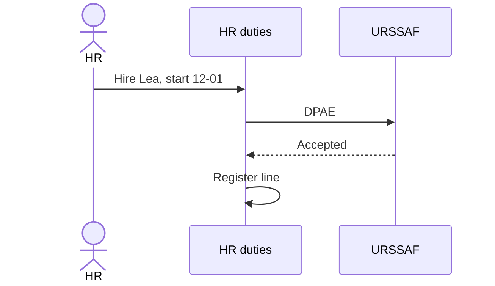

🏠 [Specs](../../../../README.md) › 🧩 [Functional capabilities](../../../README.md) ›
👥 [F9 HR and projects](../../README.md) › 📝 [Use cases](../README.md) › 📝 [Use cases: FL-F9-01 People](README.md) ›
📝 UC-F9-03 Comply with French HR duties

# 📝 UC-F9-03 Comply with French HR duties

**Status:** ✅ specified

## Summary

HR declares hires before their first day and keeps the personnel register; the other duties are split into UC-F9-21 to
UC-F9-23 (D466).

## Personas

- [U06 HR](../../../../01-users/personas/u06-hr.md)

## Goal

Hires declared and the register right.

## Trigger

A hire or a departure.

## Frequency

Per hire.

## Preconditions

F9 set up for the company.

## Postconditions

- **Succeeded:** the DPAE is accepted and the register updated.
- **Failed:** a refused DPAE blocks the start.

## Main flow

1. HR hires ([UC-F9-07](../02-recruit/uc-f09-07-make-an-offer-and-hire.md)); the DPAE goes to URSSAF before the first
   day ([BR-F9-03](../../business-rules/br-f09-03-dpae-before-the-first-day.md)).
2. The personnel register of each establishment updates on arrivals and departures
   ([CR-FR-038](../../../../10-country-packs/france/labour/cr-fr-038-personnel-register.md)) on HR duties
   ([S-F9-03](../../screens/01-people/s-f09-03-hr-duties.md)).
3. Interviews and health visits are scheduled
   ([UC-F9-21](../08-hr-duties/uc-f09-21-schedule-professional-interviews-and-health-visits.md)).
4. Thresholds and displays ([UC-F9-22](../08-hr-duties/uc-f09-22-keep-the-displays-and-the-bdese-current.md)) and
   disability employment ([UC-F9-23](../08-hr-duties/uc-f09-23-declare-disability-employment.md)) follow.

## Alternative flows

- 2a. The legal assistant warns on thresholds
  ([BR-F15-07](../../../f15-legal-assistant/business-rules/br-f15-07-warnings-inform-never-block.md)).

## Error flows

- 1e. URSSAF refuses the DPAE: its reason shown, the start blocked.

## Business rules

- [BR-F9-03 DPAE before the first day](../../business-rules/br-f09-03-dpae-before-the-first-day.md)
- [BR-F9-04 Professional interviews on time](../../business-rules/br-f09-04-professional-interviews-on-time.md)

## Entities

- [E-F9-01 Employee record](../../data/e-f09-01-employee-record.md)
- [E-F9-05 HR duty](../../data/e-f09-05-hr-duty.md)
- [E-F9-41 Pre-hiring declaration (DPAE)](../../data/e-f09-41-pre-hiring-declaration-dpae.md)

## Permissions

HR; the owner reads; HR data stays with HR and the person
([BR-F9-02](../../business-rules/br-f09-02-hr-data-stays-with-hr-and-the-person.md)).

## Notifications

HR: DPAE refused.

## Audit events

DPAE sent and accepted; register lines.

## AI involvement

The AI assistant prepares it for confirmation
([BR-F3-07](../../../f03-assistant/business-rules/br-f03-07-no-deletes-no-irreversible-acts.md)); figures come from
queries ([BR-F3-03](../../../f03-assistant/business-rules/br-f03-03-figures-come-from-queries.md)).

## API, MCP and A2A exposure

T5 operations of F9 with the caller's rights; the MCP tool of F9; no A2A skill.

## Screens

- [S-F9-03](../../screens/01-people/s-f09-03-hr-duties.md)

## Flowchart

See [FL-F9-01 People](../../flows/fl-f09-01-people.md#flowchart).

## Sequence diagram

## Acceptance criteria

1. **Given** Lea starting 2026-12-01 **when** she is hired on 11-20 **then** the DPAE is sent before 12-01.
2. **Given** URSSAF refuses "wrong NIR" **when** it answers **then** the reason shows and the start is blocked.
3. **Given** a departure on 11-30 **when** it is recorded **then** the register shows the exit date.

## Non-functional notes

None.

## Regulatory references

[CR-FR-037](../../../../10-country-packs/france/labour/cr-fr-037-dpae-before-the-first-day.md);
[CR-FR-038](../../../../10-country-packs/france/labour/cr-fr-038-personnel-register.md).

## Related use cases

See the flows.

- [UC-F9-21 Schedule professional interviews and health visits](../08-hr-duties/uc-f09-21-schedule-professional-interviews-and-health-visits.md)

- [UC-F9-22 Keep the displays and the BDESE current](../08-hr-duties/uc-f09-22-keep-the-displays-and-the-bdese-current.md)

- [UC-F9-23 Declare disability employment](../08-hr-duties/uc-f09-23-declare-disability-employment.md)

- [UC-F9-24 Receive and handle a whistleblowing report](../07-fair-pay-and-speaking-up/uc-f09-24-receive-and-handle-a-whistleblowing-report.md)

## Open questions

None.

---

⬅️ [UC-F9-02 Onboard and offboard](uc-f09-02-onboard-and-offboard.md) · ⬆️ [Up](README.md) ·
➡️ [UC-F9-04 Use employee self-service](uc-f09-04-use-employee-self-service.md)
