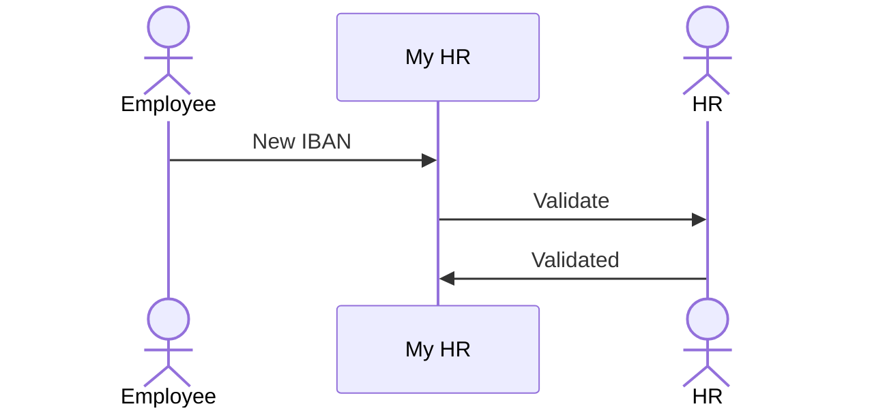

🏠 [Specs](../../../../README.md) › 🧩 [Functional capabilities](../../../README.md) ›
👥 [F9 HR and projects](../../README.md) › 📝 [Use cases](../README.md) › 📝 [Use cases: FL-F9-01 People](README.md) ›
📝 UC-F9-04 Use employee self-service

# 📝 UC-F9-04 Use employee self-service

**Status:** ✅ specified

## Summary

Employees see their details, documents, payslips and balances, update their details, request certificates, sign
documents and book training.

## Personas

- [U01 Employee](../../../../01-users/personas/u01-employee.md)
- [U14 Field worker](../../../../01-users/personas/u14-field-worker.md)

## Goal

Employees do their HR tasks themselves.

## Trigger

An employee needs something from HR.

## Frequency

Monthly.

## Preconditions

F9 set up for the company.

## Postconditions

- **Succeeded:** the request is done or sent to HR.
- **Failed:** a key change waits for validation.

## Main flow

1. The employee opens My HR ([S-F9-04](../../screens/01-people/s-f09-04-my-hr.md)): details, documents, payslips (F13),
   balances.
2. They update details; key ones (bank, address) are validated
   ([BR-F9-01](../../business-rules/br-f09-01-key-personal-data-is-validated.md)).
3. They request a certificate from HR's templates, or sign a document.
4. They book a training of the plan
   ([UC-F9-25](../09-train-and-protect/uc-f09-25-run-the-training-plan-with-opco-funding.md)).

## Alternative flows

- 1a. On the phone app.

## Error flows

- 3e. A request outside HR's templates: sent to HR.

## Business rules

- [BR-F9-01 Key personal data is validated](../../business-rules/br-f09-01-key-personal-data-is-validated.md)
- [BR-F9-02 HR data stays with HR and the person](../../business-rules/br-f09-02-hr-data-stays-with-hr-and-the-person.md)

## Entities

- [E-F9-01 Employee record](../../data/e-f09-01-employee-record.md)

## Permissions

Each employee for their own data.

## Notifications

HR: validations.

## Audit events

Changes and requests.

## AI involvement

The AI assistant prepares it for confirmation
([BR-F3-07](../../../f03-assistant/business-rules/br-f03-07-no-deletes-no-irreversible-acts.md)); figures come from
queries ([BR-F3-03](../../../f03-assistant/business-rules/br-f03-03-figures-come-from-queries.md)).

## API, MCP and A2A exposure

T5 operations of F9 with the caller's rights; the MCP tool of F9; no A2A skill.

## Screens

- [S-F9-04](../../screens/01-people/s-f09-04-my-hr.md)

## Flowchart

See [FL-F9-01 People](../../flows/fl-f09-01-people.md#flowchart).

## Sequence diagram

## Acceptance criteria

1. **Given** a new IBAN **when** Lea enters it **then** it waits for HR's validation.
2. **Given** a certificate of employment **when** she requests it **then** it is generated from HR's template.
3. **Given** her payslip of November **when** she opens My HR **then** she downloads it.

## Non-functional notes

Works on a phone.

## Regulatory references

[CR-FR-182](../../../../10-country-packs/france/payroll/cr-fr-182-payslip.md).

## Related use cases

See the flows.

- [UC-F1-16 Delegate approvals during an absence](../../../f01-administration/use-cases/11-team-delegation-and-access-review/uc-f01-16-delegate-approvals-during-an-absence.md)

## Open questions

None.

---

⬅️ [UC-F9-03 Comply with French HR duties](uc-f09-03-comply-with-french-hr-duties.md) · ⬆️ [Up](README.md) ·
➡️ [UC-F9-05 Publish jobs and source candidates](../02-recruit/uc-f09-05-publish-jobs-and-source-candidates.md)
