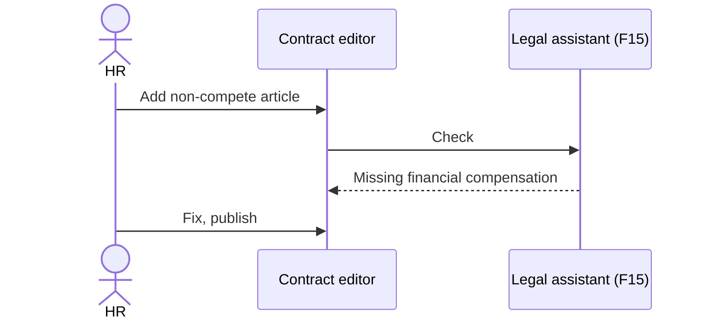

🏠 [Specs](../../../../README.md) › 🧩 [Functional capabilities](../../../README.md) ›
👥 [F9 HR and projects](../../README.md) › 📝 [Use cases](../README.md) › 📝 [Use cases: FL-F9-01 People](README.md) ›
📝 UC-F9-19 Edit contract templates

# 📝 UC-F9-19 Edit contract templates

**Status:** ✅ specified

## Summary

Contract templates built by drag and drop of articles, under the legal assistant's permanent review.

## Personas

- [U06 HR](../../../../01-users/personas/u06-hr.md)

## Goal

Contract templates that stay legal.

## Trigger

A new or changed contract model.

## Frequency

Yearly.

## Preconditions

F9 set up for the company.

## Postconditions

- **Succeeded:** the template is published.
- **Failed:** blocking issues prevent publishing.

## Main flow

1. HR lists the templates on the contract editor ([S-F9-19](../../screens/01-people/s-f09-19-contract-editor.md)).
2. They drag articles from the clause library and reorder them; fields fill from the employee and the job.
3. The legal assistant checks it as it changes
   ([BR-F9-13](../../business-rules/br-f09-13-contracts-under-permanent-legal-review.md)).
4. HR publishes it.

## Alternative flows

- 1a. Duplicate a template.
- 2a. The same editor for commercial contracts (F6).

## Error flows

- 3e. A blocking issue: not publishable until fixed.
- 1e. A template in use: archived, not deleted.

## Business rules

- [BR-F9-13 Contracts under permanent legal review](../../business-rules/br-f09-13-contracts-under-permanent-legal-review.md)

## Entities

- [E-F9-19 Contract template](../../data/e-f09-19-contract-template.md)

## Permissions

HR; the owner reads; HR data stays with HR and the person
([BR-F9-02](../../business-rules/br-f09-02-hr-data-stays-with-hr-and-the-person.md)).

## Notifications

None.

## Audit events

Templates changed, published.

## AI involvement

The legal assistant checks; a person publishes.

## API, MCP and A2A exposure

T5 operations of F9 with the caller's rights; the MCP tool of F9; no A2A skill.

## Screens

- [S-F9-19](../../screens/01-people/s-f09-19-contract-editor.md)

## Flowchart

See [FL-F9-01 People](../../flows/fl-f09-01-people.md#flowchart).

## Sequence diagram

## Acceptance criteria

1. **Given** a non-compete article without compensation **when** it is added **then** the legal assistant flags it as
   blocking.
2. **Given** the fixed template **when** it is published **then** new contracts use it.
3. **Given** a template in use **when** it is deleted **then** it is archived instead.

## Non-functional notes

None.

## Regulatory references

[CR-FR-041](../../../../10-country-packs/france/labour/cr-fr-041-fixed-term-contracts.md).

## Related use cases

See the flows.

## Open questions

None.

---

⬅️ [UC-F9-18 Run field service](../06-plan-and-deliver-work/uc-f09-18-run-field-service.md) · ⬆️ [Up](README.md) ·
➡️ [UC-F9-20](../07-fair-pay-and-speaking-up/uc-f09-20-publish-the-equality-index-and-pay-transparency-information.md)
