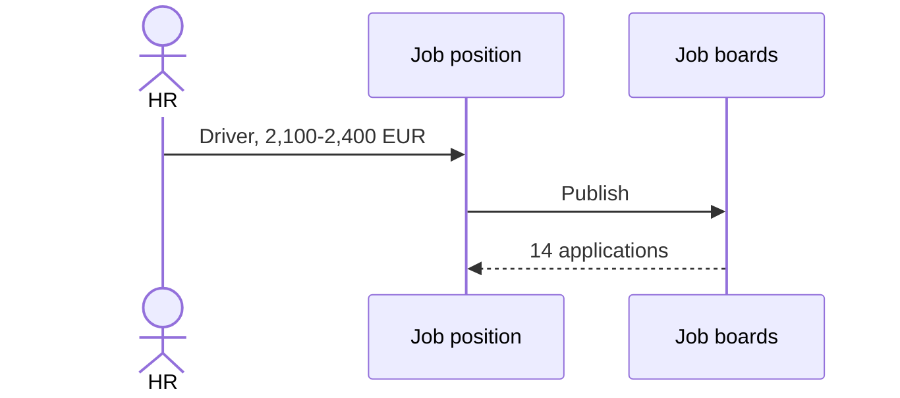

🏠 [Specs](../../../../README.md) › 🧩 [Functional capabilities](../../../README.md) ›
👥 [F9 HR and projects](../../README.md) › 📝 [Use cases](../README.md) › 📝 [Use cases: FL-F9-02 Recruit](README.md) ›
📝 UC-F9-05 Publish jobs and source candidates

# 📝 UC-F9-05 Publish jobs and source candidates

**Status:** ✅ specified

## Summary

Jobs on the career site and boards; sourcing and campaigns.

## Personas

- [U06 HR](../../../../01-users/personas/u06-hr.md)

## Goal

Jobs reach the right candidates.

## Trigger

A position to fill.

## Frequency

Monthly.

## Preconditions

F9 set up for the company.

## Postconditions

- **Succeeded:** the job is published and sourcing runs.
- **Failed:** a board's refusal shows.

## Main flow

1. HR creates a job position ([S-F9-05](../../screens/02-recruit/s-f09-05-job-position.md)) with salary range, skills,
   interviewers and contract template.
2. It is published on the career site and job boards
   ([CR-FR-194](../../../../10-country-packs/france/labour/cr-fr-194-job-offer-rules.md)).
3. Candidates are sourced from boards, LinkedIn and files
   ([D235](../../../../06-decisions/f04-meetings/d235-recruitment-split.md)); on LinkedIn, through Unipile, HR searches
   and ranks profiles ([UC-F9-40](uc-f09-40-search-and-rank-linkedin-profiles.md)), runs an outreach sequence whose
   messages HR sends with one click each, or which sends on its own when the administrator turned automatic sending on
   ([UC-F9-41](uc-f09-41-run-a-linkedin-outreach-sequence.md),
   [D570](../../../../06-decisions/f09-hr-and-projects/d570-linkedin-sending-prepared-by-default.md)), and turns
   positive replies into applicants ([UC-F9-42](uc-f09-42-turn-a-positive-reply-into-an-applicant.md)), as
   [D518](../../../../06-decisions/f09-hr-and-projects/d518-linkedin-sourcing-through-unipile.md) decided.
4. Campaigns stop when the candidate replies.

## Alternative flows

- 4a. Source performance reports.

## Error flows

- 2e. A board refuses the posting: its reason shown.

## Business rules

- [BR-F9-11 Candidate data has a term](../../business-rules/br-f09-11-candidate-data-has-a-term.md)

## Entities

- [E-F9-06 Job position](../../data/e-f09-06-job-position.md)
- [E-F9-07 Applicant](../../data/e-f09-07-applicant.md)

## Permissions

HR; the owner reads; HR data stays with HR and the person
([BR-F9-02](../../business-rules/br-f09-02-hr-data-stays-with-hr-and-the-person.md)). Hiring managers.

## Notifications

HR: applications.

## Audit events

Published, sourced.

## AI involvement

The AI assistant prepares it for confirmation
([BR-F3-07](../../../f03-assistant/business-rules/br-f03-07-no-deletes-no-irreversible-acts.md)); figures come from
queries ([BR-F3-03](../../../f03-assistant/business-rules/br-f03-03-figures-come-from-queries.md)).

## API, MCP and A2A exposure

T5 operations of F9 with the caller's rights; the MCP tool of F9; no A2A skill.

## Screens

- [S-F9-05](../../screens/02-recruit/s-f09-05-job-position.md)

## Flowchart

See [FL-F9-02 Recruit](../../flows/fl-f09-02-recruit.md#flowchart).

## Sequence diagram

## Acceptance criteria

1. **Given** a driver job with a salary range **when** it is published **then** the career site and boards show it.
2. **Given** a board refusing "missing salary" **when** it answers **then** the reason shows.
3. **Given** a candidate replying to a campaign **when** the reply arrives **then** the campaign stops.

## Non-functional notes

None.

## Regulatory references

[CR-FR-194](../../../../10-country-packs/france/labour/cr-fr-194-job-offer-rules.md);
[CR-FR-195](../../../../10-country-packs/france/data-protection/cr-fr-195-candidate-data.md).

## Related use cases

See the flows.
- [UC-F9-40 Search and rank LinkedIn profiles](uc-f09-40-search-and-rank-linkedin-profiles.md)
- [UC-F9-41 Run a LinkedIn outreach sequence](uc-f09-41-run-a-linkedin-outreach-sequence.md)
- [UC-F9-42 Turn a positive reply into an applicant](uc-f09-42-turn-a-positive-reply-into-an-applicant.md)

## Open questions

None.

---

⬅️ [UC-F9-04 Use employee self-service](../01-people/uc-f09-04-use-employee-self-service.md) · ⬆️ [Up](README.md) ·
➡️ [UC-F9-06 Run the applicant pipeline](uc-f09-06-run-the-applicant-pipeline.md)
