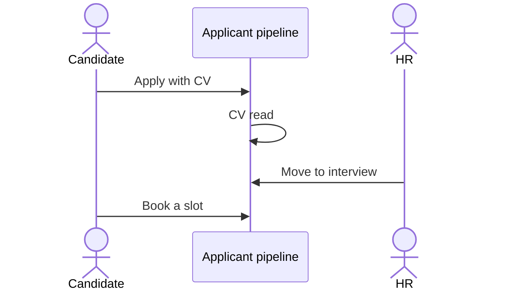

🏠 [Specs](../../../../README.md) › 🧩 [Functional capabilities](../../../README.md) ›
👥 [F9 HR and projects](../../README.md) › 📝 [Use cases](../README.md) › 📝 [Use cases: FL-F9-02 Recruit](README.md) ›
📝 UC-F9-06 Run the applicant pipeline

# 📝 UC-F9-06 Run the applicant pipeline

**Status:** ✅ specified

## Summary

Applicants move through stages; the AI reads CVs and can pre-screen by voice.

## Personas

- [U06 HR](../../../../01-users/personas/u06-hr.md)
- [U02 Manager](../../../../01-users/personas/u02-manager.md)

## Goal

Applicants moved fast and fairly.

## Trigger

Applications arrive.

## Frequency

Daily.

## Preconditions

F9 set up for the company.

## Postconditions

- **Succeeded:** applicants at their stage; interviews scheduled.
- **Failed:** deletion requests done.

## Main flow

1. Applications arrive; the AI reads CVs into the record on the applicant pipeline
   ([S-F9-06](../../screens/02-recruit/s-f09-06-applicant-pipeline.md)).
2. Applicants move through stages with emails; they self-schedule interviews.
3. An optional AI voice pre-screening asks the same questions to all
   ([BR-F9-12](../../business-rules/br-f09-12-ai-calls-say-they-are-ai.md)).
4. Interviews are captured and evaluated in F4,
   [UC-F4-13](../../../f04-meetings/use-cases/09-score-calls-and-interviews/uc-f04-13-interview-a-candidate.md).

## Alternative flows

- 2a. Tests and surveys.

## Error flows

- 2e. A candidate asks to be deleted: done ([BR-F9-11](../../business-rules/br-f09-11-candidate-data-has-a-term.md)).

## Business rules

- [BR-F9-11 Candidate data has a term](../../business-rules/br-f09-11-candidate-data-has-a-term.md)
- [BR-F9-12 AI calls say they are AI](../../business-rules/br-f09-12-ai-calls-say-they-are-ai.md)

## Entities

- [E-F9-07 Applicant](../../data/e-f09-07-applicant.md)

## Permissions

HR; the owner reads; HR data stays with HR and the person
([BR-F9-02](../../business-rules/br-f09-02-hr-data-stays-with-hr-and-the-person.md)). Hiring managers.

## Notifications

Candidates: stage emails.

## Audit events

Stages, deletions.

## AI involvement

CV reading and pre-screening are high-risk AI: a person decides,
[CR-FR-058](../../../../10-country-packs/france/ai-and-recording/cr-fr-058-high-risk-ai-in-employment.md).

## API, MCP and A2A exposure

T5 operations of F9 with the caller's rights; the MCP tool of F9; no A2A skill.

## Screens

- [S-F9-06](../../screens/02-recruit/s-f09-06-applicant-pipeline.md)

## Flowchart

See [FL-F9-02 Recruit](../../flows/fl-f09-02-recruit.md#flowchart).

## Sequence diagram

## Acceptance criteria

1. **Given** a CV in PDF **when** it arrives **then** name, experience and skills are filled.
2. **Given** a candidate asking deletion **when** it is asked **then** the record is deleted.
3. **Given** pre-screening on **when** the call starts **then** it says it is an AI.

## Non-functional notes

None.

## Regulatory references

[CR-FR-058](../../../../10-country-packs/france/ai-and-recording/cr-fr-058-high-risk-ai-in-employment.md);
[CR-FR-195](../../../../10-country-packs/france/data-protection/cr-fr-195-candidate-data.md).

## Related use cases

See the flows.

## Open questions

None.

---

⬅️ [UC-F9-05 Publish jobs and source candidates](uc-f09-05-publish-jobs-and-source-candidates.md) · ⬆️ [Up](README.md) ·
➡️ [UC-F9-07 Make an offer and hire](uc-f09-07-make-an-offer-and-hire.md)
