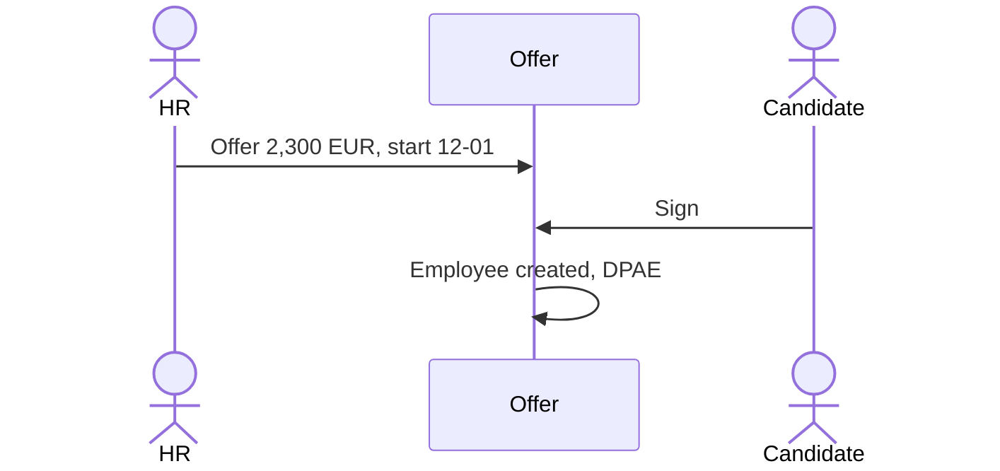

🏠 [Specs](../../../../README.md) › 🧩 [Functional capabilities](../../../README.md) ›
👥 [F9 HR and projects](../../README.md) › 📝 [Use cases](../README.md) › 📝 [Use cases: FL-F9-02 Recruit](README.md) ›
📝 UC-F9-07 Make an offer and hire

# 📝 UC-F9-07 Make an offer and hire

**Status:** ✅ specified

## Summary

An online offer, signed, then the applicant becomes an employee.

## Personas

- [U06 HR](../../../../01-users/personas/u06-hr.md)

## Goal

Hire with a signed offer and start the right processes.

## Trigger

A chosen candidate.

## Frequency

Per hire.

## Preconditions

F9 set up for the company.

## Postconditions

- **Succeeded:** the employee exists; DPAE and onboarding started.
- **Failed:** a refused offer keeps its reason.

## Main flow

1. HR sends an online offer ([S-F9-07](../../screens/02-recruit/s-f09-07-offer.md)); the candidate builds the package
   within limits.
2. The candidate signs.
3. One click makes the employee; the DPAE and onboarding start,
   [UC-F9-03](../01-people/uc-f09-03-comply-with-french-hr-duties.md),
   [UC-F9-02](../01-people/uc-f09-02-onboard-and-offboard.md).
4. A feedback survey goes to the new hire.

## Alternative flows

- 2a. Offer refused: reason recorded.

## Error flows

- 3e. The DPAE fails: the start is blocked ([BR-F9-03](../../business-rules/br-f09-03-dpae-before-the-first-day.md)).

## Business rules

- [BR-F9-03 DPAE before the first day](../../business-rules/br-f09-03-dpae-before-the-first-day.md)

## Entities

- [E-F9-07 Applicant](../../data/e-f09-07-applicant.md)
- [E-F9-02 Contract](../../data/e-f09-02-contract.md)
- [E-F9-38 Job offer](../../data/e-f09-38-job-offer.md)

## Permissions

HR; the owner reads; HR data stays with HR and the person
([BR-F9-02](../../business-rules/br-f09-02-hr-data-stays-with-hr-and-the-person.md)).

## Notifications

Candidate: offer.

## Audit events

Offer sent, signed, hired.

## AI involvement

The AI assistant prepares it for confirmation
([BR-F3-07](../../../f03-assistant/business-rules/br-f03-07-no-deletes-no-irreversible-acts.md)); figures come from
queries ([BR-F3-03](../../../f03-assistant/business-rules/br-f03-03-figures-come-from-queries.md)).

## API, MCP and A2A exposure

T5 operations of F9 with the caller's rights; the MCP tool of F9; no A2A skill.

## Screens

- [S-F9-07](../../screens/02-recruit/s-f09-07-offer.md)

## Flowchart

See [FL-F9-02 Recruit](../../flows/fl-f09-02-recruit.md#flowchart).

## Sequence diagram

## Acceptance criteria

1. **Given** an offer of 2,300 EUR **when** the candidate signs **then** the employee is created.
2. **Given** a refused offer "salary" **when** it is refused **then** the reason is recorded.
3. **Given** the DPAE refused **when** the start nears **then** the start is blocked.

## Non-functional notes

None.

## Regulatory references

[CR-FR-037](../../../../10-country-packs/france/labour/cr-fr-037-dpae-before-the-first-day.md).

## Related use cases

See the flows.

## Open questions

None.

---

⬅️ [UC-F9-06 Run the applicant pipeline](uc-f09-06-run-the-applicant-pipeline.md) · ⬆️ [Up](README.md) ·
➡️ [UC-F9-08 Run referrals](uc-f09-08-run-referrals.md)
