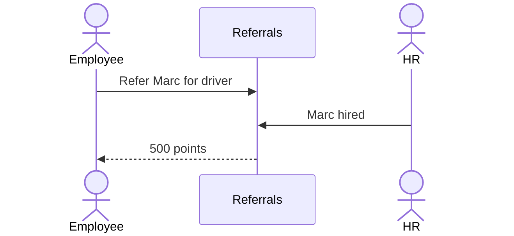

🏠 [Specs](../../../../README.md) › 🧩 [Functional capabilities](../../../README.md) ›
👥 [F9 HR and projects](../../README.md) › 📝 [Use cases](../README.md) › 📝 [Use cases: FL-F9-02 Recruit](README.md) ›
📝 UC-F9-08 Run referrals

# 📝 UC-F9-08 Run referrals

**Status:** ✅ specified

## Summary

Employees refer candidates and earn points and rewards.

## Personas

- [U01 Employee](../../../../01-users/personas/u01-employee.md)
- [U06 HR](../../../../01-users/personas/u06-hr.md)

## Goal

Employees bring good candidates.

## Trigger

A job opens.

## Frequency

Monthly.

## Preconditions

F9 set up for the company.

## Postconditions

- **Succeeded:** referrals tracked and rewarded.
- **Failed:** a duplicate referral not counted.

## Main flow

1. Employees share jobs from referrals ([S-F9-08](../../screens/02-recruit/s-f09-08-referrals.md)).
2. Referred candidates are tracked; points per stage.
3. Points buy rewards.
4. HR sees which referrals were hired.

## Alternative flows

- 1a. Teams and avatars.

## Error flows

- 2e. A candidate already in the pipeline: not counted twice.

## Business rules

- See F9's rules.

## Entities

- [E-F9-07 Applicant](../../data/e-f09-07-applicant.md)
- [E-F9-36 Employee referral](../../data/e-f09-36-employee-referral.md)

## Permissions

Employees; HR.

## Notifications

Employees: points.

## Audit events

Referrals, points, rewards.

## AI involvement

None.

## API, MCP and A2A exposure

T5 operations of F9 with the caller's rights; the MCP tool of F9; no A2A skill.

## Screens

- [S-F9-08](../../screens/02-recruit/s-f09-08-referrals.md)

## Flowchart

See [FL-F9-02 Recruit](../../flows/fl-f09-02-recruit.md#flowchart).

## Sequence diagram

## Acceptance criteria

1. **Given** a referral of Marc **when** he is hired **then** the referrer gets the hire points.
2. **Given** Marc already applied **when** he is referred **then** the referral is not counted.
3. **Given** 1,000 points **when** a reward is chosen **then** the points are spent.

## Non-functional notes

None.

## Regulatory references

None.

## Related use cases

See the flows.

## Open questions

None.

---

⬅️ [UC-F9-07 Make an offer and hire](uc-f09-07-make-an-offer-and-hire.md) · ⬆️ [Up](README.md) ·
➡️ [UC-F9-09 Request and approve time off](../03-time/uc-f09-09-request-and-approve-time-off.md)
