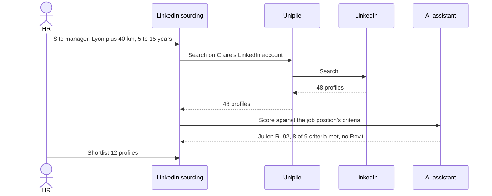

🏠 [Specs](../../../../README.md) › 🧩 [Functional capabilities](../../../README.md) ›
👥 [F9 HR and projects](../../README.md) › 📝 [Use cases](../README.md) › 📝 [Use cases: FL-F9-02 Recruit](README.md) ›
📝 UC-F9-40 Search and rank LinkedIn profiles

# 📝 UC-F9-40 Search and rank LinkedIn profiles

**Status:** 🔄 waiting for the owner

## Summary

HR searches LinkedIn for a job position with a rich set of criteria, through the company's Unipile connector and HR's
own LinkedIn account. The AI assistant scores each profile found against the job position's criteria, with a short
reason per score, and HR shortlists the people to contact.

## Personas

- [U06 Human resources](../../../../01-users/personas/u06-hr.md)
- [U07 Administrator](../../../../01-users/personas/u07-administrator.md), who connects Unipile once:
  [UC-F24-02](../../../f24-integrations-hub/use-cases/01-find-and-connect/uc-f24-02-connect-a-tool-in-the-fewest-steps.md).

## Goal

The people who best match the job are found and ranked, and HR keeps only those worth contacting.

## Trigger

A job position the career site and the boards do not fill, or HR's choice when publishing it
([UC-F9-05](uc-f09-05-publish-jobs-and-source-candidates.md)).

## Frequency

A few searches per open position, run again when the shortlist runs short.

## Preconditions

- The job position exists with its criteria ([E-F9-06 Job position](../../data/e-f09-06-job-position.md)).
- The administrator connected Unipile in F24:
  [UC-F24-02](../../../f24-integrations-hub/use-cases/01-find-and-connect/uc-f24-02-connect-a-tool-in-the-fewest-steps.md).
- Unipile's API key is in the secret store, never in configuration or logs:
  [BR-F24-08](../../../f24-integrations-hub/business-rules/br-f24-08-credentials-in-the-vault.md).
- HR linked their own LinkedIn account on Unipile's hosted sign-in page, once; simple-ERP never sees the LinkedIn
  password ([E-F24-02 Tool connection](../../../f24-integrations-hub/data/e-f24-02-tool-connection.md)).
- Profile ranking is switched on for the company, which accepted its deployer duties for a high-risk AI use
  ([BR-F4-21](../../../f04-meetings/business-rules/br-f04-21-candidate-scoring-is-high-risk-ai.md)).

## Postconditions

- **Succeeded:** the search is saved with its criteria
  ([E-F9-44 Sourcing search](../../data/e-f09-44-sourcing-search.md)); each profile found is a prospect
  ([E-F9-45 Prospect](../../data/e-f09-45-prospect.md)) with its score, its reason and the criteria met or missed; HR's
  shortlist is ready for the outreach sequence ([UC-F9-41](uc-f09-41-run-a-linkedin-outreach-sequence.md)).
- **Failed:** nothing is sent to anyone; the criteria stay saved and HR can run the search again.

## Main flow

1. HR opens LinkedIn sourcing from the job position
   ([S-F9-37](../../screens/02-recruit/s-f09-37-linkedin-sourcing-search.md)); titles, skills, seniority and location
   are prefilled from the job position.
2. HR completes the criteria: titles, skills, seniority, years of experience, location and radius, languages,
   industries, current and past employers to include or exclude, education, keywords with boolean operators (AND, OR,
   NOT, quotes) and open to work.
3. simple-ERP checks every criterion and refuses one the law forbids in hiring
   ([BR-F9-40](../../business-rules/br-f09-40-no-criterion-the-law-forbids-in-hiring.md)).
4. HR runs the search; simple-ERP sends it through Unipile on HR's LinkedIn account, within the account's limits
   ([BR-F9-41](../../business-rules/br-f09-41-linkedin-account-limits-respected.md)). (Proposed) The criteria the
   account's LinkedIn search does not offer are applied by the AI assistant to the profiles returned, and the screen
   says which ([Q19](../../../../07-questions/q19-which-linkedin-search-sourcing-uses.md)).
5. The AI assistant scores each profile from 0 to 100 against the job position's criteria, with a short reason per score
   and the criteria met or missed; the profiles are listed by score.
6. HR reads the scores and reasons, opens a profile when needed, and shortlists the people to contact; a score never
   shortlists anyone by itself
   ([BR-F4-21](../../../f04-meetings/business-rules/br-f04-21-candidate-scoring-is-high-risk-ai.md)).
7. HR saves the search; the shortlist goes to the outreach sequence
   ([UC-F9-41](uc-f09-41-run-a-linkedin-outreach-sequence.md)).

## Alternative flows

- 1a. HR asks the AI assistant: "find site managers near Lyon on LinkedIn"; the AI assistant fills the criteria for HR
  to check, and the search runs only when HR confirms
  ([BR-F3-07](../../../f03-assistant/business-rules/br-f03-07-no-deletes-no-irreversible-acts.md)).
- 4a. A saved search runs again later: the profiles already found, contacted or on the do-not-contact list are marked
  and never added twice ([BR-F9-39](../../business-rules/br-f09-39-prospects-kept-only-as-long-as-needed.md)).
- 6a. HR adds a profile by its LinkedIn address; it is scored like the others.
- 6b. HR removes a shortlisted profile; it is not contacted from this search.

## Error flows

- 3e. A criterion the law forbids (an age, a family situation, a nationality): refused with the reason; the search does
  not run ([BR-F9-40](../../business-rules/br-f09-40-no-criterion-the-law-forbids-in-hiring.md)).
- 4e. HR's LinkedIn account needs a new sign-in: HR is sent to Unipile's hosted sign-in page; the criteria stay.
- 4f. The account's search limit is reached, as Unipile reports it: the search stops with the profiles found so far and
  can go on the next day ([BR-F9-41](../../business-rules/br-f09-41-linkedin-account-limits-respected.md)).
- 5e. The AI assistant cannot score a profile (too little on it): it is listed "not scored" with the reason; HR may
  shortlist it by hand.
- Any step: a service does not answer; the call is retried first
  ([BR-F3-32](../../../f03-assistant/business-rules/br-f03-32-retry-before-an-error.md)), then the message follows the
  error pattern (D122) and the criteria stay on the screen.

## Business rules

- [BR-F9-40 No search criterion the law forbids in hiring](../../business-rules/br-f09-40-no-criterion-the-law-forbids-in-hiring.md)
- [BR-F9-41 The LinkedIn account's limits are respected](../../business-rules/br-f09-41-linkedin-account-limits-respected.md)
- [BR-F9-39 Prospects are kept only as long as the sequence needs them](../../business-rules/br-f09-39-prospects-kept-only-as-long-as-needed.md)
- [BR-F9-36 HR approves the shortlist and the sequence before the first message](../../business-rules/br-f09-36-hr-approves-before-the-first-message.md)
- [BR-F4-21 Candidate scoring is high-risk AI](../../../f04-meetings/business-rules/br-f04-21-candidate-scoring-is-high-risk-ai.md)
- [BR-F9-02 HR data stays with HR and the person](../../business-rules/br-f09-02-hr-data-stays-with-hr-and-the-person.md)

## Entities

- [E-F9-44 Sourcing search](../../data/e-f09-44-sourcing-search.md): created, changed
- [E-F9-45 Prospect](../../data/e-f09-45-prospect.md): created, changed
- [E-F9-06 Job position](../../data/e-f09-06-job-position.md): read
- [E-F24-02 Tool connection](../../../f24-integrations-hub/data/e-f24-02-tool-connection.md): read, HR's LinkedIn
  account linked through Unipile

## Permissions

HR only. (Proposed) The hiring manager of the job position reads the shortlist, never the profiles left out. The
administrator connects Unipile and sets its caps but sees no profile.

## Notifications

HR, in the app: a search run in the background has finished, with the number of profiles found and scored.

## Audit events

Search run (criteria, account, profiles found, limit reached); each score (model, score, reason, criteria version); each
profile shortlisted, removed or added by hand, by whom and when.

## AI involvement

The AI assistant fills criteria for HR to check, scores and explains; it never shortlists, contacts or rejects anyone.
Ranking candidates is a high-risk AI use (EU AI Act, Annex III, point 4(a)):
[BR-F4-21](../../../f04-meetings/business-rules/br-f04-21-candidate-scoring-is-high-risk-ai.md) and the
[AI governance](../../../../05-non-functional/ai-governance.md) page apply, and HR's approval of the shortlist
([BR-F9-36](../../business-rules/br-f09-36-hr-approves-before-the-first-message.md)) is the human oversight. Scores use
only job-related criteria, never a ground the law forbids, a photo or a name
([BR-F9-40](../../business-rules/br-f09-40-no-criterion-the-law-forbids-in-hiring.md)). (Proposed) The model is the
"Profile ranking" AI feature setting in F1.

## API, MCP and A2A exposure

T5 operations of F9 for HR (run a search, list the ranked profiles, shortlist). (Proposed) The MCP tool of F9 may run a
search and list the ranked profiles for HR, never shortlist alone. No A2A skill.

## Screens

- [S-F9-37 LinkedIn sourcing search](../../screens/02-recruit/s-f09-37-linkedin-sourcing-search.md)

## Flowchart

See [FL-F9-14 Source candidates on LinkedIn](../../flows/fl-f09-14-source-candidates-on-linkedin.md#flowchart).

## Sequence diagram

## Acceptance criteria

1. **Given** the site manager job with its criteria **when** HR opens LinkedIn sourcing **then** titles, skills,
   seniority and location are prefilled.
2. **Given** the criterion "under 35" **when** HR runs the search **then** it is refused with the reason and nothing is
   searched.
3. **Given** 48 profiles found **when** they are scored **then** each shows a score from 0 to 100, a short reason and
   the criteria met or missed.
4. **Given** a profile scored 92 **when** HR does not shortlist it **then** it is not contacted.
5. **Given** a profile on the do-not-contact list **when** the search runs again **then** it is marked and cannot be
   shortlisted.
6. **Given** the account's search limit reached **when** the search runs **then** it stops with the profiles found so
   far and says when it can go on.

## Non-functional notes

(Proposed) 100 profiles found and scored within 2 minutes, in the background with its progress. Profiles not shortlisted
are not kept beyond the search ([BR-F9-39](../../business-rules/br-f09-39-prospects-kept-only-as-long-as-needed.md)).

## Regulatory references

EU AI Act, [Regulation (EU) 2024/1689](https://eur-lex.europa.eu/eli/reg/2024/1689/oj), Annex III, point 4(a):
[CR-FR-058](../../../../10-country-packs/france/ai-and-recording/cr-fr-058-high-risk-ai-in-employment.md),
[CR-FR-057](../../../../10-country-packs/france/ai-and-recording/cr-fr-057-human-oversight.md); non-discrimination in
hiring: [CR-FR-194](../../../../10-country-packs/france/labour/cr-fr-194-job-offer-rules.md); candidates' data:
[CR-FR-195](../../../../10-country-packs/france/data-protection/cr-fr-195-candidate-data.md),
[CR-FR-196](../../../../10-country-packs/france/data-protection/cr-fr-196-legitimate-interest-balancing.md).

## Related use cases

- [UC-F9-05 Publish jobs and source candidates](uc-f09-05-publish-jobs-and-source-candidates.md)
- [UC-F9-41 Run a LinkedIn outreach sequence](uc-f09-41-run-a-linkedin-outreach-sequence.md)
- [UC-F24-02 Connect a tool in the fewest steps](../../../f24-integrations-hub/use-cases/01-find-and-connect/uc-f24-02-connect-a-tool-in-the-fewest-steps.md)

## Open questions

- [Q18 LinkedIn automation and its user agreement](../../../../07-questions/q18-linkedin-automation-and-its-user-agreement.md)
- [Q19 Which LinkedIn search sourcing uses](../../../../07-questions/q19-which-linkedin-search-sourcing-uses.md)

---

⬅️ [UC-F9-39 Read documents with the AI and verify](../13-keep-qualifications/uc-f09-39-read-documents-and-verify.md) ·
⬆️ [Up](README.md) · ➡️ [UC-F9-41 Run a LinkedIn outreach sequence](uc-f09-41-run-a-linkedin-outreach-sequence.md)
