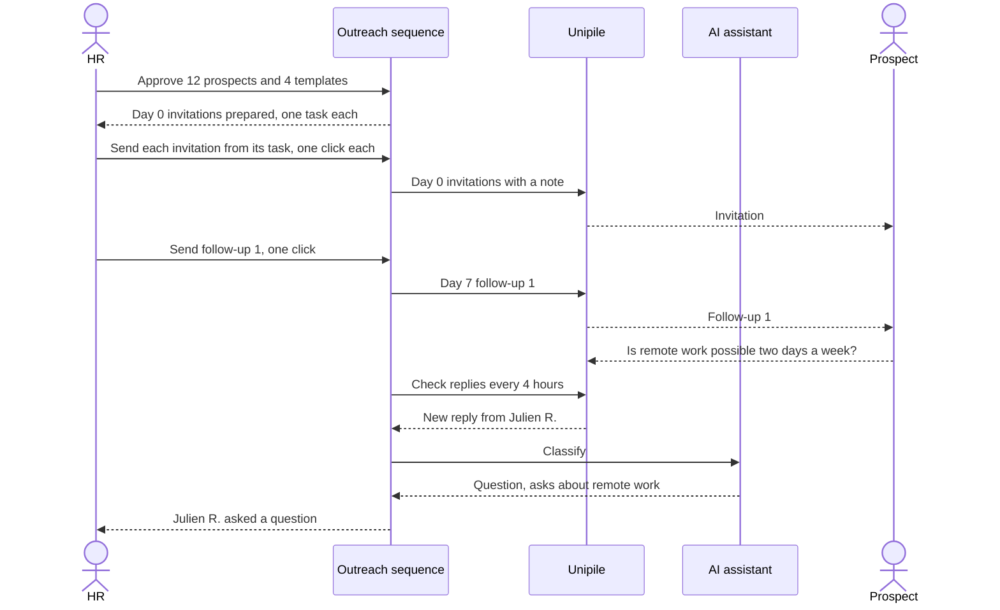

🏠 [Specs](../../../../README.md) › 🧩 [Functional capabilities](../../../README.md) ›
👥 [F9 HR and projects](../../README.md) › 📝 [Use cases](../README.md) › 📝 [Use cases: FL-F9-02 Recruit](README.md) ›
📝 UC-F9-41 Run a LinkedIn outreach sequence

# 📝 UC-F9-41 Run a LinkedIn outreach sequence

**Status:** ✅ specified

## Summary

HR approves the shortlist and the message templates once. SimpleERP then prepares an invitation with a note on day 0
(a direct message when the person is already connected) and follow-ups on days 7 and 21 by default, and HR sends each
one with one click from the task each message becomes in their task list, listed in one daily digest; a message not
sent within 7 days of its task's creation expires.
When the administrator turned automatic sending on before the sequence started, they go out on their own instead
([D570](../../../../06-decisions/f09-hr-and-projects/d570-linkedin-sending-prepared-by-default.md)). SimpleERP checks
replies every few hours and stops at a reply, a refusal or day 60. The AI assistant classifies each reply as positive,
negative, question or unclear; a question or an unclear reply goes to HR.

## Personas

- [U06 Human resources](../../../../01-users/personas/u06-hr.md)
- [U07 Administrator](../../../../01-users/personas/u07-administrator.md), who sets the caps of the LinkedIn accounts
  and may turn automatic sending on for the company
  ([D570](../../../../06-decisions/f09-hr-and-projects/d570-linkedin-sending-prepared-by-default.md))

## Goal

Every shortlisted person is contacted once, followed up at most twice, and nobody is chased beyond two months.

## Trigger

HR approves the sequence of a sourcing search on [S-F9-38](../../screens/02-recruit/s-f09-38-outreach-sequence.md).

## Frequency

One sequence per sourcing search; replies checked every few hours for 60 days.

## Preconditions

- A shortlist from [UC-F9-40](uc-f09-40-search-and-rank-linkedin-profiles.md).
- HR's LinkedIn account linked through Unipile and active
  ([E-F24-02 Tool connection](../../../f24-integrations-hub/data/e-f24-02-tool-connection.md)).
- The company's privacy notice for candidates published and its link set
  ([BR-F9-38](../../business-rules/br-f09-38-sourced-people-told-at-the-first-contact.md)).
- The sending mode of the company's Unipile connection: prepared by default, automatic only when the administrator
  turned it on ([D570](../../../../06-decisions/f09-hr-and-projects/d570-linkedin-sending-prepared-by-default.md)).
  The sequence takes the mode set when it starts and keeps it until it ends.

## Postconditions

- **Succeeded:** each prospect ended as applicant, declined, no answer or erased; every message sent and received is
  kept with the prospect ([E-F9-47 Outreach message](../../data/e-f09-47-outreach-message.md)).
- **Failed:** the messages not sent stay planned and the sequence is paused, with the reason.

## Main flow

1. HR opens the outreach sequence of the search ([S-F9-38](../../screens/02-recruit/s-f09-38-outreach-sequence.md)): the
   shortlist, the steps and their days, the templates.
2. HR writes or adapts the templates, which the AI assistant may draft: the invitation note, the direct message for
   people already connected, follow-up 1, follow-up 2, the booking-link reply and a thank-you on a refusal.
   The first message says who writes and why, where the profile was found, and links the company's privacy notice
   ([BR-F9-38](../../business-rules/br-f09-38-sourced-people-told-at-the-first-contact.md)).
3. HR approves the shortlist and the templates once
   ([BR-F9-36](../../business-rules/br-f09-36-hr-approves-before-the-first-message.md)); the sequence starts with the
   company's sending mode of that moment, which it keeps until it ends
   ([E-F9-46](../../data/e-f09-46-outreach-sequence.md)).
4. Day 0: each prospect's invitation with its note, or a direct message when already connected, is prepared and waits
   as a task in HR's task list ([E-F9-18 Project and task](../../data/e-f09-18-project-and-task.md),
   [S-F9-17](../../screens/06-plan-and-deliver-work/s-f09-17-projects.md)); HR sends each one with one click, with Send
   in the task or on [S-F9-39](../../screens/02-recruit/s-f09-39-prospect-conversations.md); nothing goes out on
   LinkedIn without that click. With automatic sending on, the messages go out on their own instead
   ([D570](../../../../06-decisions/f09-hr-and-projects/d570-linkedin-sending-prepared-by-default.md)).
   In both modes, within the account's limits and caps
   ([BR-F9-41](../../business-rules/br-f09-41-linkedin-account-limits-respected.md)).
5. Days 7 and 21 by default: a follow-up falls due for each prospect who has not replied, prepared for HR's click or
   sent on its own, as in step 4
   ([BR-F9-37](../../business-rules/br-f09-37-outreach-stops-at-a-reply-a-refusal-or-day-60.md)).
6. Every few hours, every 4 hours, SimpleERP checks replies and accepted invitations through Unipile.
7. A reply stops that prospect's follow-ups at once; the AI assistant classifies it as positive, negative, question or
   unclear, with a short reason.
8. Positive: [UC-F9-42](uc-f09-42-turn-a-positive-reply-into-an-applicant.md). Negative: the thank-you is prepared as a
   task for HR's click, or sent on its own in automatic mode, as in step 4; the prospect is declined and erased at the
   end of the sequence
   ([BR-F9-39](../../business-rules/br-f09-39-prospects-kept-only-as-long-as-needed.md)). Question or unclear: the
   thread goes to HR on [S-F9-39](../../screens/02-recruit/s-f09-39-prospect-conversations.md), who answers by hand and
   then marks it positive or negative.
9. Day 60: the sequence ends for everyone; prospects without an answer end as "no answer"
   ([BR-F9-37](../../business-rules/br-f09-37-outreach-stops-at-a-reply-a-refusal-or-day-60.md)).

## Alternative flows

- 1a. HR moves the follow-ups (for example to days 5 and 14); every step stays within day 60
  ([BR-F9-37](../../business-rules/br-f09-37-outreach-stops-at-a-reply-a-refusal-or-day-60.md)).
- 3a. HR adds prospects to a running sequence: only those prospects need approval; the templates already approved stay.
- 3b. HR changes a template after approval: the sequence returns to draft and the next message using it waits for
  approval again; the sequence keeps its sending mode
  ([BR-F9-36](../../business-rules/br-f09-36-hr-approves-before-the-first-message.md)).
- 4a. Prepared mode: every message SimpleERP sends, the invitation, the follow-ups, the booking-link reply and the
  thank-you, waits when it falls due as a task in the task list of the HR user who owns the sequence, and HR's daily
  digest lists it ([notifications](../../notifications.md)), with the messages expiring within 24 hours; HR sends it
  with one click, with Send in the task or on [S-F9-39](../../screens/02-recruit/s-f09-39-prospect-conversations.md),
  and the task closes
  ([D570](../../../../06-decisions/f09-hr-and-projects/d570-linkedin-sending-prepared-by-default.md)).
- 4b. Prepared mode, a message not sent within 7 days of the creation of its task: it expires, is never sent, and its
  task closes; the prospect goes on as if they had not answered: the next follow-up falls due on its day, and on day 60
  the prospect ends as "no answer". A prospect whose day 0 message expired was never contacted, gets no follow-up, and
  ends as "no answer" on day 60 too. A message HR clicked that a limit holds never expires: it goes when the limit
  allows. A prepared message still waiting on day 60 is cancelled
  ([BR-F9-37](../../business-rules/br-f09-37-outreach-stops-at-a-reply-a-refusal-or-day-60.md),
  [E-F9-45 Prospect](../../data/e-f09-45-prospect.md)).
- 4c. The administrator changes the company's sending mode while the sequence runs: the sequence keeps the mode it
  started with until it ends; the sequences started after the change use the new mode
  ([BR-F9-36](../../business-rules/br-f09-36-hr-approves-before-the-first-message.md),
  [D570](../../../../06-decisions/f09-hr-and-projects/d570-linkedin-sending-prepared-by-default.md)).
- 5a. A follow-up falls due while the invitation is still pending: it waits until the invitation is accepted
  and goes then, unless the next follow-up or day 60 has come.
- 7a. HR changes the class of a reply the AI assistant got wrong; the new class applies and the change is audited.
- 8a. The person asks to be erased, in any words: HR confirms and the prospect and its messages are erased everywhere
  ([BR-F9-11](../../business-rules/br-f09-11-candidate-data-has-a-term.md),
  [BR-F9-39](../../business-rules/br-f09-39-prospects-kept-only-as-long-as-needed.md)).

## Error flows

- 4e. The account's daily or weekly limit is reached, as Unipile reports it, or the administrator's cap: the remaining
  messages wait for the next day; HR sees "paused until tomorrow"
  ([BR-F9-41](../../business-rules/br-f09-41-linkedin-account-limits-respected.md)).
- 4f. HR's LinkedIn account needs a new sign-in: the sequence pauses and HR and the administrator are told; HR signs in
  again on Unipile's hosted page and the sequence goes on with its days unchanged, still ending on day 60.
- 4g. LinkedIn refuses one invitation (the person accepts none, or one is already pending): that prospect is marked with
  the reason and gets no follow-up.
- 7e. The AI assistant cannot classify a reply: it is "unclear" and goes to HR.
- Any step: a service does not answer; the call is retried first
  ([BR-F3-32](../../../f03-assistant/business-rules/br-f03-32-retry-before-an-error.md)), then the message follows the
  error pattern (D122) and nothing is sent twice.

## Business rules

- [BR-F9-36 HR approves the shortlist and the sequence before the first message](../../business-rules/br-f09-36-hr-approves-before-the-first-message.md)
- [BR-F9-37 An outreach sequence stops at a reply, a refusal or day 60](../../business-rules/br-f09-37-outreach-stops-at-a-reply-a-refusal-or-day-60.md)
- [BR-F9-38 A sourced person is told at the first contact at the latest](../../business-rules/br-f09-38-sourced-people-told-at-the-first-contact.md)
- [BR-F9-39 Prospects are kept only as long as the sequence needs them](../../business-rules/br-f09-39-prospects-kept-only-as-long-as-needed.md)
- [BR-F9-41 The LinkedIn account's limits are respected](../../business-rules/br-f09-41-linkedin-account-limits-respected.md)
- [BR-F9-11 Candidate data has a term](../../business-rules/br-f09-11-candidate-data-has-a-term.md)
- [BR-F4-21 Candidate scoring is high-risk AI](../../../f04-meetings/business-rules/br-f04-21-candidate-scoring-is-high-risk-ai.md)

## Entities

- [E-F9-46 Outreach sequence](../../data/e-f09-46-outreach-sequence.md): created, changed
- [E-F9-47 Outreach message](../../data/e-f09-47-outreach-message.md): created, changed
- [E-F9-45 Prospect](../../data/e-f09-45-prospect.md): changed
- [E-F9-18 Project and task](../../data/e-f09-18-project-and-task.md): created, changed, in prepared mode
- [E-F24-02 Tool connection](../../../f24-integrations-hub/data/e-f24-02-tool-connection.md): read

## Permissions

The HR user who owns the search approves the sequence and reads the threads; another HR user of the company
may take a sequence over. The administrator sets the caps, may turn automatic sending on for the company, and sees the
counts only, never the messages.

## Notifications

- HR, at once: a reply classified as a question or unclear; a positive reply.
- HR, once a day in prepared mode: one digest listing the messages waiting as tasks with Send and those expiring
  within 24 hours; no notification per message.
- HR, at once, and the administrator for a sign-in: a sequence paused, with the reason.
- HR, on day 60: the sequence's end with its results.

## Audit events

Approval (who, when, the shortlist, the templates' versions and the sending mode fixed at the start); each message
planned, prepared with its task, sent (by HR's click or automatically), failed, cancelled or expired; each reply
received with its class, confidence and reason; each class changed by HR; each pause and restart.

## AI involvement

The AI assistant may draft the templates and classifies the replies. It never sends a text HR did not approve as a
template, never answers a question in the thread, and never decides about a person: a reply stops the follow-ups
whatever its class, and HR sees every class and can change it
([BR-F4-21](../../../f04-meetings/business-rules/br-f04-21-candidate-scoring-is-high-risk-ai.md)). The model
is the "Reply classification" AI feature setting in F1.

## API, MCP and A2A exposure

T5 operations of F9 for HR (approve, pause, list the threads, change a class). The MCP tool of F9 lists the
threads and drafts a reply for HR, never approves or sends. No A2A skill.

## Screens

- [S-F9-38 Outreach sequence](../../screens/02-recruit/s-f09-38-outreach-sequence.md)
- [S-F9-39 Prospect conversations](../../screens/02-recruit/s-f09-39-prospect-conversations.md)
- [S-F9-17 Projects](../../screens/06-plan-and-deliver-work/s-f09-17-projects.md), the task list where a prepared
  message waits

## Flowchart

See [FL-F9-14 Source candidates on LinkedIn](../../flows/fl-f09-14-source-candidates-on-linkedin.md#flowchart).

## Sequence diagram

## Acceptance criteria

1. **Given** 12 shortlisted prospects and templates not approved **when** the sequence is saved **then** nothing is
   sent.
2. **Given** the sequence approved, prepared mode **when** day 0 comes **then** each prospect's invitation with its
   note, or a direct message if already connected, is prepared and goes only when HR clicks Send.
3. **Given** no reply **when** days 7 and 21 come **then** follow-up 1 and follow-up 2 fall due, and nothing more.
4. **Given** a reply on day 9 **when** it is checked **then** no follow-up goes to that prospect afterwards.
5. **Given** the reply "Is remote work possible?" **when** it is classified **then** it is a question and waits for HR.
6. **Given** no reply on day 60 **when** the sequence ends **then** the prospect is "no answer".
7. **Given** the account's daily limit reached **when** messages remain **then** they wait for the next day and HR sees
   why.
8. **Given** the first message **when** it is sent **then** it names the company, says where the profile was found and
   links the privacy notice.
9. **Given** automatic sending turned on by the administrator **when** day 0 comes **then** the invitations go on their
   own within the account's limits and caps.
10. **Given** a prepared follow-up HR has not sent **when** 7 days have passed since its task was created **then** it
    expires, is never sent, its task closes, and the next follow-up falls due on its day.
11. **Given** a prepared mode sequence **when** a message falls due **then** a task with Send appears in the task list
    of the HR user who owns the sequence, and the next daily digest lists it; HR gets no notification for that message
    alone.
12. **Given** a prospect whose day 0 invitation expired unsent **when** day 60 comes **then** the prospect is "no
    answer" and got no follow-up.
13. **Given** a sequence running in prepared mode **when** the administrator turns automatic sending on **then** that
    sequence stays prepared until it ends, and a sequence approved afterwards sends on its own.
14. **Given** a negative reply in prepared mode **when** it is classified **then** the thank-you is prepared as a task
    and goes only when HR clicks Send.
15. **Given** HR clicked Send on a prepared message and the daily cap is reached **when** 7 days have passed since its
    task was created **then** it has not expired and goes as soon as the limit allows.
16. **Given** 9 messages waiting and 2 of them expiring tomorrow **when** the daily digest goes **then** one
    notification lists the 9 messages and marks the 2 expiring within 24 hours.
17. **Given** a prepared mode sequence returned to draft after the administrator turned automatic sending on **when**
    HR approves it again **then** it stays in prepared mode.

## Non-functional notes

Replies checked every few hours; the messages spread over working hours; a message is never sent twice, even
after a retry.

## Regulatory references

GDPR, [Regulation (EU) 2016/679](https://eur-lex.europa.eu/eli/reg/2016/679/oj), article 14;
[CR-FR-195](../../../../10-country-packs/france/data-protection/cr-fr-195-candidate-data.md);
[CR-FR-196](../../../../10-country-packs/france/data-protection/cr-fr-196-legitimate-interest-balancing.md);
[CR-FR-058](../../../../10-country-packs/france/ai-and-recording/cr-fr-058-high-risk-ai-in-employment.md).

## Related use cases

- [UC-F9-40 Search and rank LinkedIn profiles](uc-f09-40-search-and-rank-linkedin-profiles.md)
- [UC-F9-42 Turn a positive reply into an applicant](uc-f09-42-turn-a-positive-reply-into-an-applicant.md)

## Open questions

- [Q18 LinkedIn automation and its user agreement](../../../../07-questions/q18-linkedin-automation-and-its-user-agreement.md),
  answered by
  [D570 LinkedIn sending prepared by default](../../../../06-decisions/f09-hr-and-projects/d570-linkedin-sending-prepared-by-default.md)

---

⬅️ [UC-F9-40 Search and rank LinkedIn profiles](uc-f09-40-search-and-rank-linkedin-profiles.md) · ⬆️ [Up](README.md) ·
➡️ [UC-F9-42 Turn a positive reply into an applicant](uc-f09-42-turn-a-positive-reply-into-an-applicant.md)
