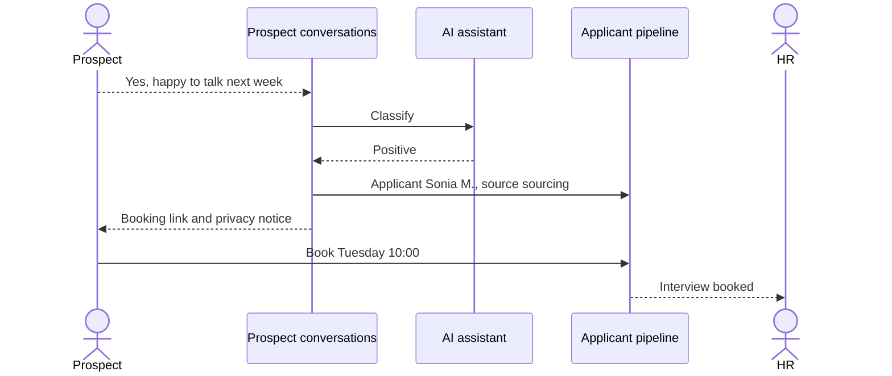

🏠 [Specs](../../../../README.md) › 🧩 [Functional capabilities](../../../README.md) ›
👥 [F9 HR and projects](../../README.md) › 📝 [Use cases](../README.md) › 📝 [Use cases: FL-F9-02 Recruit](README.md) ›
📝 UC-F9-42 Turn a positive reply into an applicant

# 📝 UC-F9-42 Turn a positive reply into an applicant

**Status:** 🔄 waiting for the owner

## Summary

When a prospect answers positively, SimpleERP creates the applicant for the job position with the source "sourcing" and
sends the self-scheduling booking link the applicant pipeline uses; the interview is then booked as any applicant's.

## Personas

- [U06 Human resources](../../../../01-users/personas/u06-hr.md)

## Goal

A person who is interested gets an interview slot without back-and-forth.

## Trigger

A reply classified as positive ([UC-F9-41](uc-f09-41-run-a-linkedin-outreach-sequence.md)), or HR marks a thread
positive.

## Frequency

A few times per sequence.

## Preconditions

- The job position has its interviewers and their free slots for self-scheduling
  ([UC-F9-06](uc-f09-06-run-the-applicant-pipeline.md)).
- The booking-link reply was approved with the sequence
  ([BR-F9-36](../../business-rules/br-f09-36-hr-approves-before-the-first-message.md)).

## Postconditions

- **Succeeded:** the applicant exists ([E-F9-07 Applicant](../../data/e-f09-07-applicant.md), source "sourcing", the
  conversation attached), the prospect ended as "applicant", the booking link was sent in the thread; the interview is
  booked when the candidate picks a slot.
- **Failed:** the reply stays with HR, who sends the link by hand.

## Main flow

1. A reply is classified as positive by the AI assistant, or HR marks it positive on
   [S-F9-39](../../screens/02-recruit/s-f09-39-prospect-conversations.md).
2. SimpleERP creates the applicant ([E-F9-07 Applicant](../../data/e-f09-07-applicant.md)) for the job position, source
   "sourcing", with the profile snapshot, the score and its reason, and the conversation.
3. The approved booking-link reply goes in the same LinkedIn thread with the job position's self-scheduling link
   ([UC-F9-06](uc-f09-06-run-the-applicant-pipeline.md)) and the privacy notice
   ([BR-F9-38](../../business-rules/br-f09-38-sourced-people-told-at-the-first-contact.md)).
4. HR is told; the applicant appears at the first stage of the pipeline
   ([S-F9-06](../../screens/02-recruit/s-f09-06-applicant-pipeline.md)).
5. The candidate picks a slot; the interview is booked in the interviewers' calendars and captured in F4
   ([UC-F4-13](../../../f04-meetings/use-cases/09-score-calls-and-interviews/uc-f04-13-interview-a-candidate.md)).
6. From then on the applicant follows the pipeline and the 2-year term of
   [BR-F9-11](../../business-rules/br-f09-11-candidate-data-has-a-term.md).

## Alternative flows

- 1a. The reply was classified as positive but is not: HR changes the class; (Proposed) the applicant is withdrawn and
  HR writes to the person by hand.
- 3a. The candidate asks for another time or channel: HR answers in the thread or by email; the link stays valid.
- 5a. (Proposed) No slot booked after 7 days: HR is reminded once.

## Error flows

- 2e. The person is already an applicant for this job: no second applicant; the conversation is attached to the existing
  one.
- 3e. The reply cannot be sent (a limit reached or a sign-in needed): it waits as in
  [UC-F9-41](uc-f09-41-run-a-linkedin-outreach-sequence.md) and HR sees it.
- 5e. No free slot: the candidate sees that no slot is free and HR is told.
- Any step: a service does not answer; the call is retried first
  ([BR-F3-32](../../../f03-assistant/business-rules/br-f03-32-retry-before-an-error.md)), then the message follows the
  error pattern (D122) and the applicant is created once.

## Business rules

- [BR-F9-38 A sourced person is told at the first contact at the latest](../../business-rules/br-f09-38-sourced-people-told-at-the-first-contact.md)
- [BR-F9-11 Candidate data has a term](../../business-rules/br-f09-11-candidate-data-has-a-term.md)
- [BR-F9-36 HR approves the shortlist and the sequence before the first message](../../business-rules/br-f09-36-hr-approves-before-the-first-message.md)
- [BR-F9-02 HR data stays with HR and the person](../../business-rules/br-f09-02-hr-data-stays-with-hr-and-the-person.md)

## Entities

- [E-F9-07 Applicant](../../data/e-f09-07-applicant.md): created
- [E-F9-45 Prospect](../../data/e-f09-45-prospect.md): changed
- [E-F9-47 Outreach message](../../data/e-f09-47-outreach-message.md): created
- [E-F9-06 Job position](../../data/e-f09-06-job-position.md): read

## Permissions

HR; the hiring managers see the applicant as any other ([UC-F9-06](uc-f09-06-run-the-applicant-pipeline.md)).

## Notifications

- HR, at once: a new applicant from sourcing.
- The interviewers: the interview booked, as in [UC-F9-06](uc-f09-06-run-the-applicant-pipeline.md).

## Audit events

Applicant created from a prospect (after the AI assistant's class or HR's), booking link sent, interview booked.

## AI involvement

Only the class of the reply ([UC-F9-41](uc-f09-41-run-a-linkedin-outreach-sequence.md)); the booking-link reply is HR's
approved template, never a text the AI assistant writes on its own.

## API, MCP and A2A exposure

T5 operations of F9 on applicants, with the caller's rights; the MCP tool of F9 lists the applicants from sourcing; no
A2A skill.

## Screens

- [S-F9-39 Prospect conversations](../../screens/02-recruit/s-f09-39-prospect-conversations.md)
- [S-F9-06 Applicant pipeline](../../screens/02-recruit/s-f09-06-applicant-pipeline.md)

## Flowchart

See [FL-F9-14 Source candidates on LinkedIn](../../flows/fl-f09-14-source-candidates-on-linkedin.md#flowchart).

## Sequence diagram

## Acceptance criteria

1. **Given** Sonia's reply "Yes, happy to talk" **when** it is classified as positive **then** an applicant exists for
   the job with the source "sourcing" and the conversation attached.
2. **Given** that applicant **when** it is created **then** the booking link goes in the thread with the privacy notice.
3. **Given** Sonia picks Tuesday 10:00 **when** she books **then** the interview is in the interviewers' calendars.
4. **Given** Sonia already an applicant for this job **when** she replies positively **then** no second applicant is
   created.

## Non-functional notes

The applicant created and the link sent within one reply check.

## Regulatory references

GDPR, [Regulation (EU) 2016/679](https://eur-lex.europa.eu/eli/reg/2016/679/oj), article 14;
[CR-FR-195](../../../../10-country-packs/france/data-protection/cr-fr-195-candidate-data.md);
[CR-FR-047](../../../../10-country-packs/france/labour/cr-fr-047-hr-records-retention.md).

## Related use cases

- [UC-F9-41 Run a LinkedIn outreach sequence](uc-f09-41-run-a-linkedin-outreach-sequence.md)
- [UC-F9-06 Run the applicant pipeline](uc-f09-06-run-the-applicant-pipeline.md)
- [UC-F4-13 Interview a candidate](../../../f04-meetings/use-cases/09-score-calls-and-interviews/uc-f04-13-interview-a-candidate.md)

## Open questions

None.

---

⬅️ [UC-F9-41 Run a LinkedIn outreach sequence](uc-f09-41-run-a-linkedin-outreach-sequence.md) · ⬆️ [Up](README.md) ·
➡️ [UC-F9-43](../15-work-location-headcount-and-learning/uc-f09-43-declare-remote-work-days.md)
