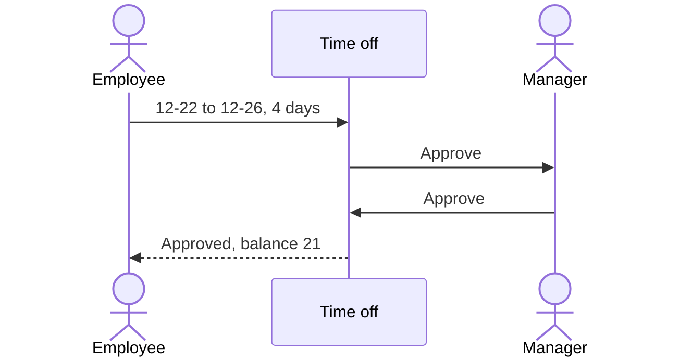

🏠 [Specs](../../../../README.md) › 🧩 [Functional capabilities](../../../README.md) ›
👥 [F9 HR and projects](../../README.md) › 📝 [Use cases](../README.md) › 📝 [Use cases: FL-F9-03 Time](README.md) ›
📝 UC-F9-09 Request and approve time off

# 📝 UC-F9-09 Request and approve time off

**Status:** ✅ specified

## Summary

Time off with balances, accruals and approvals.

## Personas

- [U01 Employee](../../../../01-users/personas/u01-employee.md)
- [U02 Manager](../../../../01-users/personas/u02-manager.md)
- [U06 HR](../../../../01-users/personas/u06-hr.md)

## Goal

Time off requested, approved and seen by planning and payroll.

## Trigger

An employee needs time off.

## Frequency

Weekly.

## Preconditions

F9 set up for the company.

## Postconditions

- **Succeeded:** approved and planned; payroll informed.
- **Failed:** not enough balance.

## Main flow

1. The employee requests time off on time off ([S-F9-09](../../screens/03-time/s-f09-09-time-off.md)); the balance
   shows.
2. Approvers approve in one or several steps, [BR-F9-05](../../business-rules/br-f09-05-time-off-follows-its-type.md),
   [UC-F2-29](../../../f02-no-code-configuration/use-cases/11-rights-translations-and-approvals/uc-f02-29-set-up-an-approval-chain.md);
   a deputy decides during an absence,
   [UC-F1-16](../../../f01-administration/use-cases/11-team-delegation-and-access-review/uc-f01-16-delegate-approvals-during-an-absence.md).
3. Planning and payroll see it ([CR-FR-044](../../../../10-country-packs/france/labour/cr-fr-044-paid-leave.md)).
4. A manager going away is offered to delegate,
   [UC-F1-16](../../../f01-administration/use-cases/11-team-delegation-and-access-review/uc-f01-16-delegate-approvals-during-an-absence.md).

## Alternative flows

- 1a. Allocations in bulk; public holidays and blackout days.

## Error flows

- 1e. Not enough balance: an extra allocation can be requested.

## Business rules

- [BR-F9-05 Time off follows its type](../../business-rules/br-f09-05-time-off-follows-its-type.md)

## Entities

- [E-F9-08 Time-off allocation](../../data/e-f09-08-time-off-allocation.md)
- [E-F9-09 Time-off request](../../data/e-f09-09-time-off-request.md)

## Permissions

Employees; managers approve; HR.

## Notifications

Approver: request; employee: decision.

## Audit events

Requested, approved.

## AI involvement

The AI assistant prepares it for confirmation
([BR-F3-07](../../../f03-assistant/business-rules/br-f03-07-no-deletes-no-irreversible-acts.md)); figures come from
queries ([BR-F3-03](../../../f03-assistant/business-rules/br-f03-03-figures-come-from-queries.md)).

## API, MCP and A2A exposure

T5 operations of F9 with the caller's rights; the MCP tool of F9; no A2A skill.

## Screens

- [S-F9-09](../../screens/03-time/s-f09-09-time-off.md)

## Flowchart

See [FL-F9-03 Time](../../flows/fl-f09-03-time.md#flowchart).

## Sequence diagram

## Acceptance criteria

1. **Given** Lea with 25 days **when** she requests 4 days **then** the balance shows 21 after approval.
2. **Given** a blackout week **when** a request falls in it **then** it is refused.
3. **Given** 2 days left **when** she requests 4 **then** an extra allocation can be requested.

## Non-functional notes

Works on a phone.

## Regulatory references

[CR-FR-044](../../../../10-country-packs/france/labour/cr-fr-044-paid-leave.md).

## Related use cases

See the flows.

- [UC-F2-29 Set up an approval chain](../../../f02-no-code-configuration/use-cases/11-rights-translations-and-approvals/uc-f02-29-set-up-an-approval-chain.md)

## Open questions

None.

---

⬅️ [UC-F9-08 Run referrals](../02-recruit/uc-f09-08-run-referrals.md) · ⬆️ [Up](README.md) ·
➡️ [UC-F9-10 Record attendance and overtime](uc-f09-10-record-attendance-and-overtime.md)
