🏠 [Specs](../../../../README.md) › 🧩 [Functional capabilities](../../../README.md) ›
👥 [F9 HR and projects](../../README.md) › 📝 [Use cases](../README.md) › 📝 [Use cases: FL-F9-03 Time](README.md) ›
📝 UC-F9-10 Record attendance and overtime

# 📝 UC-F9-10 Record attendance and overtime

**Status:** ✅ specified

## Summary

Check in by kiosk, badge, PIN or phone; overtime approved.

## Personas

- [U01 Employee](../../../../01-users/personas/u01-employee.md)
- [U14 Field worker](../../../../01-users/personas/u14-field-worker.md)
- [U02 Manager](../../../../01-users/personas/u02-manager.md)

## Goal

Attendance and overtime right for payroll.

## Trigger

Employees check in and out.

## Frequency

Daily.

## Preconditions

F9 set up for the company.

## Postconditions

- **Succeeded:** attendance recorded; overtime approved.
- **Failed:** missing check-outs flagged.

## Main flow

1. The employee checks in at a kiosk or on the phone ([S-F9-10](../../screens/03-time/s-f09-10-attendance.md)); location
   only at check-in where on ([BR-F9-06](../../business-rules/br-f09-06-location-only-at-check-in.md)).
2. They check out; hours compute.
3. The manager reviews anomalies and approves overtime,
   [BR-F9-08](../../business-rules/br-f09-08-overtime-needs-approval.md),
   [CR-FR-043](../../../../10-country-packs/france/labour/cr-fr-043-overtime.md).
4. Payroll gets approved hours (F13).

## Alternative flows

- 1a. Managers add missing records.

## Error flows

- 2e. A missing check-out: flagged next morning.

## Business rules

- [BR-F9-06 Location only at check-in](../../business-rules/br-f09-06-location-only-at-check-in.md)
- [BR-F9-08 Overtime needs approval](../../business-rules/br-f09-08-overtime-needs-approval.md)

## Entities

- [E-F9-10 Attendance](../../data/e-f09-10-attendance.md)
- [E-F9-34 Attendance kiosk](../../data/e-f09-34-attendance-kiosk.md)
- [E-F9-35 Employee badge](../../data/e-f09-35-employee-badge.md)

## Permissions

Employees; managers.

## Notifications

Managers: anomalies.

## Audit events

Check-ins, corrections, approvals.

## AI involvement

None.

## API, MCP and A2A exposure

T5 operations of F9 with the caller's rights; the MCP tool of F9; no A2A skill.

## Screens

- [S-F9-10](../../screens/03-time/s-f09-10-attendance.md)

## Flowchart

See [FL-F9-03 Time](../../flows/fl-f09-03-time.md#flowchart).

## Sequence diagram

```mermaid
sequenceDiagram
  actor E as Employee
  participant A as Attendance
  actor M as Manager
  E->>A: Check in 07:58, check out 18:40
  A->>M: 1.7 h overtime
  M->>A: Approve
```

## Acceptance criteria

1. **Given** a check-in at 07:58 and out at 18:40 for a 9-hour day **when** it is computed **then** 1.7 hours of
   overtime wait for approval.
2. **Given** no check-out **when** the next morning comes **then** it is flagged.
3. **Given** no network at the site **when** the phone checks in **then** it is kept and sent later.

## Non-functional notes

Check-in within 2 seconds.

## Regulatory references

[CR-FR-042](../../../../10-country-packs/france/labour/cr-fr-042-working-time-and-rest.md);
[CR-FR-043](../../../../10-country-packs/france/labour/cr-fr-043-overtime.md);
[CR-FR-054](../../../../10-country-packs/france/data-protection/cr-fr-054-location-with-consent.md).

## Related use cases

See the flows.

## Open questions

None.

---

⬅️ [UC-F9-09 Request and approve time off](uc-f09-09-request-and-approve-time-off.md) · ⬆️ [Up](README.md) ·
➡️ [UC-F9-11 Run appraisals and track skills](../04-grow/uc-f09-11-run-appraisals-and-track-skills.md)
