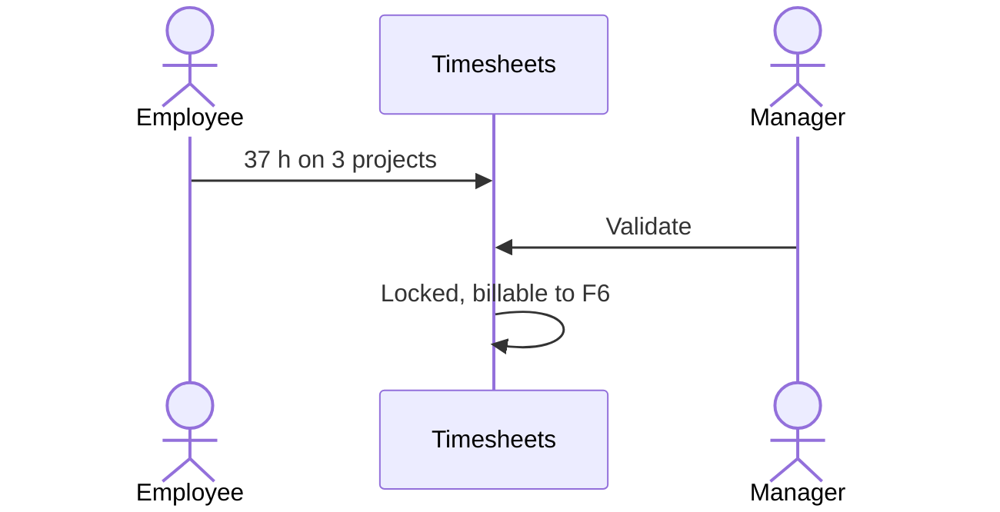

🏠 [Specs](../../../../README.md) › 🧩 [Functional capabilities](../../../README.md) ›
👥 [F9 HR and projects](../../README.md) › 📝 [Use cases](../README.md) › 📝 [Use cases: FL-F9-03 Time](README.md) ›
📝 UC-F9-16 Record and validate timesheets

# 📝 UC-F9-16 Record and validate timesheets

**Status:** ✅ specified

## Summary

Timers, weekly grids, opt-in activity drafts, validation, billing.

## Personas

- [U01 Employee](../../../../01-users/personas/u01-employee.md)
- [U14 Field worker](../../../../01-users/personas/u14-field-worker.md)
- [U02 Manager](../../../../01-users/personas/u02-manager.md)

## Goal

Time logged, validated and billed.

## Trigger

The week's work.

## Frequency

Weekly.

## Preconditions

F9 set up for the company.

## Postconditions

- **Succeeded:** validated weeks locked; billable time invoiced.
- **Failed:** over-contract weeks flagged.

## Main flow

1. Employees log time with timers or the grid on timesheets ([S-F9-16](../../screens/03-time/s-f09-16-timesheets.md));
   drafts from their own activity if they turned it on
   ([BR-F9-07](../../business-rules/br-f09-07-activity-drafts-stay-private.md)).
2. Reminders go to those who have not logged.
3. Managers validate; validated weeks lock
   ([BR-F9-10](../../business-rules/br-f09-10-validated-timesheets-are-locked.md)).
4. Billable time feeds invoices (F6).

## Alternative flows

- 1a. Time off shown on the grid.

## Error flows

- 3e. A week over contract hours: flagged.

## Business rules

- [BR-F9-07 Activity drafts stay private](../../business-rules/br-f09-07-activity-drafts-stay-private.md)
- [BR-F9-10 Validated timesheets are locked](../../business-rules/br-f09-10-validated-timesheets-are-locked.md)

## Entities

- [E-F9-17 Timesheet line](../../data/e-f09-17-timesheet-line.md)

## Permissions

Employees; managers.

## Notifications

Reminders.

## Audit events

Logged, validated.

## AI involvement

The AI assistant prepares it for confirmation
([BR-F3-07](../../../f03-assistant/business-rules/br-f03-07-no-deletes-no-irreversible-acts.md)); figures come from
queries ([BR-F3-03](../../../f03-assistant/business-rules/br-f03-03-figures-come-from-queries.md)).

## API, MCP and A2A exposure

T5 operations of F9 with the caller's rights; the MCP tool of F9; no A2A skill.

## Screens

- [S-F9-16](../../screens/03-time/s-f09-16-timesheets.md)

## Flowchart

See [FL-F9-03 Time](../../flows/fl-f09-03-time.md#flowchart).

## Sequence diagram

## Acceptance criteria

1. **Given** 37 hours logged on 3 projects **when** the manager validates **then** the week locks.
2. **Given** a week of 44 hours on a 35-hour contract **when** it is submitted **then** it is flagged.
3. **Given** no time logged by Friday 16:00 **when** the time passes **then** a reminder is sent.

## Non-functional notes

None.

## Regulatory references

[CR-FR-042](../../../../10-country-packs/france/labour/cr-fr-042-working-time-and-rest.md).

## Related use cases

See the flows.

## Open questions

None.

---

⬅️ [UC-F9-15 Plan shifts](../06-plan-and-deliver-work/uc-f09-15-plan-shifts.md) · ⬆️ [Up](README.md) ·
➡️ [UC-F9-17 Manage projects and tasks](../06-plan-and-deliver-work/uc-f09-17-manage-projects-and-tasks.md)
