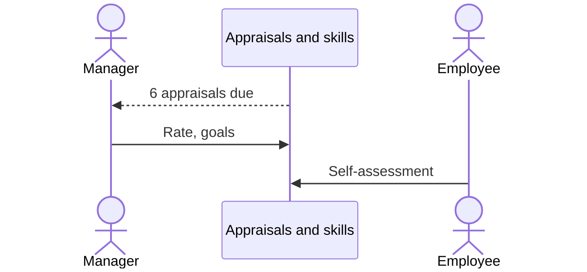

🏠 [Specs](../../../../README.md) › 🧩 [Functional capabilities](../../../README.md) ›
👥 [F9 HR and projects](../../README.md) › 📝 [Use cases](../README.md) › 📝 [Use cases: FL-F9-04 Grow](README.md) ›
📝 UC-F9-11 Run appraisals and track skills

# 📝 UC-F9-11 Run appraisals and track skills

**Status:** ✅ specified

## Summary

Appraisals, 360 feedback, goals, skills, certifications and training.

## Personas

- [U02 Manager](../../../../01-users/personas/u02-manager.md)
- [U01 Employee](../../../../01-users/personas/u01-employee.md)
- [U06 HR](../../../../01-users/personas/u06-hr.md)

## Goal

People grow and their skills are known.

## Trigger

Appraisal season; a certification due.

## Frequency

Yearly appraisals.

## Preconditions

F9 set up for the company.

## Postconditions

- **Succeeded:** appraisals done; skills and certifications current.
- **Failed:** expiring certifications reminded.

## Main flow

1. Appraisals are generated on schedule from templates on appraisals and skills
   ([S-F9-11](../../screens/04-grow/s-f09-11-appraisals-and-skills.md)).
2. Goals are set and followed; skill levels evolve.
3. Certifications are tracked with expiry reminders,
   [BR-F9-17](../../business-rules/br-f09-17-mandatory-trainings-must-be-current-for-the-work-that-needs-them.md).
4. Training needs go to the plan
   ([UC-F9-25](../09-train-and-protect/uc-f09-25-run-the-training-plan-with-opco-funding.md)).

## Alternative flows

- 1a. An appraisal outside the schedule.

## Error flows

- 3e. A certification expiring in 90 days: reminder.

## Business rules

- [BR-F9-02 HR data stays with HR and the person](../../business-rules/br-f09-02-hr-data-stays-with-hr-and-the-person.md)

## Entities

- [E-F9-11 Appraisal](../../data/e-f09-11-appraisal.md)
- [E-F9-12 Qualification](../../data/e-f09-12-certification.md)

## Permissions

Managers and HR; employees for their own.

## Notifications

Appraisals due.

## Audit events

Appraisals, skills.

## AI involvement

The AI assistant prepares it for confirmation
([BR-F3-07](../../../f03-assistant/business-rules/br-f03-07-no-deletes-no-irreversible-acts.md)); figures come from
queries ([BR-F3-03](../../../f03-assistant/business-rules/br-f03-03-figures-come-from-queries.md)).

## API, MCP and A2A exposure

T5 operations of F9 with the caller's rights; the MCP tool of F9; no A2A skill.

## Screens

- [S-F9-11](../../screens/04-grow/s-f09-11-appraisals-and-skills.md)

## Flowchart

See [FL-F9-04 Grow](../../flows/fl-f09-04-grow.md#flowchart).

## Sequence diagram

## Acceptance criteria

1. **Given** a yearly template **when** the campaign starts **then** each manager gets their appraisals.
2. **Given** a forklift licence ending 2027-02-01 **when** 2026-11-03 comes **then** the employee and HR are reminded.
3. **Given** a need "Excel" **when** it is noted **then** it goes to the training plan.

## Non-functional notes

None.

## Regulatory references

[CR-FR-039](../../../../10-country-packs/france/labour/cr-fr-039-professional-interviews.md).

## Related use cases

See the flows.

- [UC-F9-25 Run the training plan with OPCO funding](../09-train-and-protect/uc-f09-25-run-the-training-plan-with-opco-funding.md)

## Open questions

None.

---

⬅️ [UC-F9-10 Record attendance and overtime](../03-time/uc-f09-10-record-attendance-and-overtime.md) ·
⬆️ [Up](README.md) · ➡️ [UC-F9-12 Manage the fleet](../05-workplace-services/uc-f09-12-manage-the-fleet.md)
