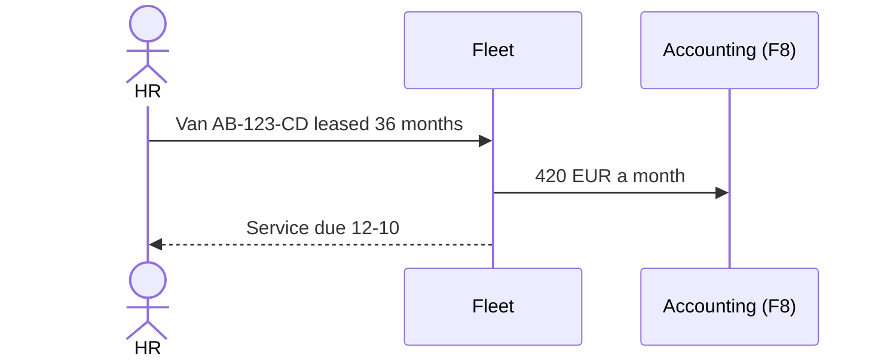

🏠 [Specs](../../../../README.md) › 🧩 [Functional capabilities](../../../README.md) ›
👥 [F9 HR and projects](../../README.md) › 📝 [Use cases](../README.md) ›
📝 [Use cases: FL-F9-05 Workplace services](README.md) › 📝 UC-F9-12 Manage the fleet

# 📝 UC-F9-12 Manage the fleet

**Status:** ✅ specified

## Summary

Vehicles, contracts, costs, drivers, services and accidents.

## Personas

- [U06 HR](../../../../01-users/personas/u06-hr.md)
- [U07 Administrator](../../../../01-users/personas/u07-administrator.md)

## Goal

Vehicles and their costs under control.

## Trigger

A vehicle, a contract, a service.

## Frequency

Monthly.

## Preconditions

F9 set up for the company.

## Postconditions

- **Succeeded:** contracts, services and costs current.
- **Failed:** expired contracts alerted.

## Main flow

1. HR records vehicles with contracts, costs and drivers on fleet
   ([S-F9-12](../../screens/05-workplace-services/s-f09-12-fleet.md)).
2. Expiry alerts warn; services and accidents are recorded.
3. Recurring costs go to accounting (F8).
4. The company-car benefit goes to payroll.

## Alternative flows

- 1a. Vehicle requests through approvals.

## Error flows

- 2e. A contract expired: alert.

## Business rules

- See F9's rules.

## Entities

- [E-F9-13 Company vehicle](../../data/e-f09-13-company-vehicle.md)

## Permissions

HR; the owner reads; HR data stays with HR and the person
([BR-F9-02](../../business-rules/br-f09-02-hr-data-stays-with-hr-and-the-person.md)). Administrators.

## Notifications

Expiries.

## Audit events

Vehicles and contracts.

## AI involvement

The AI assistant prepares it for confirmation
([BR-F3-07](../../../f03-assistant/business-rules/br-f03-07-no-deletes-no-irreversible-acts.md)); figures come from
queries ([BR-F3-03](../../../f03-assistant/business-rules/br-f03-03-figures-come-from-queries.md)).

## API, MCP and A2A exposure

T5 operations of F9 with the caller's rights; the MCP tool of F9; no A2A skill.

## Screens

- [S-F9-12](../../screens/05-workplace-services/s-f09-12-fleet.md)

## Flowchart

See [FL-F9-05 Workplace services](../../flows/fl-f09-05-workplace-services.md#flowchart).

## Sequence diagram

## Acceptance criteria

1. **Given** a lease ending 2027-01-31 **when** 2026-12-31 comes **then** an alert is sent.
2. **Given** a monthly lease of 420 EUR **when** the month posts **then** accounting gets the cost.
3. **Given** a car used privately **when** payroll runs **then** the benefit is computed.

## Non-functional notes

None.

## Regulatory references

None.

## Related use cases

See the flows.

## Open questions

None.

---

⬅️ [UC-F9-11 Run appraisals and track skills](../04-grow/uc-f09-11-run-appraisals-and-track-skills.md) ·
⬆️ [Up](README.md) · ➡️ [UC-F9-13 Request approvals and order lunch](uc-f09-13-request-approvals-and-order-lunch.md)
