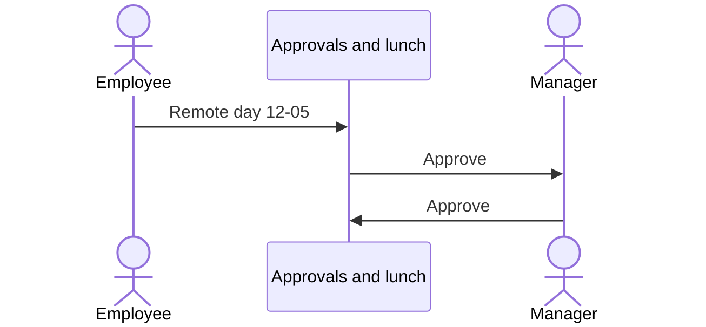

🏠 [Specs](../../../../README.md) › 🧩 [Functional capabilities](../../../README.md) ›
👥 [F9 HR and projects](../../README.md) › 📝 [Use cases](../README.md) ›
📝 [Use cases: FL-F9-05 Workplace services](README.md) › 📝 UC-F9-13 Request approvals and order lunch

# 📝 UC-F9-13 Request approvals and order lunch

**Status:** ✅ specified

## Summary

Generic approval requests and lunch orders.

## Personas

- [U01 Employee](../../../../01-users/personas/u01-employee.md)
- [U02 Manager](../../../../01-users/personas/u02-manager.md)

## Goal

Simple requests and lunch handled without email.

## Trigger

A request or lunch order.

## Frequency

Daily.

## Preconditions

F9 set up for the company.

## Postconditions

- **Succeeded:** approved requests; lunch delivered.
- **Failed:** unconfirmed orders flagged.

## Main flow

1. An employee requests something from an approval type on approvals and lunch
   ([S-F9-13](../../screens/05-workplace-services/s-f09-13-approvals-and-lunch.md)).
2. Approvers approve through the approval engine,
   [UC-F2-29](../../../f02-no-code-configuration/use-cases/11-rights-translations-and-approvals/uc-f02-29-set-up-an-approval-chain.md).
3. Lunch: employees order from vendors; the manager sends and confirms orders.
4. Employees are told when lunch arrives.

## Alternative flows

- 1a. Approval types defined by configurators.

## Error flows

- 3e. A vendor not confirming: orders flagged.

## Business rules

- See F9's rules.

## Entities

- [E-F9-14 Approval request](../../data/e-f09-14-approval-request.md)
- [E-F9-39 Lunch order](../../data/e-f09-39-lunch-order.md)

## Permissions

Employees; approvers.

## Notifications

Approvers and employees.

## Audit events

Requests and orders.

## AI involvement

The AI assistant prepares it for confirmation
([BR-F3-07](../../../f03-assistant/business-rules/br-f03-07-no-deletes-no-irreversible-acts.md)); figures come from
queries ([BR-F3-03](../../../f03-assistant/business-rules/br-f03-03-figures-come-from-queries.md)).

## API, MCP and A2A exposure

T5 operations of F9 with the caller's rights; the MCP tool of F9; no A2A skill.

## Screens

- [S-F9-13](../../screens/05-workplace-services/s-f09-13-approvals-and-lunch.md)

## Flowchart

See [FL-F9-05 Workplace services](../../flows/fl-f09-05-workplace-services.md#flowchart).

## Sequence diagram

## Acceptance criteria

1. **Given** a remote-day request **when** the manager approves **then** the employee is told.
2. **Given** 12 lunch orders **when** the manager sends them **then** the vendor gets one order.
3. **Given** a vendor not confirming by 11:00 **when** the time passes **then** orders are flagged.

## Non-functional notes

None.

## Regulatory references

None.

## Related use cases

See the flows.

## Open questions

None.

---

⬅️ [UC-F9-12 Manage the fleet](uc-f09-12-manage-the-fleet.md) · ⬆️ [Up](README.md) ·
➡️ [UC-F9-14 Welcome visitors](uc-f09-14-welcome-visitors.md)
