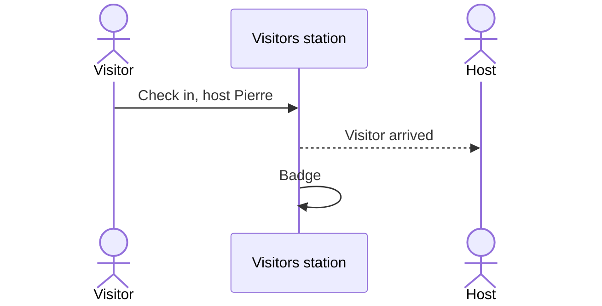

🏠 [Specs](../../../../README.md) › 🧩 [Functional capabilities](../../../README.md) ›
👥 [F9 HR and projects](../../README.md) › 📝 [Use cases](../README.md) ›
📝 [Use cases: FL-F9-05 Workplace services](README.md) › 📝 UC-F9-14 Welcome visitors

# 📝 UC-F9-14 Welcome visitors

**Status:** ✅ specified

## Summary

Visitors check in at a kiosk; hosts are notified.

## Personas

- [U16 Office worker](../../../../01-users/personas/u16-office-worker.md)

## Goal

Visitors welcomed and hosts told.

## Trigger

A visitor arrives.

## Frequency

Daily.

## Preconditions

F9 set up for the company.

## Postconditions

- **Succeeded:** the visitor is checked in and out.
- **Failed:** no host found: reception told.

## Main flow

1. The visitor checks in at the station ([S-F9-14](../../screens/05-workplace-services/s-f09-14-visitors.md)), or was
   planned.
2. The host is notified; a badge is printed.
3. Drinks requested are served.
4. The visitor checks out.

## Alternative flows

- 1a. Planned visitors pre-registered.

## Error flows

- 2e. No host found: reception notified.

## Business rules

- See F9's rules.

## Entities

- [E-F9-15 Visitor](../../data/e-f09-15-visitor.md)
- [E-F9-42 Reception kiosk](../../data/e-f09-42-reception-kiosk.md)
- [E-F9-43 Visitor badge](../../data/e-f09-43-visitor-badge.md)

## Permissions

Office workers at reception; hosts.

## Notifications

Host: visitor arrived.

## Audit events

Visits.

## AI involvement

None.

## API, MCP and A2A exposure

T5 operations of F9 with the caller's rights; the MCP tool of F9; no A2A skill.

## Screens

- [S-F9-14](../../screens/05-workplace-services/s-f09-14-visitors.md)

## Flowchart

See [FL-F9-05 Workplace services](../../flows/fl-f09-05-workplace-services.md#flowchart).

## Sequence diagram

## Acceptance criteria

1. **Given** a visitor for Pierre **when** she checks in **then** Pierre is notified and a badge printed.
2. **Given** an unknown host **when** she checks in **then** reception is notified.
3. **Given** the visitor leaves **when** she checks out **then** the visit is closed.

## Non-functional notes

None.

## Regulatory references

GDPR: visitor data kept briefly
([CR-FR-052](../../../../10-country-packs/france/data-protection/cr-fr-052-storage-limitation.md)).

## Related use cases

See the flows.

## Open questions

None.

---

⬅️ [UC-F9-13 Request approvals and order lunch](uc-f09-13-request-approvals-and-order-lunch.md) · ⬆️ [Up](README.md) ·
➡️ [UC-F9-15 Plan shifts](../06-plan-and-deliver-work/uc-f09-15-plan-shifts.md)
