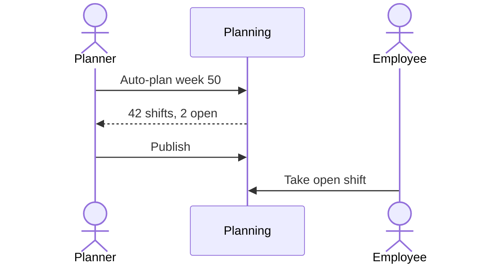

🏠 [Specs](../../../../README.md) › 🧩 [Functional capabilities](../../../README.md) ›
👥 [F9 HR and projects](../../README.md) › 📝 [Use cases](../README.md) ›
📝 [Use cases: FL-F9-06 Plan and deliver work](README.md) › 📝 UC-F9-15 Plan shifts

# 📝 UC-F9-15 Plan shifts

**Status:** ✅ specified

## Summary

Shifts by role, templates, auto-planning, swaps and open slots.

## Personas

- [U02 Manager](../../../../01-users/personas/u02-manager.md)
- [U14 Field worker](../../../../01-users/personas/u14-field-worker.md)

## Goal

Shifts that cover needs and respect people and rules.

## Trigger

Planning the week.

## Frequency

Weekly.

## Preconditions

F9 set up for the company.

## Postconditions

- **Succeeded:** shifts published; swaps handled.
- **Failed:** conflicts refused.

## Main flow

1. The planner creates shifts on planning ([S-F9-15](../../screens/06-plan-and-deliver-work/s-f09-15-planning.md)) from
   templates, or lets auto-plan fill open shifts
   ([BR-F9-09](../../business-rules/br-f09-09-shifts-respect-people-and-rules.md)).
2. Shifts needing a mandatory training are given only to people with it current,
   [BR-F9-17](../../business-rules/br-f09-17-mandatory-trainings-must-be-current-for-the-work-that-needs-them.md).
3. Drafts are published; employees are notified.
4. Employees swap or take open shifts.

## Alternative flows

- 1a. Copy last week.
- 1b. Field staff's rounds come from
  [UC-F9-30](../11-capacity-rounds-and-partners/uc-f09-30-plan-rounds-and-optimise-routes.md).

## Error flows

- 1e. A conflict: refused with the reason.

## Business rules

- [BR-F9-09 Shifts respect people and rules](../../business-rules/br-f09-09-shifts-respect-people-and-rules.md)

## Entities

- [E-F9-16 Shift](../../data/e-f09-16-shift.md)

## Permissions

Managers for their team; HR; record rules by department or site.

## Notifications

Employees: shifts.

## Audit events

Shifts published, swapped.

## AI involvement

The AI assistant prepares it for confirmation
([BR-F3-07](../../../f03-assistant/business-rules/br-f03-07-no-deletes-no-irreversible-acts.md)); figures come from
queries ([BR-F3-03](../../../f03-assistant/business-rules/br-f03-03-figures-come-from-queries.md)).

## API, MCP and A2A exposure

T5 operations of F9 with the caller's rights; the MCP tool of F9; no A2A skill.

## Screens

- [S-F9-15](../../screens/06-plan-and-deliver-work/s-f09-15-planning.md)

## Flowchart

See [FL-F9-06 Plan and deliver work](../../flows/fl-f09-06-plan-and-deliver-work.md#flowchart).

## Sequence diagram

## Acceptance criteria

1. **Given** a restaurant week with 44 shifts **when** auto-plan runs **then** 42 are filled and 2 left open.
2. **Given** a shift over the daily maximum **when** it is planned **then** it is refused.
3. **Given** an open shift **when** an employee takes it **then** it is his.

## Non-functional notes

None.

## Regulatory references

[CR-FR-042](../../../../10-country-packs/france/labour/cr-fr-042-working-time-and-rest.md).

## Related use cases

See the flows.

- [UC-F9-29 Plan capacity across projects](../11-capacity-rounds-and-partners/uc-f09-29-plan-capacity-across-projects.md)

## Open questions

None.

---

⬅️ [UC-F9-14 Welcome visitors](../05-workplace-services/uc-f09-14-welcome-visitors.md) · ⬆️ [Up](README.md) ·
➡️ [UC-F9-16 Record and validate timesheets](../03-time/uc-f09-16-record-and-validate-timesheets.md)
