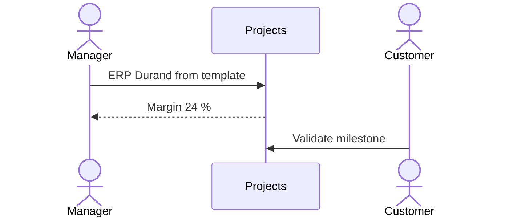

🏠 [Specs](../../../../README.md) › 🧩 [Functional capabilities](../../../README.md) ›
👥 [F9 HR and projects](../../README.md) › 📝 [Use cases](../README.md) ›
📝 [Use cases: FL-F9-06 Plan and deliver work](README.md) › 📝 UC-F9-17 Manage projects and tasks

# 📝 UC-F9-17 Manage projects and tasks

**Status:** ✅ specified

## Summary

Projects with tasks, milestones, budgets and profitability, shared with customers.

## Personas

- [U02 Manager](../../../../01-users/personas/u02-manager.md)
- [U03 Sales](../../../../01-users/personas/u03-sales.md)
- [U09 Customer](../../../../01-users/personas/u09-customer.md)

## Goal

Projects delivered on time, budget and margin.

## Trigger

A project from a template or a sale.

## Frequency

Continuous.

## Preconditions

F9 set up for the company.

## Postconditions

- **Succeeded:** tasks done, milestones invoiced, profitability known.
- **Failed:** dependency loops refused.

## Main flow

1. A project starts from a template or a sale ([S-F9-17](../../screens/06-plan-and-deliver-work/s-f09-17-projects.md));
   tasks in stages with dependencies.
2. Views: kanban, list, Gantt, planning,
   [UC-F2-17](../../../f02-no-code-configuration/use-cases/08-views-and-bookings/uc-f02-17-add-a-kanban-calendar-map-gantt-or-timeline-view.md);
   capacity is checked ([UC-F9-29](../11-capacity-rounds-and-partners/uc-f09-29-plan-capacity-across-projects.md)).
3. Budget, timesheets, purchases and sales give profitability; invoicing by time or milestone.
4. Customers see shared parts and validate milestones
   ([UC-F9-31](../11-capacity-rounds-and-partners/uc-f09-31-follow-a-project-as-a-customer.md)); subcontractors join,
   [UC-F9-32](../11-capacity-rounds-and-partners/uc-f09-32-work-with-subcontractors-and-freelancers-on-projects.md).

## Alternative flows

- 1a. Documents per project.

## Error flows

- 1e. A dependency loop: refused.

## Business rules

- See F9's rules.

## Entities

- [E-F9-18 Project and task](../../data/e-f09-18-project-and-task.md)

## Permissions

Managers for their team; HR; record rules by department or site. Customers on shared parts.

## Notifications

Task owners.

## Audit events

Tasks, milestones.

## AI involvement

The AI assistant prepares it for confirmation
([BR-F3-07](../../../f03-assistant/business-rules/br-f03-07-no-deletes-no-irreversible-acts.md)); figures come from
queries ([BR-F3-03](../../../f03-assistant/business-rules/br-f03-03-figures-come-from-queries.md)).

## API, MCP and A2A exposure

T5 operations of F9 with the caller's rights; the MCP tool of F9; no A2A skill.

## Screens

- [S-F9-17](../../screens/06-plan-and-deliver-work/s-f09-17-projects.md)

## Flowchart

See [FL-F9-06 Plan and deliver work](../../flows/fl-f09-06-plan-and-deliver-work.md#flowchart).

## Sequence diagram

## Acceptance criteria

1. **Given** a project of 120 hours sold 14,400 EUR **when** 80 hours are logged **then** profitability updates.
2. **Given** task A depending on B and B on A **when** it is saved **then** it is refused.
3. **Given** a milestone validated **when** it is validated **then** its invoice follows.

## Non-functional notes

None.

## Regulatory references

None.

## Related use cases

See the flows.

- [UC-F4-27 Keep meeting actions in step with tasks](../../../f04-meetings/use-cases/13-outside-people-and-follow-up/uc-f04-27-keep-meeting-actions-in-step-with-tasks.md)

- [UC-F9-29 Plan capacity across projects](../11-capacity-rounds-and-partners/uc-f09-29-plan-capacity-across-projects.md)

- [UC-F9-31 Follow a project as a customer](../11-capacity-rounds-and-partners/uc-f09-31-follow-a-project-as-a-customer.md)

- [UC-F9-32 Work with subcontractors and freelancers on projects](../11-capacity-rounds-and-partners/uc-f09-32-work-with-subcontractors-and-freelancers-on-projects.md)

## Open questions

None.

---

⬅️ [UC-F9-16 Record and validate timesheets](../03-time/uc-f09-16-record-and-validate-timesheets.md) ·
⬆️ [Up](README.md) · ➡️ [UC-F9-18 Run field service](uc-f09-18-run-field-service.md)
