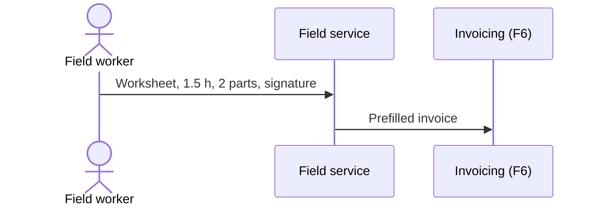

🏠 [Specs](../../../../README.md) › 🧩 [Functional capabilities](../../../README.md) ›
👥 [F9 HR and projects](../../README.md) › 📝 [Use cases](../README.md) ›
📝 [Use cases: FL-F9-06 Plan and deliver work](README.md) › 📝 UC-F9-18 Run field service

# 📝 UC-F9-18 Run field service

**Status:** ✅ specified

## Summary

Field tasks planned on a map, done on phones with worksheets and signatures.

## Personas

- [U14 Field worker](../../../../01-users/personas/u14-field-worker.md)
- [U02 Manager](../../../../01-users/personas/u02-manager.md)

## Goal

Field work planned, done and invoiced from the phone.

## Trigger

A field task.

## Frequency

Daily.

## Preconditions

F9 set up for the company.

## Postconditions

- **Succeeded:** worksheets signed; invoices prefilled.
- **Failed:** offline work waits to sync.

## Main flow

1. Tasks come from sales or by hand and are planned on calendar, Gantt and map on field service
   ([S-F9-18](../../screens/06-plan-and-deliver-work/s-f09-18-field-service.md)), as rounds where needed
   ([UC-F9-30](../11-capacity-rounds-and-partners/uc-f09-30-plan-rounds-and-optimise-routes.md)).
2. The field worker fills the worksheet on the phone, offline if needed
   ([D38](../../../../06-decisions/ux/d38-offline-field-tasks.md)).
3. They record time and parts and get the customer's signature.
4. The invoice is prefilled (F6).

## Alternative flows

- 1a. Recurring maintenance visits.

## Error flows

- 2e. No network: kept and sent later.

## Business rules

- [BR-F9-06 Location only at check-in](../../business-rules/br-f09-06-location-only-at-check-in.md)

## Entities

- [E-F9-18 Project and task](../../data/e-f09-18-project-and-task.md)
- [E-F9-37 Field worksheet](../../data/e-f09-37-field-worksheet.md)

## Permissions

Field workers for their tasks; managers.

## Notifications

Field worker: tasks.

## Audit events

Worksheets.

## AI involvement

The AI assistant prepares it for confirmation
([BR-F3-07](../../../f03-assistant/business-rules/br-f03-07-no-deletes-no-irreversible-acts.md)); figures come from
queries ([BR-F3-03](../../../f03-assistant/business-rules/br-f03-03-figures-come-from-queries.md)).

## API, MCP and A2A exposure

T5 operations of F9 with the caller's rights; the MCP tool of F9; no A2A skill.

## Screens

- [S-F9-18](../../screens/06-plan-and-deliver-work/s-f09-18-field-service.md)

## Flowchart

See [FL-F9-06 Plan and deliver work](../../flows/fl-f09-06-plan-and-deliver-work.md#flowchart).

## Sequence diagram

## Acceptance criteria

1. **Given** a boiler service at 09:00 **when** the worksheet is signed **then** an invoice is prefilled with time and
   parts.
2. **Given** no network in the cellar **when** the worksheet is saved **then** it syncs when the network is back.
3. **Given** a yearly maintenance contract **when** the date comes **then** the visit is created.

## Non-functional notes

Offline as [D38](../../../../06-decisions/ux/d38-offline-field-tasks.md).

## Regulatory references

[CR-FR-020](../../../../10-country-packs/france/invoicing/cr-fr-020-electronic-acceptance-and-signature.md).

## Related use cases

See the flows.

- [UC-F2-22 Fill a form offline on the phone](../../../f02-no-code-configuration/use-cases/09-portals-and-offline-forms/uc-f02-22-fill-a-form-offline-on-the-phone.md)

- [UC-F9-30 Plan rounds and optimise routes](../11-capacity-rounds-and-partners/uc-f09-30-plan-rounds-and-optimise-routes.md)

## Open questions

None.

---

⬅️ [UC-F9-17 Manage projects and tasks](uc-f09-17-manage-projects-and-tasks.md) · ⬆️ [Up](README.md) ·
➡️ [UC-F9-19 Edit contract templates](../01-people/uc-f09-19-edit-contract-templates.md)
