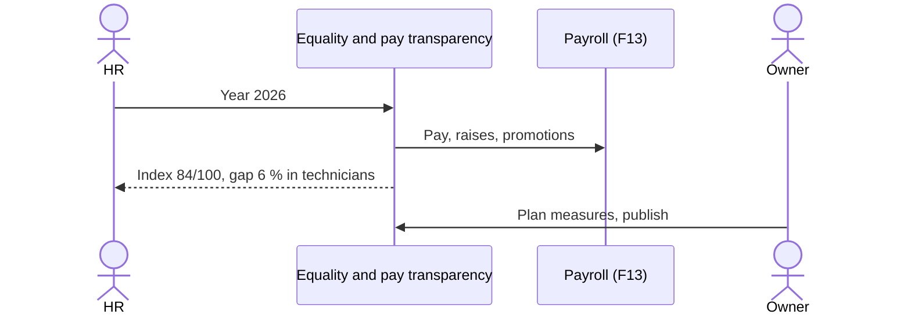

🏠 [Specs](../../../../README.md) › 🧩 [Functional capabilities](../../../README.md) ›
👥 [F9 HR and projects](../../README.md) › 📝 [Use cases](../README.md) ›
📝 [Use cases: FL-F9-07 Fair pay and speaking up](README.md) ›
📝 UC-F9-20 Publish the equality index and pay-transparency information

# 📝 UC-F9-20 Publish the equality index and pay-transparency information

**Status:** 🔄 waiting for the owner

## Summary

HR computes the gender equality index and the pay gaps per category from payroll, plans corrective measures and
publishes the results; employees can ask the pay information the pay-transparency rules give them.

## Personas

- [U06 Human resources](../../../../01-users/personas/u06-hr.md)
- [U13 Owner](../../../../01-users/personas/u13-owner.md)
- [U45 Payroll officer](../../../../01-users/personas/u45-payroll-officer.md)
- [U01 Employee](../../../../01-users/personas/u01-employee.md)

## Goal

Equal pay proven every year, gaps corrected.

## Trigger

The yearly date, or an employee's request.

## Frequency

Yearly; requests occasionally.

## Preconditions

- A year of payroll (F13) and 50 employees or more for the index
  ([CR-FR-046](../../../../10-country-packs/france/labour/cr-fr-046-headcount-thresholds.md)).

## Postconditions

- **Succeeded:** the index and gaps are published and declared; measures planned.
- **Failed:** too small categories are left out and said so.

## Main flow

1. HR opens Equality and pay transparency
   ([S-F9-20](../../screens/07-fair-pay-and-speaking-up/s-f09-20-equality-and-pay-transparency.md)) for the year.
2. simple-ERP computes the index's indicators from payroll and HR records
   ([CR-FR-187](../../../../10-country-packs/france/payroll/cr-fr-187-equal-pay-index.md)): pay gap, raises, promotions,
   return from maternity leave, top earners.
3. It shows the pay gap per category of equal work
   ([BR-F9-14](../../business-rules/br-f09-14-pay-gaps-are-computed-per-category-of-equal-work.md)).
4. The owner plans corrective measures where a gap passes the threshold.
5. HR publishes the score and declares it; an employee asking their pay level and the category's average gets it within
   the legal time.

## Alternative flows

- 5a. Under 50 employees: the pay-gap report for pay transparency only.

## Error flows

- 2e. A category with fewer than 3 people of a gender (Proposed): left out of the gap, said so.
- 5e. A request from someone else than the employee: refused.

## Business rules

- [BR-F9-14 Pay gaps are computed per category of equal work](../../business-rules/br-f09-14-pay-gaps-are-computed-per-category-of-equal-work.md)
- [BR-F9-02 HR data stays with HR and the person](../../business-rules/br-f09-02-hr-data-stays-with-hr-and-the-person.md)

## Entities

- [E-F9-20 Equality index](../../data/e-f09-20-equality-index.md)
- [E-F9-01 Employee record](../../data/e-f09-01-employee-record.md)

## Permissions

HR; the owner reads; HR data stays with HR and the person
([BR-F9-02](../../business-rules/br-f09-02-hr-data-stays-with-hr-and-the-person.md)). The payroll officer computes; the
owner approves the measures.

## Notifications

HR: publication due.

## Audit events

Computed, published, declared; requests answered.

## AI involvement

The AI assistant prepares it for confirmation
([BR-F3-07](../../../f03-assistant/business-rules/br-f03-07-no-deletes-no-irreversible-acts.md)); figures come from
queries ([BR-F3-03](../../../f03-assistant/business-rules/br-f03-03-figures-come-from-queries.md)).

## API, MCP and A2A exposure

T5 operations of F9 with the caller's rights; the MCP tool of F9; no A2A skill.

## Screens

- [S-F9-20 Equality and pay transparency](../../screens/07-fair-pay-and-speaking-up/s-f09-20-equality-and-pay-transparency.md)

## Flowchart

See [FL-F9-07 Fair pay and speaking up](../../flows/fl-f09-07-fair-pay-and-speaking-up.md#flowchart).

## Sequence diagram

## Acceptance criteria

1. **Given** Distribution Lemoine with 60 employees and 2026 payroll **when** the index is computed **then** its 5
   indicators and the score out of 100 show.
2. **Given** technicians paid 6 % less for women **when** the gaps are computed **then** the category shows a 6 % gap.
3. **Given** a category of 2 women and 9 men **when** the gap is computed **then** it is left out and said so.
4. **Given** an employee asking her category's average pay **when** she asks **then** she gets it within the legal time.

## Non-functional notes

None.

## Regulatory references

[CR-FR-187](../../../../10-country-packs/france/payroll/cr-fr-187-equal-pay-index.md); (Proposed) to read: directive
(EU) 2023/970 on pay transparency.

## Related use cases

- [UC-F13-18 Report yearly](../../../f13-payroll/use-cases/05-reports-and-rules/uc-f13-18-report-yearly.md)
- [UC-F8-28 Prepare the sustainability report](../../../f08-accounting/use-cases/09-pay-analyse-and-report/uc-f08-28-prepare-the-sustainability-report.md)

## Open questions

None.

---

⬅️ [UC-F9-19 Edit contract templates](../01-people/uc-f09-19-edit-contract-templates.md) · ⬆️ [Up](README.md) ·
➡️ [UC-F9-21](../08-hr-duties/uc-f09-21-schedule-professional-interviews-and-health-visits.md)
