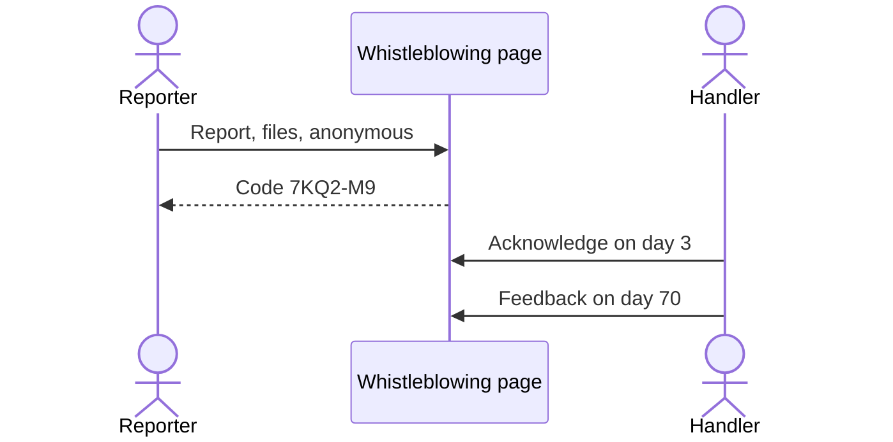

🏠 [Specs](../../../../README.md) › 🧩 [Functional capabilities](../../../README.md) ›
👥 [F9 HR and projects](../../README.md) › 📝 [Use cases](../README.md) ›
📝 [Use cases: FL-F9-07 Fair pay and speaking up](README.md) › 📝 UC-F9-24 Receive and handle a whistleblowing report

# 📝 UC-F9-24 Receive and handle a whistleblowing report

**Status:** ✅ specified, ⚖️ lawyer review before launch (D574)

## Summary

An employee or an outside person reports a wrongdoing through the company's channel; the named handler acknowledges,
investigates and gives feedback, and the reporter's identity is protected.

## Personas

- [U01 Employee](../../../../01-users/personas/u01-employee.md)
- [U06 Human resources](../../../../01-users/personas/u06-hr.md)
- [U13 Owner](../../../../01-users/personas/u13-owner.md)

## Goal

Wrongdoings reported safely and handled within the legal times.

## Trigger

A report.

## Frequency

Rare.

## Preconditions

- A handler named by the company (50 employees or more).

## Postconditions

- **Succeeded:** acknowledged, handled and closed with feedback.
- **Failed:** a report outside the channel's scope is redirected with the reason.

## Main flow

1. The reporter opens the whistleblowing page
   ([S-F9-21](../../screens/07-fair-pay-and-speaking-up/s-f09-21-whistleblowing.md)) from the intranet or the public
   link, names or anonymous, and describes the facts with files.
2. They get a code to follow the report.
3. The handler acknowledges within 7 days
   ([BR-F9-15](../../business-rules/br-f09-15-a-reports-reporter-is-known-only-to-its-handler.md)).
4. The handler investigates; only they see the reporter's identity.
5. Feedback is given within 3 months; the report is closed and kept as the law says.

## Alternative flows

- 1a. Anonymous: the handler and the reporter talk through the code only.

## Error flows

- 3e. The acknowledgement date nears: the handler is reminded.
- 4e. Anyone else asks the identity: refused and logged.

## Business rules

- [BR-F9-15 A report's reporter is known only to its handler](../../business-rules/br-f09-15-a-reports-reporter-is-known-only-to-its-handler.md)

## Entities

- [E-F9-21 Whistleblowing report](../../data/e-f09-21-whistleblowing-report.md)

## Permissions

The named handlers only; the owner sees counts, never identities.

## Notifications

Handler: new report; reporter: by code.

## Audit events

Received, acknowledged, closed; identity access attempts.

## AI involvement

None: reports are never read by the AI.

## API, MCP and A2A exposure

None.

## Screens

- [S-F9-21 Whistleblowing](../../screens/07-fair-pay-and-speaking-up/s-f09-21-whistleblowing.md)

## Flowchart

See [FL-F9-07 Fair pay and speaking up](../../flows/fl-f09-07-fair-pay-and-speaking-up.md#flowchart).

## Sequence diagram

## Acceptance criteria

1. **Given** an anonymous report on 2026-11-12 **when** it is sent **then** the reporter gets a follow-up code.
2. **Given** no acknowledgement on day 6 **when** the day passes **then** the handler is reminded.
3. **Given** the owner opening the report list **when** she opens it **then** she sees counts and no identity.
4. **Given** the handler **when** she gives feedback through the code **then** the reporter reads it with the code.

## Non-functional notes

Reports are encrypted at rest.

## Regulatory references

(⚖️ lawyer review before launch, D574) to read: law 2016-1691 (Sapin II) as amended by law 2022-401 (Waserman).

## Related use cases

- [UC-F15-01 Use the legal assistant](../../../f15-legal-assistant/use-cases/01-ask-a-legal-question/uc-f15-01-use-the-legal-assistant.md)
- [UC-F9-03 Comply with French HR duties](../01-people/uc-f09-03-comply-with-french-hr-duties.md)

## Open questions

None.

---

⬅️ [UC-F9-23 Declare disability employment](../08-hr-duties/uc-f09-23-declare-disability-employment.md) ·
⬆️ [Up](README.md) · ➡️ [UC-F9-25](../09-train-and-protect/uc-f09-25-run-the-training-plan-with-opco-funding.md)
