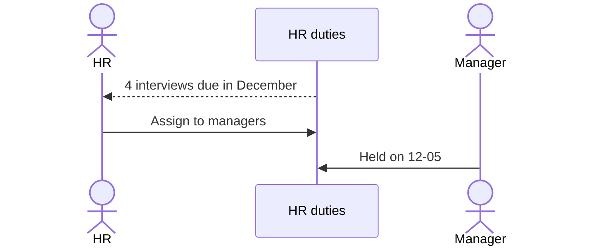

🏠 [Specs](../../../../README.md) › 🧩 [Functional capabilities](../../../README.md) ›
👥 [F9 HR and projects](../../README.md) › 📝 [Use cases](../README.md) › 📝 [Use cases: FL-F9-08 HR duties](README.md) ›
📝 UC-F9-21 Schedule professional interviews and health visits

# 📝 UC-F9-21 Schedule professional interviews and health visits

**Status:** ✅ specified

## Summary

HR schedules each employee's professional interviews (every 2 years, the 6-year review) and occupational health visits,
with reminders to managers and the record of each.

## Personas

- [U06 Human resources](../../../../01-users/personas/u06-hr.md)
- [U02 Manager](../../../../01-users/personas/u02-manager.md)
- [U01 Employee](../../../../01-users/personas/u01-employee.md)

## Goal

No interview or visit missed.

## Trigger

A hire, a return from leave, the dates coming.

## Frequency

Continuous; weekly reminders.

## Preconditions

- Employees with their hire date.

## Postconditions

- **Succeeded:** interviews and visits are scheduled and recorded.
- **Failed:** overdue ones are listed ([BR-F9-04](../../business-rules/br-f09-04-professional-interviews-on-time.md)).

## Main flow

1. HR opens HR duties ([S-F9-03](../../screens/01-people/s-f09-03-hr-duties.md)) on the Interviews and visits tab.
2. SimpleERP lists who is due: professional interviews every 2 years, the 6-year review, health visits by the
   employee's follow-up type,
   [CR-FR-039](../../../../10-country-packs/france/labour/cr-fr-039-professional-interviews.md),
   [CR-FR-045](../../../../10-country-packs/france/labour/cr-fr-045-occupational-health-visits.md).
3. The manager gets the interview to schedule; it is held and recorded (F4 HR meeting,
   [UC-F4-07](../../../f04-meetings/use-cases/05-hr-meeting/uc-f04-07-hr-meeting.md)).
4. Health visits are booked with the occupational health service and their certificates kept.

## Alternative flows

- 2a. A return after long leave triggers an interview.

## Error flows

- 3e. An interview overdue: HR and the manager are reminded weekly.

## Business rules

- [BR-F9-04 Professional interviews on time](../../business-rules/br-f09-04-professional-interviews-on-time.md)

## Entities

- [E-F9-05 HR duty](../../data/e-f09-05-hr-duty.md)
- [E-F9-01 Employee record](../../data/e-f09-01-employee-record.md)

## Permissions

HR; the owner reads; HR data stays with HR and the person
([BR-F9-02](../../business-rules/br-f09-02-hr-data-stays-with-hr-and-the-person.md)). Managers schedule their team's
interviews.

## Notifications

Managers and employees: dates.

## Audit events

Scheduled, held, certificates.

## AI involvement

The AI assistant prepares it for confirmation
([BR-F3-07](../../../f03-assistant/business-rules/br-f03-07-no-deletes-no-irreversible-acts.md)); figures come from
queries ([BR-F3-03](../../../f03-assistant/business-rules/br-f03-03-figures-come-from-queries.md)).

## API, MCP and A2A exposure

T5 operations of F9 with the caller's rights; the MCP tool of F9; no A2A skill.

## Screens

- [S-F9-03 HR duties](../../screens/01-people/s-f09-03-hr-duties.md)

## Flowchart

See [FL-F9-08 HR duties](../../flows/fl-f09-08-hr-duties.md#flowchart).

## Sequence diagram

## Acceptance criteria

1. **Given** Lea hired on 2024-12-01 **when** 2026-11-01 comes **then** her professional interview is due and her
   manager asked to schedule it.
2. **Given** an interview overdue **when** the week passes **then** HR and the manager are reminded.
3. **Given** a night worker **when** health visits are listed **then** the reinforced follow-up dates show.

## Non-functional notes

None.

## Regulatory references

[CR-FR-039](../../../../10-country-packs/france/labour/cr-fr-039-professional-interviews.md);
[CR-FR-045](../../../../10-country-packs/france/labour/cr-fr-045-occupational-health-visits.md).

## Related use cases

- [UC-F9-03 Comply with French HR duties](../01-people/uc-f09-03-comply-with-french-hr-duties.md)
- [UC-F4-07 HR meeting](../../../f04-meetings/use-cases/05-hr-meeting/uc-f04-07-hr-meeting.md)

## Open questions

None.

---

⬅️ [UC-F9-20](../07-fair-pay-and-speaking-up/uc-f09-20-publish-the-equality-index-and-pay-transparency-information.md) ·
⬆️ [Up](README.md) ·
➡️ [UC-F9-22 Keep the displays and the BDESE current](uc-f09-22-keep-the-displays-and-the-bdese-current.md)
