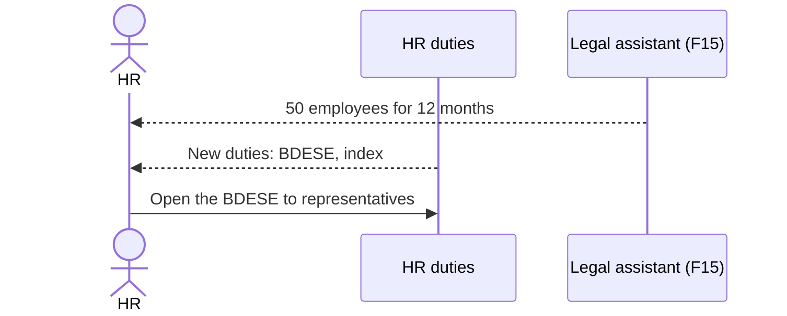

🏠 [Specs](../../../../README.md) › 🧩 [Functional capabilities](../../../README.md) ›
👥 [F9 HR and projects](../../README.md) › 📝 [Use cases](../README.md) › 📝 [Use cases: FL-F9-08 HR duties](README.md) ›
📝 UC-F9-22 Keep the displays and the BDESE current

# 📝 UC-F9-22 Keep the displays and the BDESE current

**Status:** ✅ specified

## Summary

HR keeps the mandatory displays and, from 50 employees, the economic and social database (BDESE) current, with what
changes when a headcount threshold is crossed.

## Personas

- [U06 Human resources](../../../../01-users/personas/u06-hr.md)
- [U13 Owner](../../../../01-users/personas/u13-owner.md)

## Goal

The company shows and shares what the law requires.

## Trigger

A threshold crossed, a yearly date, a change of information.

## Frequency

Yearly; at changes.

## Preconditions

- The headcount computed ([CR-FR-046](../../../../10-country-packs/france/labour/cr-fr-046-headcount-thresholds.md)).

## Postconditions

- **Succeeded:** displays and BDESE current.
- **Failed:** missing items listed.

## Main flow

1. HR opens HR duties ([S-F9-03](../../screens/01-people/s-f09-03-hr-duties.md)) on the Displays and BDESE tab.
2. The mandatory displays list shows each item, its version and date.
3. From 50 employees, the BDESE is fed from F8 and F9 figures; staff representatives get read access.
4. When the headcount crosses a threshold, simple-ERP lists the new duties; the legal assistant warns
   ([BR-F15-07](../../../f15-legal-assistant/business-rules/br-f15-07-warnings-inform-never-block.md)).

## Alternative flows

- 4a. Thresholds reached for 12 consecutive months only.

## Error flows

- 2e. A display out of date: listed.

## Business rules

- [BR-F9-16 HR duties follow the headcount](../../business-rules/br-f09-16-hr-duties-follow-the-headcount.md)

## Entities

- [E-F9-05 HR duty](../../data/e-f09-05-hr-duty.md)

## Permissions

HR; the owner reads; HR data stays with HR and the person
([BR-F9-02](../../business-rules/br-f09-02-hr-data-stays-with-hr-and-the-person.md)). Staff representatives read the
BDESE.

## Notifications

HR: threshold reached.

## Audit events

Items updated.

## AI involvement

The AI assistant prepares it for confirmation
([BR-F3-07](../../../f03-assistant/business-rules/br-f03-07-no-deletes-no-irreversible-acts.md)); figures come from
queries ([BR-F3-03](../../../f03-assistant/business-rules/br-f03-03-figures-come-from-queries.md)).

## API, MCP and A2A exposure

T5 operations of F9 with the caller's rights; the MCP tool of F9; no A2A skill.

## Screens

- [S-F9-03 HR duties](../../screens/01-people/s-f09-03-hr-duties.md)

## Flowchart

See [FL-F9-08 HR duties](../../flows/fl-f09-08-hr-duties.md#flowchart).

## Sequence diagram

## Acceptance criteria

1. **Given** a headcount of 50 for 12 consecutive months **when** the threshold is computed **then** the new duties are
   listed.
2. **Given** an updated display **when** it is replaced **then** the new version and date show.
3. **Given** a staff representative **when** she opens the BDESE **then** she reads it and cannot change it.

## Non-functional notes

None.

## Regulatory references

[CR-FR-046](../../../../10-country-packs/france/labour/cr-fr-046-headcount-thresholds.md).

## Related use cases

- [UC-F9-03 Comply with French HR duties](../01-people/uc-f09-03-comply-with-french-hr-duties.md)
- [UC-F9-20 Publish the equality index and pay-transparency information](../07-fair-pay-and-speaking-up/uc-f09-20-publish-the-equality-index-and-pay-transparency-information.md)

## Open questions

None.

---

⬅️ [UC-F9-21](uc-f09-21-schedule-professional-interviews-and-health-visits.md) · ⬆️ [Up](README.md) ·
➡️ [UC-F9-23 Declare disability employment](uc-f09-23-declare-disability-employment.md)
