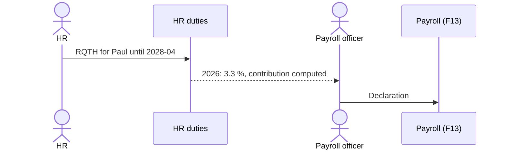

🏠 [Specs](../../../../README.md) › 🧩 [Functional capabilities](../../../README.md) ›
👥 [F9 HR and projects](../../README.md) › 📝 [Use cases](../README.md) › 📝 [Use cases: FL-F9-08 HR duties](README.md) ›
📝 UC-F9-23 Declare disability employment

# 📝 UC-F9-23 Declare disability employment

**Status:** 🔄 waiting for the owner

## Summary

HR keeps employees' disability recognitions with their dates, and the yearly disability employment declaration (OETH) is
computed for payroll's monthly declaration.

## Personas

- [U06 Human resources](../../../../01-users/personas/u06-hr.md)
- [U45 Payroll officer](../../../../01-users/personas/u45-payroll-officer.md)

## Goal

Meet the 6 % duty or pay the right contribution.

## Trigger

The year's end; a recognition received.

## Frequency

Yearly.

## Preconditions

- 20 employees or more.

## Postconditions

- **Succeeded:** the rate and any contribution are computed and sent with the declaration.
- **Failed:** an expired recognition is not counted.

## Main flow

1. HR records a recognition (RQTH) on the employee, visible only to HR
   ([BR-F9-02](../../business-rules/br-f09-02-hr-data-stays-with-hr-and-the-person.md)).
2. At the year's end, simple-ERP computes the rate of employees with a recognition and the deductions (subcontracting to
   sheltered work) ([BR-F9-16](../../business-rules/br-f09-16-hr-duties-follow-the-headcount.md)).
3. The payroll officer checks it and it goes in the monthly declaration (F13).
4. The contribution, if any, is paid through payroll.

## Alternative flows

- 2a. Purchases from sheltered work companies reduce the contribution.

## Error flows

- 2e. A recognition expired: not counted; HR reminded 3 months before (Proposed).

## Business rules

- [BR-F9-16 HR duties follow the headcount](../../business-rules/br-f09-16-hr-duties-follow-the-headcount.md)
- [BR-F9-02 HR data stays with HR and the person](../../business-rules/br-f09-02-hr-data-stays-with-hr-and-the-person.md)

## Entities

- [E-F9-05 HR duty](../../data/e-f09-05-hr-duty.md)
- [E-F9-01 Employee record](../../data/e-f09-01-employee-record.md)

## Permissions

HR; the owner reads; HR data stays with HR and the person
([BR-F9-02](../../business-rules/br-f09-02-hr-data-stays-with-hr-and-the-person.md)). The payroll officer.

## Notifications

HR: recognitions expiring.

## Audit events

Recognitions; declarations.

## AI involvement

The AI assistant prepares it for confirmation
([BR-F3-07](../../../f03-assistant/business-rules/br-f03-07-no-deletes-no-irreversible-acts.md)); figures come from
queries ([BR-F3-03](../../../f03-assistant/business-rules/br-f03-03-figures-come-from-queries.md)).

## API, MCP and A2A exposure

T5 operations of F9 with the caller's rights; the MCP tool of F9; no A2A skill.

## Screens

- [S-F9-03 HR duties](../../screens/01-people/s-f09-03-hr-duties.md)

## Flowchart

See [FL-F9-08 HR duties](../../flows/fl-f09-08-hr-duties.md#flowchart).

## Sequence diagram

## Acceptance criteria

1. **Given** 60 employees with 2 recognitions **when** 2026 is computed **then** the rate shows 3.3 %.
2. **Given** a recognition ending 2027-03-31 **when** 2026-12-31 comes **then** HR is reminded.
3. **Given** a manager **when** he opens Paul's record **then** he does not see the recognition.

## Non-functional notes

None.

## Regulatory references

[CR-FR-183](../../../../10-country-packs/france/payroll/cr-fr-183-dsn-monthly-declaration.md); (Proposed) to read: Code
du travail L5212-1 and following.

## Related use cases

- [UC-F9-03 Comply with French HR duties](../01-people/uc-f09-03-comply-with-french-hr-duties.md)
- [UC-F13-10 File the monthly social declaration and handle returns](../../../f13-payroll/use-cases/03-declarations-and-payments/uc-f13-10-file-the-monthly-social-declaration-and-handle-returns.md)

## Open questions

None.

---

⬅️ [UC-F9-22 Keep the displays and the BDESE current](uc-f09-22-keep-the-displays-and-the-bdese-current.md) ·
⬆️ [Up](README.md) ·
➡️ [UC-F9-24](../07-fair-pay-and-speaking-up/uc-f09-24-receive-and-handle-a-whistleblowing-report.md)
